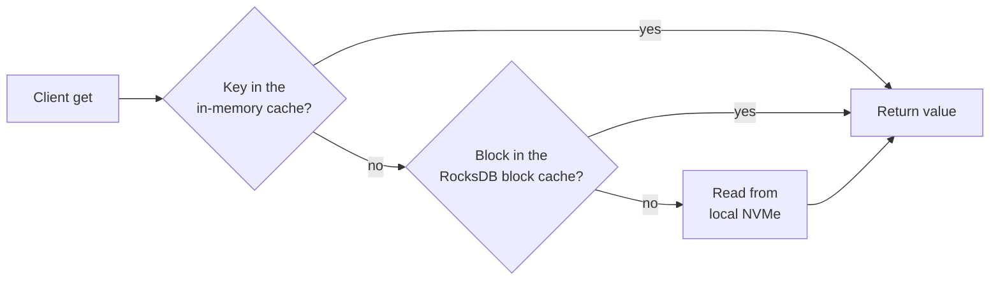

# 300 Redis Nodes, 3 Kahuna Nodes: Does the Math Work?

This week I read a post from EloqData about [replacing 300 Redis nodes with 3 Lavik nodes](https://lavik.dev/en/blog/300-redis-nodes-to-3-lavik-nodes/). The fleet in that post was large for one reason: Redis keeps every value in RAM. The memory was full and the CPUs were mostly idle. Every new slice of data meant another primary, another replica, and two more VMs.

Their answer is to keep values on local NVMe and keep only the hot part in memory. Kahuna already stores persistent keys that way. So I asked the same question for Kahuna: can three nodes hold what 300 Redis nodes held?

On paper, yes, with two big differences. Kahuna does not speak the Redis protocol, so your application changes clients. And every persistent write is replicated through a quorum before it succeeds, which is safer than Redis replication and slower per write. I have not run this benchmark yet. This post is the sizing math and the list of things that can go wrong.

<!-- truncate -->

## Why the Fleet Had 300 Nodes

The example fleet is 300 Azure `Standard_E2s_v4` VMs, each with 2 vCPUs and 16 GiB of RAM. Half are primaries and half are replicas, so the primaries hold about 2,400 GiB of data. That is roughly 2.5 billion 1 KiB values.

Redis Cluster splits the key space into 16,384 hash slots and spreads them over the primaries. When RAM fills, the only way to add capacity is to add primaries. CPU, network, and disk scale with it whether you need them or not.

## How Kahuna Handles Data Larger Than Memory

Kahuna has two [durability levels](/docs/architecture/durability-levels/). Ephemeral keys live only in memory, like Redis. Persistent keys are replicated with [Raft](/docs/glossary/#raft) and written to RocksDB on the node's local disk. This post is about persistent keys. Ephemeral keys do not help here, because memory is their only copy.

For persistent keys, memory is a cache, not the store. Each node keeps recently used keys in memory with a bounded [LRU](/docs/architecture/keys-eviction/) budget. A read that misses memory goes to RocksDB, which has its own block cache and a Bloom filter per file to skip files that cannot contain the key. Large range scans read from disk without pulling every key into the cache, so one full scan does not push out your hot keys.



The result is the same split the Lavik post describes. RAM limits the size of the hot set. Disk limits the size of the dataset.

## The Three-Node Layout

The target is three `Standard_L16as_v4` VMs. Each has 16 vCPUs, 128 GiB of RAM, and 3.84 TB of local NVMe. With three nodes, Kahuna's default full replication puts every [partition](/docs/glossary/#partition) on every node. A persistent write commits when two of the three nodes have it in their write-ahead log, and the cluster keeps serving if one node fails.

| | Redis fleet | Kahuna cluster |
|---|---|---|
| VMs | 300 × E2s_v4 | 3 × L16as_v4 |
| vCPUs | 600 | 48 |
| RAM | 4,800 GiB | 384 GiB |
| Copies of each value | 2 | 3 |
| Replication | Asynchronous: a failover can lose recent writes | Quorum: a successful write is on 2 of 3 nodes |
| Where values live | RAM | Local NVMe, hot set in RAM |

The Lavik design uses two data nodes and a third voter that stores no data. Kahuna has no data-less voter in a server cluster, so all three nodes store the full dataset. That costs one more large VM than their layout. It also gives one more copy of the data.

With the Azure East US 2 pay-as-you-go prices from their post, compute alone comes to:

| | Per month | Per year |
|---|---:|---:|
| Redis: 300 × $0.126/hour | $27,594.00 | $331,128.00 |
| Kahuna: 3 × $1.376/hour | $3,013.44 | $36,161.28 |

That is about 89% less for compute. Check current prices before you plan with these numbers. They leave out disks, backups, network traffic, and the people who run the cluster.

## Sizing It Honestly

The cost table is the easy part. The following details decide whether the three nodes work.

### Disk: write with `norev`

By default, a persistent write in RocksDB stores two records: the current value and a revision record that keeps history for [revision reads](/docs/distributed-keyvalue-store/revisions/). For 2,400 GiB of values, that is about twice the disk, which does not fit in 3.84 TB.

If you do not need history for these keys, write them with `norev`. Kahuna then updates the current value and skips the revision record. Each key still gets a small marker row. Plan for the Raft write-ahead log and for RocksDB compaction space on top of that. About 2.58 TB of values on a 3.84 TB disk fits, but with less free space than I would like in production.

```csharp
await client.SetKeyValue(
    $"agents/{agentId}/state",
    stateBytes,
    TimeSpan.FromHours(24),
    KeyValueFlags.Set | KeyValueFlags.SetNoRevision);
```

The same write in Kahuna Script:

```kahuna
set @state_key @state ex 86400000 norev
```

### Memory: give RocksDB the RAM

The defaults do not use most of a 128 GiB node. The in-memory key/value cache is a set of actors, each with a budget of about 256 MiB. With 16 cores that is about 16 GiB. The RocksDB block cache is only 256 MiB by default.

That block cache matters more than it looks. Kahuna keeps RocksDB's index and Bloom filter blocks in the block cache. At billions of keys, the filters take about 10 bits per row and the index takes one entry for each 4 KiB data block. My estimate is 20 to 25 GiB per node for this dataset, depending on key length. If those blocks do not fit, a cache miss costs extra disk reads before it reaches the value.

Give RocksDB a shared cache that holds the index and filter blocks plus a useful part of the data:

```bash
kahuna-server \
  --storage rocksdb --wal-storage rocksdb \
  --rocksdb-shared-memory \
  --storage-shared-cache-mb 65536 \
  --storage-shared-memtable-budget-mb 1024
```

The 64 GiB here is an example, not a measured value. Start there, watch the block cache hit rate, and adjust.

## What Kahuna Does Not Do Here

- **No Redis protocol.** Kahuna has a .NET client, a TypeScript client, gRPC, and REST. Redis clients cannot connect, and migration tools such as RedisShake do not work. You change the client code, then copy the data with a backfill or a period of dual writes.
- **Higher write latency.** A persistent write waits for a quorum and a disk sync. Redis acknowledges a write from memory. This layout suits read-heavy workloads and moderate write rates better than write-heavy ones.
- **No disk sweep for expired keys.** An expired persistent key is not returned to readers. Its bytes stay on disk until the key is written again or deleted. A workload that creates many short-lived keys grows its disk use over time.
- **Local NVMe is temporary.** On Azure, local NVMe data is lost when a VM is deallocated or moved. Raft can rebuild one lost node from the other two. To survive the loss of the whole cluster, you need [backups](/docs/backups-and-point-in-time-recovery/). The built-in backup target is a local directory. Object storage targets need a provider that is not in the default server package.
- **Cold reads go through RocksDB.** A read that misses both caches goes through the RocksDB read path and the operating system. Kahuna does not bypass the kernel for disk I/O the way the SPDK version of Lavik does.

## What I Will Measure

I do not have numbers for this layout yet, and I do not want to guess them. The benchmark I plan to run:

1. Three nodes on L16as_v4-class hardware, RocksDB for both storage and the write-ahead log, and a shared cache sized as above.
2. A persistent dataset several times larger than the caches, with 1 KiB values.
3. A read-heavy mix and a write-heavy mix, with throughput and p50, p99, and p99.9 latency for each.
4. Separate latency numbers for reads that hit the cache and reads that go to disk.

The existing benchmark tool already covers most of it:

```bash
kahuna-bench -c https://kahuna-1:8082 --workload mixed --durability persistent \
  --key-space 100000000 --value-size 1024 --read-pct 90 --duration 600
```

When the results are in, I will publish them here, including the parts that look bad.

If your Redis fleet is large because memory is full and the CPUs are idle, and you can change clients, Kahuna is worth a test. It gives you quorum durability for the same data. You pay for it with write latency and a client change. In short, if your workload is mostly reads with relatively few writes, Kahuna could be a good alternative for you.
