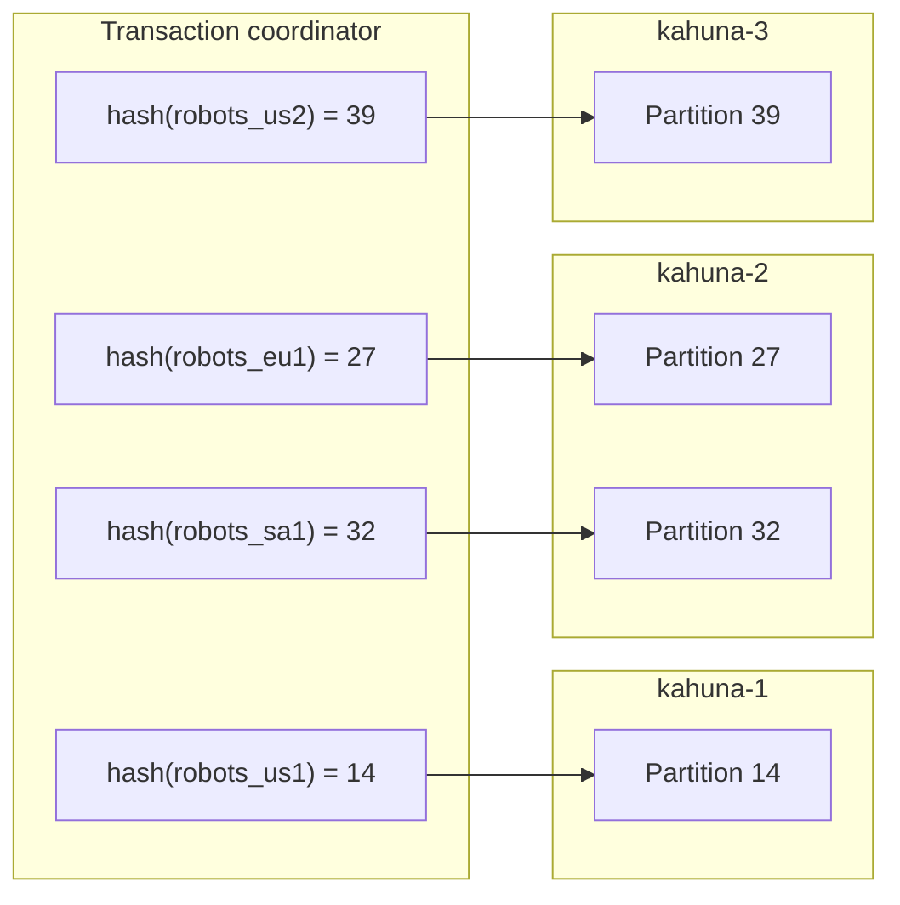
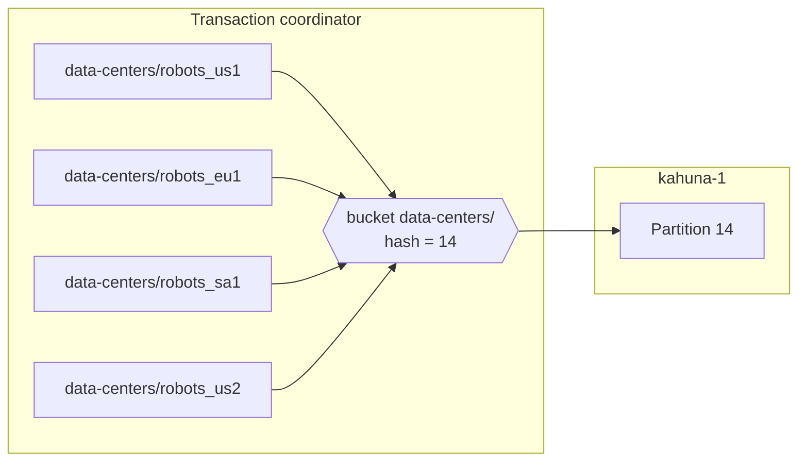

# Distributed Transactions

A transaction lets you change several keys as one unit, like a SQL transaction: either every change commits or none does. In a cluster, those keys can live on different [partitions](/docs/glossary/#partition) and nodes, each replicated by its own [Raft](/docs/glossary/#raft) group, so Kahuna must coordinate reads, writes, locks, retries, and finalization across them. Persistent modifications share one [canonical](/docs/internals/transaction-lifecycle/#basic-concepts) commit or abort decision; ephemeral state has weaker process-loss behavior, described below.

The central component is the **transaction coordinator**. The coordinator is the server-side owner of the transaction lifecycle and working set. It records what the transaction has read, modified, locked, prepared, committed, or rolled back. Clients keep a transaction handle, but the server owns the authoritative transaction state.

This design matters because an interactive transaction is not just a final `commit` call. A client may lose a response, retry a request, start commit while another operation is still in flight, or disappear without rolling back. Kahuna keeps those correctness rules inside the cluster instead of depending on every client to rebuild the final working set correctly.

This page explains the design and how to choose between the options. For how to use transactions, see [Transactions](/docs/distributed-keyvalue-store/transactions/). For the step-by-step mechanics, outcome contract, and limits, see [Transaction Lifecycle](/docs/internals/transaction-lifecycle/); its [glossary](/docs/internals/transaction-lifecycle/#basic-concepts) defines the terms used here.

For a guided introduction with a balance-transfer example and an interactive commit diagram, read <a href="/paper/kahuna-distributed-transactions-paper.html">Inside Kahuna's Distributed Transactions</a>.

## Example: A Transaction Across Partitions

The following [Kahuna Script](/docs/scripts/) increments robot capacity in several regions while enforcing one global cap:

```kahuna
let us1_amount = get robots_us1
let us2_amount = get robots_us2
let eu1_amount = get robots_eu1
let sa1_amount = get robots_sa1

let total = to_int(us1_amount) + to_int(us2_amount) + to_int(eu1_amount) + to_int(sa1_amount)

if (total + @amount_to_incr) > @global_cap then
    throw "global cap amount exceeded"
end

set robots_us1 to_int(us1_amount) + @amount_to_incr
set robots_us2 to_int(us2_amount) + @amount_to_incr
set robots_eu1 to_int(eu1_amount) + @amount_to_incr
set robots_sa1 to_int(sa1_amount) + @amount_to_incr
```

The coordinator uses routing metadata to find the leader partition for each key. In this example, the transaction touches four partitions distributed across three nodes:



The coordinator can dispatch participant operations in parallel, but it still owns the transaction-wide decision. Participant locking and unprepared [MVCC](/docs/glossary/#mvcc) staging are local to each key's [actor](/docs/glossary/#actor). Persistent prepare, canonical decision, materialization, and settlement use Raft-backed ordering.

## Coordinator and Participants

Two roles are involved:

- **Coordinator**: Owns the transaction identity, lifecycle, working set, finalization state, read validation policy, cleanup, and optional durable commit decision.
- **Participants**: The key partitions that execute the transaction's reads, writes, lock operations, prepares, commits, and rollbacks.

The coordinator may live on a different node from some or all participants. Routing is based on transaction and key placement:

- The handle routes the live session back to its original coordinator node, even when coordinator-partition leadership changes.
- Point operations are routed by the target key.
- Bucket and prefix operations are routed by the bucket prefix.
- Range operations are routed by range metadata.
- Durable commit recovery, when enabled, is routed by a record anchor key.

The transaction coordinator does not ask the client to provide a final list of keys to commit. It builds that list as operations complete.

## Priority Admission

Kahuna can put a per-node admission gate in front of transaction start. The gate is disabled by default, and it affects only when a transaction starts: it does not preempt running work or change MVCC, locking, two-phase commit, durable decisions, or commit semantics. See [Transaction Priority Admission](/docs/distributed-keyvalue-store/transaction-priority-admission/).

## Transaction Handle

Interactive transactions use a canonical transaction handle:

```text
TransactionHandle
  TransactionId      globally unique HLC identity
  CoordinatorKey     routes the live in-memory session
  RecordAnchorKey    optional route to the canonical durable transaction record
```

`CoordinatorKey` is created when the transaction begins and routes requests back to the live coordinator session.

`RecordAnchorKey` is assigned only when the coordinator folds the first confirmed persistent modified key into the working set. It is used to find the canonical durable transaction record after the live coordinator session is gone.

The anchor is a routing key, not a user-visible key/value record. Kahuna stores durable decision metadata internally.

## Server-Owned Working Set

The coordinator keeps the authoritative working set for the transaction. It records:

- Modified keys and their durability
- Point locks, prefix locks, and range locks still held
- Latest-read observations used for optional validation
- Snapshot-read policy and timestamps
- Pending and completed registered operations
- Admission priority, transaction timeout, and finalization state
- The durable record anchor, when one exists

Only confirmed effects enter the working set. A failed conditional write does not count as a modified key. A failed lock acquisition does not count as a held lock. Snapshot reads do not create live read dependencies because they read from a fixed historical timestamp.

This prevents a common failure mode in client-managed transactions: a successful operation cannot be forgotten at commit time because the server recorded it when it succeeded.

## Operation Identity and Safe Retries

Each interactive transaction operation has a stable operation ID. The client creates one ID for one logical request and reuses it when retrying that same request.

Before a participant mutates state, the operation is registered with the coordinator. After the participant finishes, it reports the confirmed effect back to the coordinator:

```text
client
  -> coordinator: begin operation
  -> participant: execute read, write, lock, or delete
  -> coordinator: complete operation with confirmed effects
```

This lets Kahuna distinguish a retry from new work:

| Registration result | Meaning |
|---|---|
| `New` | The operation has not run and may execute. |
| `AlreadyPending` | The same operation is already in flight. |
| `AlreadyCompleted` | Return the cached result without applying the effect again. |
| `RejectedSessionClosed` | Finalization already closed the transaction. |
| `RejectedDuplicate` | The same operation ID was reused for different work. |
| `RejectedCapacity` | The session has too many pending operations. |

Participants also keep a bounded node-local cache of recent in-doubt operation results. If a participant applied a mutation but the completion acknowledgement was lost, retrying with the same operation ID can replay the completion without applying the mutation twice.

This cache is not durable history. It is a short-lived retry mechanism that closes the normal acknowledgement-loss window.

## Locking Modes

Kahuna supports pessimistic (the default) and optimistic transactions. Pessimistic transactions lock keys, buckets, or ranges as they go; optimistic transactions read without exclusive locks and validate at commit. See [Locking Modes](/docs/distributed-keyvalue-store/transactions/#locking-modes) for the behavior and the best fit of each. The flows below show the difference.

## Pessimistic Transaction Flow

Using the robot capacity example, a pessimistic transaction follows this shape:

1. Acquire exclusive point locks for keys that must be protected.
2. Execute reads from the responsible partition leaders.
3. Acquire prefix locks for transactional bucket reads or range locks for bounded ordered reads when needed.
4. Run script logic or client-side application logic against the read values.
5. Create [write intents](/docs/glossary/#write-intent) for modified keys.
6. Prepare every participant through [two-phase commit](/docs/glossary/#two-phase-commit-2pc).
7. Commit every prepared participant.
8. Release point, prefix, and range locks.
9. Release MVCC read entries and other cleanup state.

Locks are backed by a [lease](/docs/glossary/#lease), so they are not held forever if a caller disappears. Rollback and abandoned-session cleanup release any confirmed locks from the server-owned working set.

## Optimistic Transaction Flow

An optimistic transaction follows a different path:

1. Assign a transaction timestamp using the [Hybrid Logical Clock](/docs/glossary/#hybrid-logical-clock-hlc).
2. Read keys using MVCC without acquiring exclusive locks.
3. Record the first observed revision for reads that need validation.
4. Run script logic or client-side application logic.
5. Validate that observed revisions have not changed.
6. Check for concurrent write intents over keys that were read but not written.
7. Create write intents for modified keys.
8. Prepare and commit through two-phase commit.

The concurrent write-intent check prevents write skew, where two transactions each read a key the other one changes and both commit based on stale reads. Simple revision checks can miss it.

## Read Policy and Snapshot Reads

Transaction options can control read behavior:

- `ReadValidation` determines whether latest-value reads are tracked and validated before commit.
- Optimistic locking enables read validation for compatibility.
- `ReadTimestamp` gives point `Get` and `Exists` a fixed historical HLC timestamp.
- A fixed read timestamp cannot be combined with tracked read validation.

Snapshot reads are historical views, not read-your-own-writes views. A snapshot transaction can read the state visible at a specific HLC timestamp, but writes are not allowed inside that historical transaction.

For user-facing syntax and client examples, see [Transactions](/docs/distributed-keyvalue-store/transactions/) and [Revisions and Snapshot Reads](/docs/distributed-keyvalue-store/revisions/).

## Closing Before Finalization

Finalization starts by closing the transaction to new operations.

This is necessary because commit can race with in-flight work. If a write is already running while commit starts, the coordinator must not freeze the working set too early and miss that write. It also must not keep accepting new operations forever.

Kahuna solves this with a finalization fence:

1. The first close, commit, rollback, or reaper attempt moves the session out of accepting mode.
2. New operations are rejected.
3. Operations registered before the fence are allowed to finish or reach a safe retry state.
4. The coordinator freezes an immutable working-set snapshot.
5. Commit or rollback runs from that frozen snapshot.

Repeated close or finalization attempts observe the same frozen state. A late operation cannot slip into a transaction after commit has started.

## Finalization State Machine

Commit, rollback, close, and abandoned-session cleanup share one finalization slot per transaction. Exactly one caller owns the active attempt. Concurrent callers wait for that same attempt and observe the same result.

This prevents commit and rollback from running independently over the same mutable transaction.

Finalization outcomes are stable once terminal. The [outcome contract](/docs/internals/transaction-lifecycle/#outcome-contract) lists each outcome and the caller action: in short, retry `MustRetry` with the same handle, and start a new transaction after `Aborted`.

A retryable failure releases the finalization slot for a later attempt, but it does not reopen the transaction to new data operations.

## Two-Phase Commit

Kahuna uses two-phase commit across the modified participants.

During persistent **prepare**, each participant checks the proposed mutation and replicates its prepared intent, preserving its value for recovery. Ephemeral prepares remain local memory state.

During persistent **commit**, the coordinator establishes the canonical decision. Reads resolve committed intents immediately; materialization and settlement can run later. Ephemeral values are applied in memory.

During **rollback**, the coordinator releases staged writes, locks, and MVCC read entries from the frozen working set. Rollback attempts every cleanup item even if another cleanup item fails. Kahuna reports `RolledBack` only after mandatory cleanup receives positive acknowledgement.

Read-only transactions are valid. They can commit without a prepare round.

## Durable Commit Decisions

Two durability settings are easy to confuse:

- `KeyValueDurability.Persistent` means the value is replicated and stored persistently.
- `DecisionDurability` is the session policy for finalization. `DecisionDurability.Durable` means finalization records and prepared persistent intents can be recovered after the durable finalization path starts.

Persistent modifications enter the durable-intent commit path under both policies. `DecisionDurability.BestEffort` is the default; the name does not mean persistent writes skip durable preparation. The policies differ in what they accept:

| Write set | `BestEffort` (default) | `Durable` |
|---|---|---|
| All persistent | Durable-intent two-phase commit with a canonical transaction record. Crash-atomic: recovery can finish materialization and settlement if the live coordinator disappears after durable finalization starts. | The same path. Also requires a record anchor and disables the single-key fast path for scripts. |
| All ephemeral | In-memory prepare and commit. Values can be lost on leadership or process loss. | Rejected. |
| Mixed persistent and ephemeral | The ephemeral subset prepares first, then the persistent decision drives its commit or rollback. This does not make the ephemeral subset crash-atomic. | Rejected: ephemeral values, intents, and receipts cannot survive process loss. |

Use `Durable` when the server should enforce an all-persistent write set.

Durable-intent finalization prepares the proposed values as replicated intents on every modified persistent partition, validates the staged bases and the read set, and then compare-and-sets one canonical transaction record from `Undecided` to `Commit` or `Abort`. That record is the point of no return: once it moves to `Commit`, Kahuna must not report a definite abort. By default, commit returns once the record is durable; materialization and settlement run in the background, and reads that meet a committed-but-unsettled intent resolve it through the record instead of serving a stale value. Eligible single-partition transactions can use a one-phase fast path.

See [Transaction Lifecycle](/docs/internals/transaction-lifecycle/) for the [two-phase sequence](/docs/internals/transaction-lifecycle/#durable-intent-two-phase-commit), [decision deadlines](/docs/internals/transaction-lifecycle/#decision-deadlines), the [one-phase fast path](/docs/internals/transaction-lifecycle/#one-phase-durable-fast-path), [deferred settlement](/docs/internals/transaction-lifecycle/#deferred-settlement), and [completion receipts](/docs/internals/transaction-lifecycle/#completion-receipts-and-range-movement).

### Durable Mode Boundaries

Durable decision mode has specific limits:

- If the coordinator disappears before the canonical transaction record is initialized, the active session is lost like a best-effort session.
- Prepared persistent intents are durable in this mode. A participant leader change after prepare does not lose the staged value; recovery on the new leader can resolve it from the canonical record.
- Ephemeral modified keys are rejected under explicit `DecisionDurability.Durable`. Under BestEffort, mixed transactions prepare the ephemeral subset first, then let the persistent decision drive ephemeral commit or rollback; process loss can still lose the ephemeral subset.
- Read-only transactions and ephemeral-only modifications do not create a durable decision anchor.
- The active in-memory session is still not persisted from `Begin`.
- Reads and writes can route cross-node canonical-record lookups when deferred settlement leaves a foreign prepared intent behind. Duplicate finalization for a non-resident record may still return `MustRetry` or `Errored`, but never a fabricated conflict.

Durable mode protects the durable finalization path. It does not make the whole interactive session durable from `Begin`.

## Durable Decision Recovery

Every node runs prepared-intent recovery for the partitions it leads. Recovery follows the canonical record: it materializes intents of committed transactions, discards intents of aborted ones, and leaves an undecided record alone until its decision deadline passes, after which it drives an idempotent presumed abort. It never guesses a final outcome while the record is undecided inside its deadline. See [Recovery](/docs/internals/transaction-lifecycle/#recovery) for the full rules.

## Abandoned Sessions and Reaping

If a caller starts a transaction and never commits or rolls back, the transaction reaper eventually closes and cleans it up.

The reaper uses HLC time. It waits for the transaction timeout plus a grace period, then claims the same finalization slot used by explicit commit and rollback.

Reaper behavior follows the same safety rules:

- A session with no unresolved operation is rolled back from its confirmed working set.
- If mandatory cleanup sees a transient failure, the session remains available for a later cleanup attempt.
- If an operation is still unresolved after the extended deadline, the session expires with an unknown error rather than falsely claiming rollback.
- A durable session whose canonical record is already committed is not rolled back. Recovery finishes the prepared intents from the record.

## Range-Lock Renewal

The transaction coordinator renews range locks held by live sessions on the same periodic tick used by reaping. Renewal is server-side; clients do not need to heartbeat range locks manually.

Each sweep re-acquires confirmed range locks with a TTL derived from `CollectionInterval`, bounded concurrency, and a sweep deadline. Renewal is best-effort: scheduling delays, failures, and failover can leave gaps. It continues during finalize drain until cleanup owns the lock set.

Range locks are leader-local state. The session remains on its original coordinator node across partition leadership changes and routes participant work to current leaders. A subsequent sweep can re-establish lost locks. Process loss of that coordinator loses the active session and renewal stops. Final validation and staging-continuity checks can abort a transaction whose locks or staging were lost; a leadership change does not imply only `MustRetry`.

## Retention and Bounds

Bounds on retained outcomes, durable records, prepared intents, operations per session, and admission keep transaction coordination predictable. See [Bounds and Backpressure](/docs/internals/transaction-lifecycle/#bounds-and-backpressure) for every setting and its default.

## Key Buckets and Locality

Hash-routed keys can spread one transaction across several partitions. That improves distribution, but it also adds more participant partitions to coordinate.

When related keys should stay together, use a common bucket prefix:

```kahuna
let us1_amount = get `data-centers/robots_us1`
let us2_amount = get `data-centers/robots_us2`
let eu1_amount = get `data-centers/robots_eu1`
let sa1_amount = get `data-centers/robots_sa1`

let total = to_int(us1_amount) + to_int(us2_amount) + to_int(eu1_amount) + to_int(sa1_amount)

if (total + @amount_to_incr) > @global_cap then
    throw "global cap amount exceeded"
end

set `data-centers/robots_us1` to_int(us1_amount) + @amount_to_incr
set `data-centers/robots_us2` to_int(us2_amount) + @amount_to_incr
set `data-centers/robots_eu1` to_int(eu1_amount) + @amount_to_incr
set `data-centers/robots_sa1` to_int(sa1_amount) + @amount_to_incr
```

The shared `data-centers/` bucket routes those keys as one single-partition group:



This reduces cross-partition coordination and can improve transaction latency. For large ordered key spaces that may need to split over time, use [key-range sharding](/docs/distributed-keyvalue-store/key-range-sharding/) instead.

## Scripts and Interactive Transactions

Kahuna exposes transactions through scripts and through interactive client sessions. Both converge on the same coordinator machinery.

Scripts execute on the server coordinator and reduce client/server round trips. They are a good fit when the transaction logic can be expressed in Kahuna Script.

Interactive transactions let application code drive the workflow from a client SDK, over gRPC or REST. The policy, such as locking mode, timeout, and decision durability, is chosen at begin time. See [Interactive Transactions](/docs/distributed-keyvalue-store/transactions/#interactive-transactions) for client examples.

## Practical Guidance

- Use pessimistic locking for hot keys, inventory reservations, counters with business rules, and reads that must block phantoms (keys another transaction adds to a bucket or range you already read).
- Use optimistic locking for mostly-read workflows where retries are acceptable.
- Use bucket prefixes when a transactional working set should stay on one partition.
- Use range reads and range locks for ordered key spaces that can split over time.
- Use durable commit decisions only for all-persistent write sets that need recovery after durable finalization starts.
- Keep transaction timeouts short enough that abandoned sessions are cleaned up quickly.
- Retry `MustRetry` with the same transaction handle and do not add more operations after finalization begins.
- Treat `Aborted` as a business-level retry from a new transaction.
- Treat `Errored` as an unknown or expired outcome that needs application-level handling.

The mental model is: the client owns the business workflow, while Kahuna owns transaction correctness. The coordinator records confirmed work, deduplicates retries, closes the session before finalization, commits or rolls back from a frozen working set, and recovers installed durable decisions when configured to do so.

## Read and Settlement Details

See [Transaction Reads and Locks](/docs/distributed-keyvalue-store/read-and-lock-semantics/) for latest-read pins, historical read fences, and lock compatibility. [Durable Settlement](/docs/internals/durable-settlement/) describes the default materialization records, opt-in `DurableMaterializeOnResolve`, replay behavior, and rolling-upgrade requirements.
