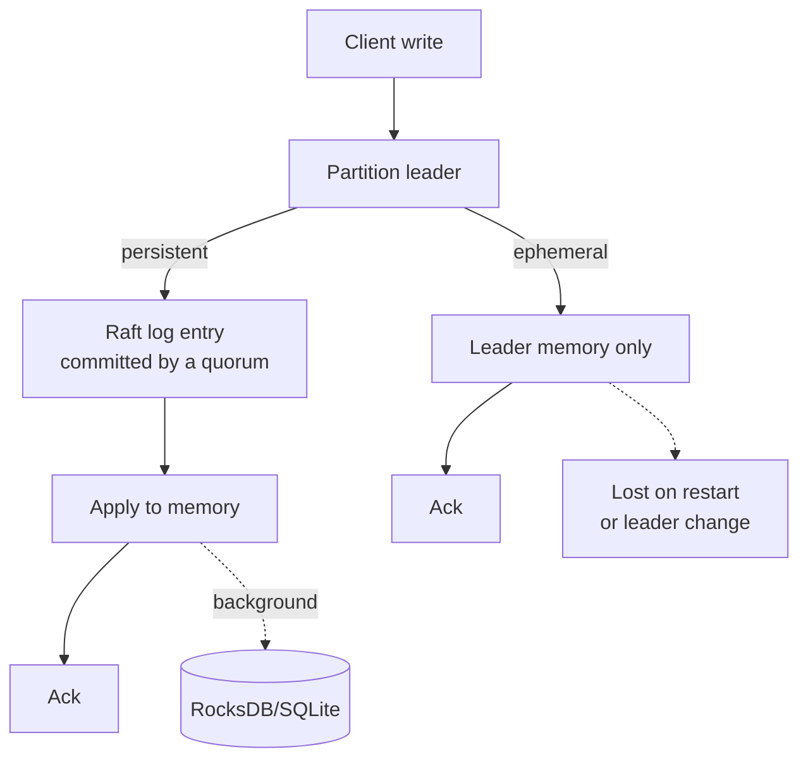

# Durability Levels

Every key and lock you write to Kahuna has a **durability level**. It decides where the data lives and what it survives, and it is the main trade-off between safety and speed:

| | Persistent | Ephemeral |
|---|---|---|
| Where it lives | Replicated to a [quorum](/docs/glossary/#quorum) of nodes through [Raft](/docs/glossary/#raft), then written to disk | Only in the memory of the [partition](/docs/glossary/#partition) leader |
| Survives a node crash or restart | Yes | No |
| Survives a leader change | Yes | No |
| Survives [memory eviction](/docs/architecture/keys-eviction/) | Yes, reloaded from disk | No |
| Write cost | Waits for replication; higher latency | In memory; lowest latency |
| Typical data | Configuration, balances, job state, leader election, anything you cannot lose | Caches, sessions, rate-limit counters, short-lived locks |

You select the level on each operation: `KeyValueDurability` and `LockDurability` in the .NET client, the `durability` option in the TypeScript client, and `set` versus `eset` (and the other `e`-prefixed commands) in [Kahuna Script](/docs/scripts/). Sequences are always persistent.

**How to choose:** ask what happens if the value disappears. If the application can rebuild it or simply start again (a cache entry, a counter that resets), use ephemeral and get faster operations. If losing it would cause wrong results, duplicate work, or lost money, use persistent.

The rest of this page explains what Kahuna does internally for each level.

## Write and Read Path

Kahuna stores persistent data (locks, keys, and sequences) through Raft replication and materialized local storage, so it can recover from node crashes or failures. Suppose you store a key named `my-config` with the value `'my-value'`:

- **Partition Determination:**  A consistent hash is computed for `my-config` to determine its partition. For example, **CH(`my-config`) = 42**.
- **Leader Identification:**  The node designated as the leader for Raft partition 42 is identified. The leader may differ from the node that initially received the request, so Kahuna forwards the request when needed.
- **Proposal and Consensus:**  The leader proposes the mutation as a Raft log entry. A quorum must replicate and commit the entry before the write is considered committed.
- **Apply to Memory:**  Once Raft commits the entry, Kahuna applies it to the in-memory state owned by the key's [actor](/docs/glossary/#actor).
- **Background Materialization:**  The dirty key/value entry is queued to `BackgroundWriterActor`, which flushes materialized state and selected revision history to RocksDB, SQLite, or the configured backend.
- **Visibility:**  The committed value becomes visible through the partition leader. If the write is part of a transaction, visibility is controlled by the transaction coordinator, [write intents](/docs/glossary/#write-intent), [MVCC](/docs/glossary/#mvcc) metadata, and [two-phase commit](/docs/glossary/#two-phase-commit-2pc).

Raft orders and replicates persistent data, while materialized storage lets a node recover efficiently without replaying the entire [write-ahead log (WAL)](/docs/glossary/#write-ahead-log-wal).

**For ephemeral keys this differs:** partition determination and leader identification are the same, but there is no Raft proposal and no disk write. The leader creates or retrieves the in-memory entry for `my-config` and applies the change, so the value lives only in the volatile memory (RAM) of the partition leader. The value is visible through the leader; in a transaction, visibility is controlled by the transaction coordinator and MVCC state. Conflicting operations are serialized through actor ownership, locks, write intents, or transaction validation, so reads and writes stay consistent under concurrent access.

The diagram compares the two write paths. A persistent write is acknowledged after a quorum commits it and the leader applies it to memory; the disk write to the materialized backend happens later, in the background. An ephemeral write is acknowledged from the leader's memory.

**Reads** follow the same partition and leader steps. The leader usually serves the latest value from actor-owned memory. If a persistent entry was evicted from memory, it can be reloaded from durable storage.

## Cache Entries

Both **Ephemeral** and **Persistent** durability modes maintain in-memory key/value entries to accelerate reads. Persistent entries can be reloaded from durable storage after eviction, while ephemeral entries are removed permanently because they have no durable backing store.

Kahuna runs a bounded key/value collector independently on each actor. The collector first removes definite garbage such as deleted, undefined, and expired entries using [tombstone](/docs/glossary/#tombstone) and expiration indexes. If the actor is still above its entry or byte budget, it evicts cold live entries from an intrusive LRU list. Persistent entries whose latest change may not be flushed to disk are pinned until they are safe to reload from storage. Revision and MVCC metadata are trimmed inline where they grow.

See [Keys Eviction](/docs/architecture/keys-eviction/) for the full algorithm and configuration details.

## Trade-offs

Beyond the table above:

- **Persistent:** Raft replication and consensus keep reads and writes consistent across failures, but they need more computational and storage resources, and waiting for the Raft commit can add latency under heavy load.
- **Ephemeral:** Avoiding disk writes and replication lowers resource use. An ephemeral lock, like an ephemeral key, is lost on a node restart or a leader change: it can be acquired again before its lease would have expired, and its [fencing token](/docs/distributed-locks/fencing-tokens/) count restarts.

## Use Cases

- **Persistent:** configuration management, where changes must be recorded and recoverable after a failure; critical state such as coordination services and distributed locks that must survive reboots; balances and other small state where a lost write means lost money. Kahuna holds coordination state, not your system of record: keep financial transaction records and long-term audit logs in a primary database (see [Why Kahuna?](/docs/why-kahuna/#replacing-a-cache-and-database-for-small-state)).
- **Ephemeral:** user sessions and other transient state, caches for frequently accessed data, short-lived data in real-time analytics or streaming, and development or test environments where temporary storage is acceptable.
