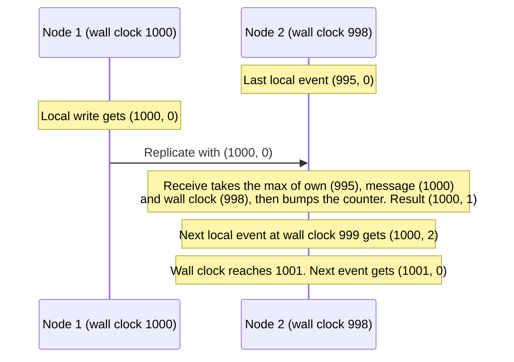

# Hybrid Logical Clocks (HLC)

## Overview

Kahuna uses **Hybrid Logical Clocks (HLCs)** for causally ordered timestamps across a distributed cluster. HLCs combine physical time with a logical counter, giving Kahuna timestamps that move forward even when several events happen in the same millisecond or when clocks are slightly skewed.

Why this matters: every node has its own clock, and clocks drift apart. If Kahuna ordered events by each node's wall clock alone, a later write on a node with a slow clock could look older than an earlier write on another node. HLC timestamps stay close to real time, but they always move forward and respect cause and effect, so they can order events across nodes safely.

You meet HLC timestamps directly when you use historical `AS OF` reads, snapshot holds, point-in-time restore targets, and the `hlc()` script function. Their physical part is Unix epoch milliseconds, so you can use a wall-clock time as a target.

HLCs are used for:

- transaction IDs
- MVCC visibility
- historical `AS OF` reads
- snapshot holds
- leases and expiration metadata
- replication and restore metadata
- durable transaction decision records and completion receipts

Raft remains the source of truth for committed ordering inside each partition. HLCs provide the time model used by MVCC and cross-partition coordination.

## HLC Format in Kahuna

A Kahuna HLC carries three components:

```text
HLC = (nodeId, physicalTimeMillis, logicalCounter)
```

- **`nodeId`**: Node component used to keep generated timestamps unique across nodes.
- **`physicalTimeMillis`**: Wall-clock time in milliseconds.
- **`logicalCounter`**: Counter used when physical time does not advance between events.

This lets timestamps remain monotonic for a node even under rapid successive events or modest clock skew.

## Transaction Timestamps

Each transaction receives an HLC transaction ID. That ID is carried through the transaction and appears in transaction context, MVCC entries, durable decision records, completion receipts, and diagnostics.

HLCs support transaction behavior in several places:

- **On begin**: The transaction receives an HLC identity.
- **On reads**: MVCC chooses the version visible to the transaction or requested snapshot timestamp.
- **On commit**: Participant writes receive committed HLC metadata through the partition commit path.
- **On recovery**: Durable decision records and completion receipts are keyed by transaction HLC.

Snapshot isolation and serializable behavior come from the combination of HLCs, MVCC, locks, read validation, write intents, two-phase commit, and Raft ordering.

## MVCC Visibility

Kahuna uses HLC metadata as version timestamps for key/value records. A simplified record looks like this:

```json
{
  "transactionId": { "node": 1, "physical": 1713351023980, "logical": 3 },
  "key": "user:123",
  "value": "..."
}
```

MVCC reads filter out versions that are in the future relative to the transaction timestamp or requested snapshot HLC. Historical reads such as `GET key AS OF <timestamp>` return the newest revision whose commit timestamp is at or before the requested time.

Predicate safety, such as avoiding phantoms in bucket or range reads, also depends on prefix/range locks under pessimistic transactions or validation under optimistic transactions.

## Conflict Detection

Kahuna does not use last-write-wins semantics for committed key/value state.

Instead:

- Raft orders committed mutations per partition.
- Compare-value and compare-revision operations reject stale updates explicitly.
- Pessimistic transactions use locks and write intents to block conflicts.
- Optimistic transactions validate read observations and concurrent write intents at commit.
- HLC metadata determines MVCC visibility and historical snapshots.

This gives applications explicit conflict behavior rather than silently choosing the write with the largest timestamp.

## Locks, Expiration, and Sequencing

HLCs also appear in coordination metadata:

- **Leases** use HLC-based expiration metadata.
- **Fencing tokens** are ordered so protected resources can reject stale lock holders.
- **Sequences** store update metadata and idempotency records through the key/value subsystem.

HLCs help Kahuna reason about time-based behavior without depending on perfectly synchronized clocks.

## Example: HLC Write Flow

1. A client sends a write to a Kahuna node.
2. Kahuna routes the write to the current partition leader.
3. The leader proposes the mutation through Raft.
4. Once the log entry commits, Kahuna applies the mutation with HLC metadata.
5. Followers restore the same committed operation from the Raft log.
6. Future MVCC or snapshot reads use the HLC metadata to decide whether the version is visible.

## Design Advantages

| Benefit | Description |
|---------|-------------|
| **Causality preservation** | Keeps related events ordered even when wall-clock time is not enough. |
| **Clock skew tolerance** | Avoids dependence on perfect clock synchronization. |
| **Unified time model** | Used across transactions, leases, snapshots, and replication metadata. |
| **Historical reads** | Lets clients ask what value was visible at a specific HLC timestamp. |
| **Recovery metadata** | Identifies durable transaction decisions and completion receipts. |

## HLC Timeline

The example below shows why a receiving node does not simply use its own wall clock. Node 2's clock runs 2 ms behind Node 1. Timestamps are shown as `(physical, logical)`; the node component is omitted.



Node 2 never issues a timestamp lower than one it has already seen, so the replicated write stays ordered before everything Node 2 does next, even though Node 2's wall clock is behind.

## Conclusion

HLCs are a core part of Kahuna's consistency model, but they are not the only mechanism. Raft provides committed ordering, actors serialize local state, MVCC preserves historical versions, and the transaction coordinator handles cross-partition correctness.
