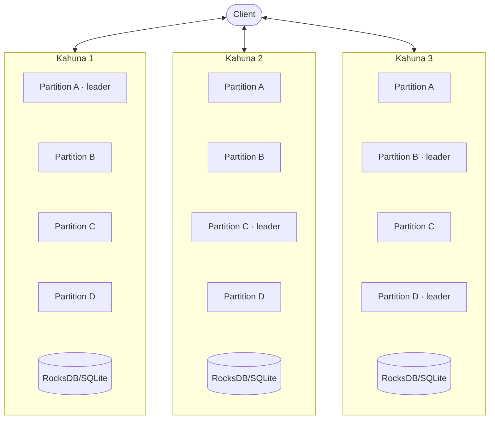

# Architecture Overview

Kahuna gives you one strongly consistent cluster for [distributed locks](/docs/distributed-locks/), [key/value storage](/docs/distributed-keyvalue-store/), and [sequences](/docs/distributed-sequencer/), so you run one system instead of three. Read this page to understand how that cluster survives node failures and where request latency comes from.

The cluster is split into [partitions](/docs/glossary/#partition). Each partition is a [Raft](/docs/glossary/#raft) group: a set of replicas that agree on one ordered log of writes, with one [leader](/docs/glossary/#leader-follower-and-learner) and several followers. Clients can talk to any node; Kahuna routes or forwards each request to the leader that owns the target key, lock, or sequence. New clients can also use [leader-aware routing](/docs/client-routing/) to learn owners and skip many forwarding hops.

The diagram shows three nodes and four partitions. A node can lead some partitions while replicating others, so leadership and work are spread across the cluster.

## Partitions

Kahuna routes data by partition:

- Point key/value operations route by key.
- Locks route by resource name.
- Sequences route through reserved key/value entries.
- Registered key ranges can use range routing instead of hash routing.

The leader for a partition serializes operations for that partition. Persistent mutations are replicated through Raft before they are acknowledged. If the leader fails, another replica can be elected and continue from the committed log.

By default, every voter hosts every partition. Operators can also configure a [replication factor](/docs/replica-placement/) so each partition is hosted by a smaller replica set while non-hosting nodes continue to forward client requests.

## Consensus

Kahuna uses [Kommander](https://github.com/kahunakv/kommander) for Raft. Each partition has its own Raft log, leader, and replication group.

For persistent data, the normal path is:

1. The receiving node finds the partition leader.
2. The leader validates and orders the operation.
3. Raft replicates the log entry to a [quorum](/docs/glossary/#quorum), a majority of the partition's voting replicas.
4. The committed entry is applied to memory owned by an [actor](/docs/glossary/#actor), a worker that processes one message at a time for its keys.
5. Background writers materialize state to RocksDB, SQLite, or memory.

[Request Flow](/docs/internals/request-flow/) shows this path as a sequence diagram, including forwarding and background persistence.

This keeps the client API simple while preserving one committed history per partition.

## Correctness Testing

Kahuna has a public [Jepsen test suite](https://github.com/kahunakv/kahuna-jepsen) for distributed correctness testing. The suite runs against a multi-node cluster with network partitions, process kills, process pauses, and membership changes. It currently covers:

- `register`: linearizable compare-and-set (CAS) register behavior over the key/value store. This Jepsen workload checks that single-key reads, writes, and CAS operations each appear to take effect at one instant, in real-time order.
- `lock`: [lease](/docs/glossary/#lease)-aware mutual exclusion and [fencing-token](/docs/glossary/#fencing-token) monotonicity
- `append`: list-append histories over interactive transactions, checked for serializability by Elle, Jepsen's transaction checker
- `sequencer`: duplicate-free allocation, allocation-range integrity, and idempotent replay
- `membership`: leave and rejoin fault injection around the Raft roster while workloads continue

These tests complement unit, integration, and benchmark tests. Each one is scoped to the workload it models, so a passing run is evidence for the covered key/value, lock, transaction, sequencer, and membership-change properties, not proof that every Kahuna feature is correct.

## Scaling and Membership

Kahuna scales by adding partitions and distributing partition leadership:

- New nodes can join an existing cluster, catch up, and become eligible to lead partitions.
- Nodes can leave for maintenance or decommissioning.
- A positive replication factor spreads partition replicas without forcing every node to store every partition.
- The opt-in [leader balancer](/docs/leader-balancing/) can gradually redistribute partition leadership.
- Key-range spaces can split when a range becomes too large or too hot.

Membership changes are separate from request routing. Clients can still use multiple endpoints and let Kahuna locate the current leader for each operation.

## Storage and Runtime

Kahuna separates the replicated log from materialized state:

- Kommander stores the Raft [write-ahead log (WAL)](/docs/glossary/#write-ahead-log-wal).
- Kahuna stores materialized locks, key/value entries, revisions, and sequence state.
- RocksDB is the default persistent storage engine.
- SQLite is available for smaller deployments and easier inspection.
- Memory storage is available for tests, embedded usage, and temporary state.

Actors keep hot state in memory. Background writers flush committed persistent state to the configured backend. Eviction, WAL checkpointing, backup and [point-in-time recovery (PITR)](/docs/glossary/#point-in-time-recovery-pitr) retention, and revision cleanup run as maintenance paths around the same committed state model.

## Performance Paths

Kahuna keeps the strongly consistent path practical with:

- Actor-local state for hot reads and mutation staging
- Direct leader routing after the target partition is known, including learned client-side routes
- Partition write coalescing for persistent key/value writes
- Dedicated backend read and write schedulers
- Background materialization, eviction, and checkpointing

These optimizations do not replace Raft. They reduce avoidable work around the replicated path.

## When to Use Kahuna

Use Kahuna when several application instances must agree on state, ownership, or ordering:

- **Shared configuration and hot small state:** configuration, [service discovery records](/docs/recipes/service-discoverability/), sessions, and [feature flags](/docs/recipes/feature-flags/). Persistent values stay in memory and reload from RocksDB or SQLite after eviction, so you do not coordinate a database copy and a cache copy. Use ephemeral values when losing that state is acceptable.
- **Exclusive ownership and shared limits:** scheduled jobs, [leader election](/docs/recipes/leader-election/), and access to shared resources with lock leases, plus [distributed rate limiters](/docs/distributed-rate-limiting/) within their durability, renewal, and failure-mode limits. Protected resources must enforce fencing tokens to reject work from an expired owner.
- **Multi-key changes and ordered allocation:** update related keys together with transactions or scripts, such as [inventory reservations](/docs/recipes/inventory-reservation/), and allocate invoice numbers, order IDs, offsets, or non-overlapping ranges through [sequences](/docs/distributed-sequencer/), using idempotency keys for retries.

Use a simpler cache or local store when data can be lost, rebuilt, or briefly inconsistent. Kahuna does not replace a primary business database for relational queries, document storage, analytics, large records, or bulk data. See [Why Kahuna?](/docs/why-kahuna/) for the trade-offs.

## Visibility and Recovery Details

Latest transactional reads pin committed observations per key, which differs from fixed-timestamp historical reads. A persistent commit records a [canonical decision](/docs/internals/transaction-lifecycle/#basic-concepts) before optional deferred settlement, and process-loss durability depends on a persistent, durably written Raft WAL. For the full guarantees and failure limits, see [Transaction Reads and Locks](/docs/distributed-keyvalue-store/read-and-lock-semantics/), [Durable Settlement](/docs/internals/durable-settlement/), and [Snapshot Installation and Raft Recovery](/docs/snapshot-and-raft-recovery/).
