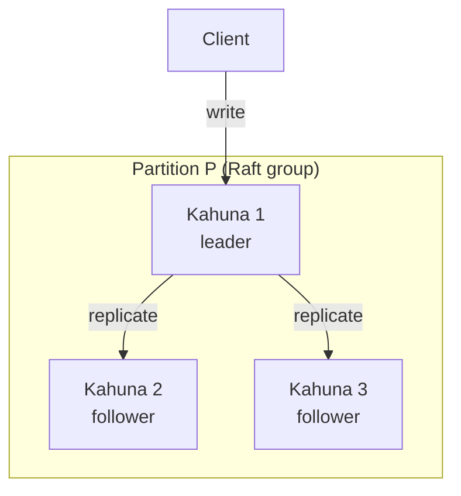
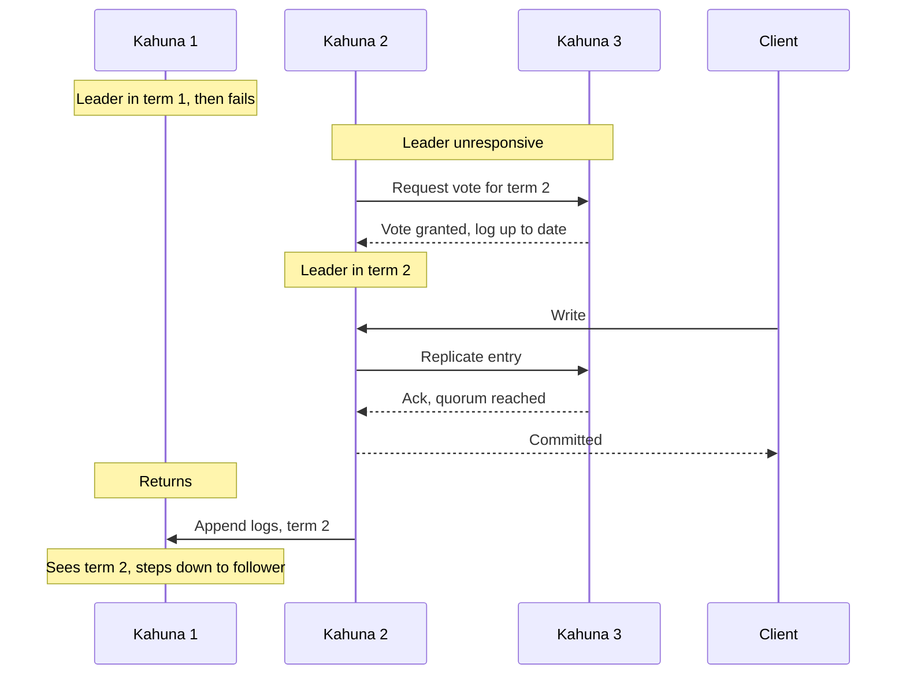

# Raft Consensus in Kahuna

## Overview

A distributed system keeps copies of its data on several machines so it can survive losing one of them. The hard part is making every copy agree on the same changes, in the same order, even when machines crash or the network drops messages. A **consensus protocol** solves that problem.

**Raft** is a widely used consensus protocol. One node is elected **leader** and orders every change. A change counts as committed only after a majority of nodes, called a **quorum**, has stored it. If the leader fails, the remaining nodes elect a new one, and no committed change is lost.

For you as a Kahuna user, Raft is the reason that:

- A committed persistent write survives the failure of a minority of replicas. In a group of three, one can fail; in a group of five, two can fail.
- All clients observe changes to a key in the same order.
- The cluster keeps serving after a leader fails, following a short election.

You do not configure or call Raft directly in application code. The rest of this page explains how Kahuna uses it, for readers who want to understand availability, failover, and recovery behavior.

## Consensus and Replication Mechanisms



The client sends writes to Kahuna 1, the leader of partition P's Raft group, which replicates each change to the followers Kahuna 2 and Kahuna 3.

In each [partition](/docs/glossary/#partition)'s Raft group, the elected leader is the only replica that accepts writes. The leader appends each change to its log and sends the log entries to the followers, so every replica applies changes in one order.

By default, the leader queues its local [write-ahead log (WAL)](/docs/glossary/#write-ahead-log-wal) write and sends proposals to followers at the same time (`--raft-fan-out-before-local-write`; fan-out means sending to the followers). Quorum completion still requires the leader's local write to be durable. A local failure after fan-out can leave followers holding the proposal, so a retryable result does not prove rejection. Process-loss durability also requires persistent WAL storage and durable write settings.

## Fault Tolerance and Recovery Systems

If a leader becomes unavailable, the remaining replicas elect a new one based on their log state, and the partition resumes service after the election.

Committed entries are delivered in log order, but followers may lag. With `--raft-follower-apply-in-own-turn` enabled (the default), a follower acknowledges an append first and applies the entries later, in a separate executor turn (a separately scheduled slice of work). [Partition 0](/docs/glossary/#partition-0) (the system partition) applies inline, in the same turn as the append. An append acknowledgement does not prove the follower has applied the entry.

## Operational Architecture

Each partition is an independent Raft group, so agreement runs per partition instead of across the whole cluster, which lets the cluster scale horizontally.

When a network failure heals, the leader's log is the authoritative record: reconnected followers reconcile their logs against it.

## Raft Group Configuration

In the default full-replication mode, every roster voter hosts every partition. With [replication factor and replica placement](/docs/replica-placement/), each partition has an explicit voter set, such as three or five replicas, and quorum is computed over that partition's voter replicas only.

One replica is elected leader and processes requests for that partition. Followers replicate committed data from the leader. Nodes that do not host a partition can still accept client requests and forward them to a hosting replica.

## Leadership Management

Leadership transitions occur through a voting mechanism triggered when the current leader becomes unresponsive or experiences failures. Each leadership election establishes a new "term" represented by a monotonically increasing counter value. A term has at most one elected leader under Raft voting rules. A stale node can still believe it is leader from an older term; quorum confirmation and term fences are needed to reject its authoritative work.

The sequence below shows a failover in a three-replica group. Kahuna 2 and Kahuna 3 form a quorum, so they can elect a leader and commit writes without Kahuna 1. When Kahuna 1 returns, it sees the higher term, steps down, and reconciles its log against the new leader.



In multi-partition clusters, independent elections can leave one node leading more partitions or more high-traffic partitions than its peers. Kahuna's optional [leader balancer](/docs/leader-balancing/) monitors leader count and partition load, then suggests normal Raft leadership handoffs. It changes leadership placement without moving partition data. Replica placement is a separate feature that changes which nodes store and vote for a partition.

## Stale Leader Fencing

A node can briefly believe it is still leader after it has been cut off from the voters that elect a replacement. Kahuna fences that window at multiple layers:

- Replicated writes and durable transaction phases still require a Raft quorum, so a cut-off leader returns a retryable result instead of committing data
- Authoritative reads confirm leadership through a quorum before serving from the leader
- Actor-only state changes, including interactive transaction staging and point, prefix, or range locks, also confirm leadership before changing local memory
- Proposals carry the term observed when they were admitted. If the node lost leadership and regained it in a newer term before appending the proposal, the proposal is rejected as stale and the caller retries
- When a node loses leadership for a partition, Kahuna drops belief-only state for that partition: staged transactional writes, unprepared write intents, and point, prefix, or range locks in every mode

Check-quorum step-down is enabled by default for server and clustered embedded nodes. The standalone `EmbeddedKahunaNode` constructor forces it off, along with backfill, because its phantom witnesses are not real replicas. A leader that stops hearing same-term acknowledgement from a majority steps down, bounding the stale-leader window. See [Server Configuration](/docs/server-configuration/#raft-timing) for `--raft-enable-check-quorum` and `--raft-check-quorum-interval-multiplier`.

## Transaction Support

For persistent writes, each participant partition replicates its prepared changes through Raft, and the transaction's canonical commit-or-abort record is also Raft-replicated, before Kahuna confirms the commit. Every participant therefore resolves against one replicated decision, even when the transaction spans nodes and partitions. See [Distributed Transactions](/docs/architecture/distributed-transactions/).

## Multi-Raft Management

Kommander schedules partition groups through shared executors and WAL queues. Partition write coalescing batches compatible proposals; follower apply turns use cooperative time and entry budgets. Capacity depends on workload, storage, and configured limits; the implementation does not establish an unconditional partition-count or performance guarantee.

## Kommander Implementation

Kahuna implements the Raft protocol through the [Kommander library](https://github.com/kahunakv/kommander). Kommander handles Raft message processing, elections, log persistence, and state-machine callbacks. Raft log storage is configured separately from Kahuna's materialized key/value backend; each layer can use RocksDB or SQLite depending on server configuration.

## Snapshot Catch-Up and Log Retention

A follower below retained log history needs whole-partition snapshot seeding. Receive staging caps account for disk and memory together; peers acknowledge staging separately and poll installation with a progress-based stall bound. See [Snapshot Installation and Raft Recovery](/docs/snapshot-and-raft-recovery/) for snapshot options, failure behavior, and installation limits.

How long a leader keeps log entries decides how often followers need a snapshot. The following describes Kahuna's pinned **Kommander 1.11.3** behavior. The server passes these options to `RaftConfiguration`; the replication-scheduling and live-replica lag-window/cap flags have no matching `EmbeddedKahunaOptions` properties, so do not assume server/embedded configuration parity. Flag defaults are in [Raft Communication](/docs/server-configuration/#raft-communication) and [Raft Queueing and Batching](/docs/server-configuration/#raft-queueing-and-batching).

### Live-Replica Retention

A live follower that recently needed snapshot rescue holds compaction within a retention depth. When the recent-history window is enabled, the effective depth is:

```text
max(CompactionLiveReplicaLagBudget, min(recent-window entries, CompactionLiveReplicaLagCap))
```

`--raft-compaction-live-replica-lag-budget` defaults to 1,000,000 entries. `--raft-compaction-live-replica-lag-window` (180,000 ms) sizes the recent history from the leader's observed commit rate; `0` uses the entry budget alone. `--raft-compaction-live-replica-lag-cap` (10,000,000 entries) caps the window's increase; nonpositive disables that increase, and it does not lower a larger entry budget. A new leader initially uses the entry budget.

This is a bounded catch-up aid, **not a guarantee that a pause of that many milliseconds always avoids a snapshot**. Liveness, the separate silent-peer retention window, checkpoints, application durability, and PITR floors also constrain compaction. A replica outside retained history still needs snapshot seeding.

### Followers Retain the Leader's Catch-Up Floor

The leader sends its effective live-replica retention floor and composed entry budget on AppendLogs/heartbeat traffic. Followers apply that floor to their own WAL compaction when accepting the term's leader, so a future leader retains the same protected catch-up history instead of having already compacted it away. A zero floor report preserves the previous floor; an explicit no-constraint report clears it. Application-durability and PITR floors still constrain compaction independently.

This extends the bounded retention policy across replicas; it does not retain all history indefinitely or guarantee that a lagging replica can avoid snapshot seeding.

### Message Size Limits

`--raft-grpc-max-message-bytes` defaults to 16 MiB and bounds peer send/receive messages. Keep outbound batch/backfill payload limits below it to allow protocol overhead. Raise receivers' message limits before raising senders' payload sizes. These transport limits do not replace snapshot staging caps.
