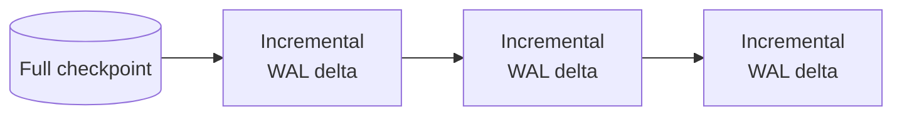
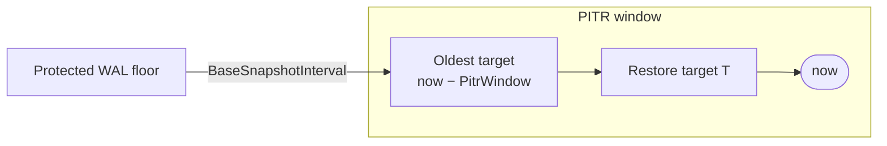

import Tabs from '@theme/Tabs';
import TabItem from '@theme/TabItem';

# Backups and Point-in-Time Recovery

[Raft](/docs/glossary/#raft) replication protects Kahuna against losing a node, but it does not protect against bad data. If a faulty deploy, a script bug, or an operator mistake deletes or overwrites keys, replication copies that change to every replica within milliseconds. Backups give you a copy of the data from **before** the mistake.

**Point-in-time recovery (PITR)** goes one step further. Instead of restoring only to the moment of the last backup, you can restore to any chosen moment inside a recent window (one hour by default, up to six hours), for example "five seconds before the bad deploy started". Use backups and PITR to:

- Recover from accidental deletes, overwrites, or corrupted application data.
- Keep a copy of the data outside the cluster, so an incident that destroys the nodes' disks does not destroy every copy.
- Inspect the state of the data at an earlier time, in a separate directory, without touching the live cluster.
- Seed a new node from a backup instead of a full transfer from its leader. See [PITR Bootstrap](/docs/pitr-bootstrap/).

Kahuna's backup design combines storage-engine checkpoints with the committed Raft write-ahead log (WAL), the ordered log of every committed change. This supports full backups, incremental backups, and recovery to a selected [Hybrid Logical Clock (HLC)](/docs/glossary/#hybrid-logical-clock-hlc) timestamp. Kahuna does not schedule backups by itself: you trigger them from the CLI, a client, or the REST and gRPC APIs, usually from a scheduled job. On Kubernetes, the [operator can schedule full and incremental backups](/docs/kubernetes-operator/#scheduled-full-and-incremental-backups) and manage their shared storage and retention.

:::caution Restore scope

Kahuna Server exposes backup and restore through REST, gRPC, `Kahuna.Client`, the TypeScript client, and `kahuna-cli`. Restore is offline: it writes a new storage directory and never replaces the live state of the node handling the request.

PITR restore reconstructs committed key/value state. Locks are runtime coordination leases and are not part of the restored PITR image. Range metadata is managed by the cluster and should be rebuilt or caught up through normal membership and Raft recovery. Plan recovery procedures around the data types used by the application and test them before relying on a runbook.

:::

When admin authorization is enabled, backup creation, GC, chain validation, and restore require an [admin key](/docs/admin-operations-authorization/). Backup listings and chain reads remain ungated.

## Runbook

The usual cycle, from configuration to a running node on recovered data. The sections below explain each step.

1. **Configure every node** with the same shared backup directory, cluster ID, and PITR window, and a restore root on the nodes that accept restores:

   ```bash
   kahuna-server \
     <cluster-options> \
     --pitr-backup-dir /mnt/kahuna-backups \
     --pitr-backup-cluster-id prod-us-east-1 \
     --pitr-restore-root /var/lib/kahuna/restores \
     --pitr-window 14400
   ```

2. **Take a coordinated full backup.** Only the leader of [partition 0](/docs/glossary/#partition-0) accepts it; other nodes answer `NotBackupCoordinator`, so retry against the current leader. Keep the backup ID it prints.

   ```bash
   kahuna-cli -c "https://kahuna-1:8082" --backup-coordinated
   ```

3. **Schedule incrementals** from a job runner such as cron, each one using the previous backup as its parent. Keep the interval well inside `--pitr-window`. On Kubernetes, the [operator schedules both](/docs/kubernetes-operator/#scheduled-full-and-incremental-backups).

   ```bash
   kahuna-cli -c "https://kahuna-1:8082" \
     --backup-incremental \
     --parent-backup-id <previous-backup-id>
   ```

4. **Restore to time `T`** into a new, empty directory under the restore root. `T` is Unix epoch milliseconds; `0` restores through the end of the chain. The directory is written on the server node that handles the request.

   ```bash
   kahuna-cli -c "https://kahuna-1:8082" \
     --restore <leaf-backup-id> \
     --target-dir /var/lib/kahuna/restores/at-t \
     --target-time-ms <T>
   ```

5. **Start a node on the restored directory**, with the same storage engine and storage revision as the source and a new, empty WAL directory. Without `--initial-cluster` it runs as a standalone node and serves the key/value data as of `T`, separate from the live cluster:

   ```bash
   kahuna-server \
     --storage rocksdb \
     --storage-path /var/lib/kahuna/restores/at-t \
     --storage-revision v1 \
     --wal-storage rocksdb \
     --wal-path /var/lib/kahuna/restored-wal
   ```

:::note Whole-cluster recovery is not documented yet

These steps recover the data onto one standalone node. A procedure for bringing a whole multi-node cluster back from a backup, with every node restored to the same point in time, is not documented yet. To seed one new node that joins a running cluster, use [PITR Bootstrap](/docs/pitr-bootstrap/).

:::

## Backup Model

The three recovery operations use the same two artifacts:

| Operation | Artifacts | Purpose |
|-----------|-----------|---------|
| Full backup | Storage checkpoint, manifest, and optional intent frontier | Creates a complete base image at a known WAL position. |
| Incremental backup | Committed WAL segments and manifest | Stores only changes since a parent backup, so its size follows the write volume since the parent, not the dataset size. |
| Point-in-time restore | Full checkpoint and an incremental chain | Replays changes in order and stops at the requested HLC timestamp. |

The intent frontier holds the prepared transaction [intents](/docs/glossary/#write-intent) that later incremental replay needs; see [Prepared-Intent Frontier](#prepared-intent-frontier-and-reader-compatibility).

A full backup is the root of a chain. Each incremental backup references its immediate parent and records a contiguous WAL range for every included [partition](/docs/glossary/#partition).



Kahuna validates the complete chain before restore. It rejects missing parents, cycles, a chain that does not begin with a full backup, unexpected full backups in the middle of a chain, and gaps between partition WAL ranges.

## Recoverable Window

Kahuna retains a sliding interval of WAL history for point-in-time recovery. `--pitr-window` sets how far back a restore target may be: `3600` seconds (one hour) by default and at most `21600` seconds (six hours). Increasing it retains more WAL and consumes more disk. `--base-snapshot-interval` (default `1800` seconds, no greater than the window) is the intended interval between base checkpoints. A shorter interval reduces WAL replay during restore but creates checkpoints more often.

For example, retain four hours of recoverable WAL and plan hourly base checkpoints with:

```bash
kahuna-server \
  --pitr-window 14400 \
  --base-snapshot-interval 3600
```

Kahuna normalizes invalid values at startup; see [Server Configuration](/docs/server-configuration/#backups-and-point-in-time-recovery) for the rules and for every backup flag.

Kahuna computes a protected WAL floor around:

```text
now - PitrWindow - BaseSnapshotInterval
```

Raft compaction must not remove entries at or above this floor. The extra snapshot interval keeps enough history to connect an available base checkpoint to the oldest recoverable timestamp.

On a timeline, a restore target `T` must fall inside the PITR window, and the protected WAL reaches one base snapshot interval further back:



:::note

`--base-snapshot-interval` participates in retention calculations. It does not schedule backups automatically. Trigger backups through the CLI, .NET client, TypeScript client, REST, or gRPC API.

:::

## Create and Inspect Backups

Configure the server first:

```bash
kahuna-server \
  --pitr-backup-dir /var/lib/kahuna/backups \
  --pitr-backup-cluster-id prod-us-east-1 \
  --pitr-backup-mac-key-file /etc/kahuna/backup-mac.key \
  --pitr-restore-root /var/lib/kahuna/restores \
  --pitr-window 14400 \
  --base-snapshot-interval 3600
```

`--pitr-backup-dir` enables the backup APIs; Kahuna creates the directory when needed. Use the same shared directory on every production node (see [Coordinator and Catalog Placement](#coordinator-and-catalog-placement)). The cluster ID and MAC key protect manifests (see [Confidentiality and Authenticity](#confidentiality-and-authenticity)), and the restore root confines remote restores (see [Restore Target Safety](#restore-target-safety)).

The built-in backup target is `local`. The backup storage layer also supports host-registered targets for object storage or other artifact stores, but those providers live outside the default server package. When using a non-local target, configure `--pitr-backup-target` to the provider name and set `--pitr-backup-scratch-dir` if the target needs a local checkpoint staging area. Size the scratch directory for one whole full backup.

<Tabs groupId="client-examples">
<TabItem value="cli" label="CLI">

```bash
# Coordinated full backup, recommended for a multi-partition production snapshot
kahuna-cli -c "https://kahuna-1:8082" --backup-coordinated

# Node-local full backup. Under replica placement it can omit partitions hosted
# elsewhere, and restore then rejects its chain with RestrictedCoverage
kahuna-cli -c "https://kahuna-1:8082" --backup-full

# Incremental backup using the previous backup as its parent
kahuna-cli -c "https://kahuna-1:8082" \
  --backup-incremental \
  --parent-backup-id <backup-id>

# Inspect the local catalog and validate a chain
kahuna-cli -c "https://kahuna-1:8082" --list-backups
kahuna-cli -c "https://kahuna-1:8082" --backup-chain <leaf-backup-id>

# Reclaim backup disk or preview the GC plan
kahuna-cli -c "https://kahuna-1:8082" --backup-gc
kahuna-cli -c "https://kahuna-1:8082" --backup-gc --backup-gc-dry-run
```

Add `--format json` for machine-readable output. Interactive mode supports `backup full`, `backup coordinated`, and `list backups`.

</TabItem>
<TabItem value="dotnet" label=".NET">

```csharp
using Kahuna.Client;
using Kahuna.Shared.Communication.Rest;

var client = new KahunaClient("https://kahuna-1:8082");

KahunaBackupInfo full = await client.TakeCoordinatedBackupAsync();
KahunaBackupInfo incremental =
    await client.TakeIncrementalBackupAsync(full.BackupId);

List<KahunaBackupInfo> backups = await client.ListBackupsAsync();
List<KahunaBackupInfo> chain =
    await client.GetBackupChainAsync(incremental.BackupId);

KahunaBackupGcResult preview =
    await client.RunBackupGarbageCollectionAsync(dryRun: true);
```

The client supports full, incremental, coordinated backups, catalog inspection, offline restore, and backup garbage collection over REST or gRPC communication.

</TabItem>
<TabItem value="typescript" label="TypeScript">

```ts
import { KahunaClient } from "kahuna-client";

const client = new KahunaClient({
  endpoints: ["https://kahuna-1:8082"]
});

const full = await client.takeCoordinatedBackup();
const incremental = await client.takeIncrementalBackup(full.backupId);

const backups = await client.listBackups();
const chain = await client.getBackupChain(incremental.backupId);

const preview = await client.collectBackupGarbage({ dryRun: true });
```

The TypeScript client supports the same backup catalog, full backup, incremental backup, coordinated backup, restore, and backup garbage-collection operations.

</TabItem>
</Tabs>

An incremental request can fall back to a full backup when the WAL range needed for the parent has already been compacted, or when the topology diverged from the parent chain (a membership change or a partition split or merge). This is visible in the returned fields: `RequestedKind` remains `Incremental`, `ActualKind` is `Full`, and `SubstitutionReason` explains why Kahuna took a new base image instead.

## Restore to a New Directory

`RestoreAsync` and `--restore` copy the chain's full checkpoint into a target directory and replay incremental entries. A target time of `0` restores through the natural end of the selected chain. A positive target is the HLC physical component expressed as Unix epoch milliseconds.

Kahuna maps a positive `--target-time-ms` to the inclusive end of that millisecond. That prevents same-millisecond commits with a higher HLC counter from being accidentally excluded.

<Tabs groupId="client-examples">
<TabItem value="cli" label="CLI">

```bash
# Restore the complete chain
kahuna-cli -c "https://kahuna-1:8082" \
  --restore <leaf-backup-id> \
  --target-dir /var/lib/kahuna/restored

# Restore to a specific time
kahuna-cli -c "https://kahuna-1:8082" \
  --restore <leaf-backup-id> \
  --target-dir /var/lib/kahuna/restored-at-t \
  --target-time-ms 1781478000000
```

</TabItem>
<TabItem value="dotnet" label=".NET">

```csharp
KahunaRestoreResponse restored = await client.RestoreAsync(
    leafBackupId: incremental.BackupId,
    targetDir: "/var/lib/kahuna/restored",
    targetTimeMs: 0
);
```

</TabItem>
<TabItem value="typescript" label="TypeScript">

```ts
const restored = await client.restore(
  incremental.backupId,
  "/var/lib/kahuna/restored",
  { targetTimeMs: 0 }
);
```

</TabItem>
</Tabs>

Start a fresh node against the restored directory using the same storage adapter and storage revision as the backup source. Hot in-place restore of a running node is not supported.

The response includes `Outcome`, `EntriesApplied`, `LastAppliedPhysicalMs`, and the exact chain coverage bounds: `MinRecoverablePhysicalMs` and `MaxRecoverablePhysicalMs`. A restore target outside those chain coverage bounds is rejected even if it is still inside the wall-clock PITR window.

Use `--backup-restore-throttle-mbps` (default `0`, unlimited) to cap the checkpoint copy when restore I/O competes with foreground traffic.

### Restore Target Safety

The target path is on the filesystem of the server node handling the request, not the machine running `kahuna-cli`. Remote restore over REST, gRPC, the clients, or the CLI is refused unless the server sets `--pitr-restore-root`; choose a target under that directory:

```bash
kahuna-server \
  --pitr-backup-dir /var/lib/kahuna/backups \
  --pitr-restore-root /var/lib/kahuna/restores
```

Kahuna rejects restore targets outside the restore root, targets that overlap the live storage path or backup directory, symlinked paths, and non-empty target directories. `--pitr-allow-unconfined-remote-restore` allows remote restore without a restore root; it is an administrative escape hatch and should not be enabled on shared nodes. Restore builds the result in a private staging directory and publishes it with an atomic rename, so a cancelled or failed restore does not leave a partial directory at the final target path.

### What a Restore Includes

- Only Raft-committed WAL entries are replayed. A transaction prepare (the first phase of [two-phase commit](/docs/glossary/#two-phase-commit-2pc)) can be committed to the log before the transaction is decided; an unfinished or aborted transaction does not become visible because its prepare is present.
- The cut uses each transaction's commit HLC, not the time each partition appended it. All participants of a committed distributed transaction share that commit HLC, so restore includes or excludes the transaction as one unit instead of cutting through different partitions.
- If the history needed to reconstruct a committed value is missing, restore fails instead of silently dropping the value.
- Keys written with no revisions cannot be rolled back across overwritten values. If such a key changed after the requested cut, Kahuna refuses an exact backup or restore path rather than silently over-including the newer value. Use no-revision writes for cache-like keys that do not require PITR.
- Locks and range metadata are not part of the restored image; see the restore scope note at the top of this page.

The replay mechanics are described in [Backup, Restore, and PITR internals](/docs/internals/backups-and-pitr/#point-in-time-replay).

## Bootstrap a Joining Node

A new node can seed its persistence backend and WAL from a backup before joining an existing cluster. Normal Raft catch-up then transfers changes after the restore point.

```bash
kahuna-server \
  --join-existing \
  --initial-cluster https://kahuna-1:8082 https://kahuna-2:8082 \
  --pitr-backup-dir /var/lib/kahuna/backups \
  --pitr-bootstrap-from <leaf-backup-id> \
  --pitr-target-time-ms 1781478000000
```

Omit `--pitr-target-time-ms` or set it to `0` to bootstrap through the chain's natural end. The server copies and verifies the full base image before opening an empty backend, replays the chain, and installs certified WAL snapshot boundaries. `--pitr-bootstrap-from latest` selects the newest seed-compatible chain; optional `--pitr-bootstrap-fallback-to-join` permits retention/no-chain fallback to normal catch-up. Existing data is not overwritten. See [PITR Bootstrap](/docs/pitr-bootstrap/) for authentication, cluster-ID checks, marker recovery, and exact fallback limits.

## HTTP API

| Method | Path | Operation |
|--------|------|-----------|
| `POST` | `/v1/backups/full` | Create a full backup |
| `POST` | `/v1/backups/incremental` | Create an incremental backup with `{"parentBackupId":"<guid>"}` |
| `POST` | `/v1/backups/coordinated` | Create a coordinated full backup |
| `GET` | `/v1/backups` | List the local catalog |
| `GET` | `/v1/backups/{id}/chain` | Resolve and validate a chain |
| `POST` | `/v1/backups/validate-chain` | Validate the chain identified by `leafBackupId` |
| `POST` | `/v1/restore` | Restore a chain into `targetDir` through `targetTimeMs` |
| `POST` | `/v1/backups/gc` | Run backup garbage collection. Pass `?dryRun=true` to preview without deleting. |

The equivalent gRPC `Backups` service exposes `TakeFullBackup`, `TakeIncrementalBackup`, `TakeCoordinatedBackup`, `ListBackups`, `GetBackupChain`, `ValidateChain`, `Restore`, and `RunBackupGarbageCollection`. Backup endpoints return unavailable when `--pitr-backup-dir` is not configured on the target node.

## Production Hardening

### Coordinator and Catalog Placement

`POST /v1/backups/coordinated` creates the cluster-wide backup. Kahuna accepts it only on the node that currently leads [partition 0](/docs/glossary/#partition-0) (the system partition). A request sent to another node is rejected with `NotBackupCoordinator`; retry against the current coordinator.

`ListBackups`, chain resolution, parent lookup, and restore read whatever is present in the receiving node's `BackupDir`. Because the coordinator can move over time, node-local backup directories scatter coordinated backups across whichever node was coordinator when each was taken, and each node sees only a partial catalog. For production clusters, point every node's `--pitr-backup-dir` at the same shared durable storage. Taking a backup does not itself require a shared target, but other nodes need access to its catalog and artifacts for later restore or chain operations.

Listing responses include `ClusterId` and `CoordinatorNode` when available. Use these fields to verify that a shared catalog contains backups produced by different coordinators. A listing that only shows the local node as coordinator is usually a node-local, partial view.

### Coordinated Cut

Each Raft partition has its own WAL position, so a log index cannot identify one cluster-wide moment. A coordinated backup selects one HLC timestamp below every in-flight commit it observes and caps every partition at that timestamp. After capture, Kahuna confirms that every covered partition applied its committed frontier and rejects the image if any prepared intent it observed carries a commit timestamp at or below the cut. It tries up to three cuts, then returns retryable `CutUnverified` without publishing a backup; retry after the workload or replication catches up.

This verification covers durable prepared-intent transactions. Persistent transactions on the ticket path (actor-only staging, used for example by extend-only transactions) keep pending state on participant [actors](/docs/glossary/#actor) that the coordinator does not see. A plain full backup (`--backup-full`, `/v1/backups/full`) does not perform coordinated cut verification. Incrementals extend a coordinated chain without choosing a new coordinated cut. See [Coordinated Cluster Timestamp](/docs/internals/backups-and-pitr/#coordinated-cluster-timestamp) for the mechanism.

### Confidentiality and Authenticity

Backup artifacts contain the physical storage checkpoint and committed WAL segments. Treat the backup directory as sensitive production data.

- Kahuna creates backup directories with restrictive permissions where the platform supports it.
- On startup, Kahuna refuses an unsafe backup root that is a symlink or group/world-writable on POSIX (`InsecureRoot`).
- Set the same `--pitr-backup-cluster-id` on every node. Kahuna stamps it into manifests and refuses to chain or restore artifacts from another cluster.
- `--pitr-backup-mac-key-file` enables HMAC-SHA-256 authentication of manifest identity, coverage, and digest metadata before restore. Store the key outside `BackupDir`, restrict it to the server user, and deploy the same key contents to every node.
- Backup artifacts are not encrypted by Kahuna. Put `BackupDir` on an encrypted volume or an encrypted object-store mount when backups contain sensitive data.
- Error responses are sanitized and include an operation ID. Full paths and backend exception details stay in server logs under that ID.

Enabling a MAC key means older unsigned backups cannot be restored under that configuration. Re-take production backups after enabling the key.

These checks, together with [restore target safety](#restore-target-safety), make backup and restore fail closed before Kahuna writes or trusts production artifacts.

### Topology Changes

A full or coordinated backup can fail with `TopologyChanged` if partition ownership, range metadata, or cluster membership changes while Kahuna is building the backup. Nothing is published in that case. Retry once the topology is stable.

### Replica Placement Coverage

With the default full-replication topology, any voter has every partition locally and can produce a backup covering the whole cluster.

With a positive [replication factor](/docs/replica-placement/), a node stores only the partitions it hosts. Plan backup coverage before enabling one:

- **Backups with replica placement require Kahuna 1.12.5 or later.** These servers compose a coordinated backup from the hosting nodes' partition shares at one cut, so the result covers the whole cluster without any node storing every partition. Composed incrementals preserve that coverage; if such a chain needs a new base, the fallback is a coordinated full.
- Every participating node needs backup configuration and the same storage engine. Shares are staged in private scratch space (`--pitr-backup-scratch-dir`, otherwise system temporary storage) until merged; they are not separately published backups.
- A plain full backup stays node-local and can omit partitions hosted elsewhere.
- Manifests record the cluster partition set and the covered subset. Restore, chain validation, and PITR bootstrap reject a chain with `RestrictedCoverage` if any stamped link fails to cover every cluster partition: coverage spread across different links is not enough.
- A coordinated capture that cannot obtain a required share publishes nothing and returns `PartitionCaptureFailed`; retry after availability or topology settles. See [Capture Cost and Lagging Replicas](#capture-cost-and-lagging-replicas).

The [Kubernetes operator](/docs/kubernetes-operator/#scheduled-full-and-incremental-backups) schedules these backups and rejects recognized older release tags when placement is configured.

## Backup Retention and Garbage Collection

Kahuna has two backup cleanup mechanisms:

| Mechanism | What it deletes | Default |
|-----------|-----------------|---------|
| Orphan sweep | Leftover temporary, staging, quarantine, merge, or artifact directories that no valid manifest owns. | Always enabled. |
| Retention | Valid backup chains outside configured count, age, or byte limits. | Disabled until at least one retention bound is set. |

Retention is chain-aware. Kahuna keeps or deletes a full backup and its incrementals as a unit, so no retained incremental is left without its parent chain. The newest chain is always kept, even if it alone exceeds the byte budget.

Enable retention by setting at least one bound: `--backup-retention-max-chains` (most-recent chains to keep), `--backup-retention-max-age` (seconds since a chain's newest backup), or `--backup-retention-max-bytes` (artifact byte budget). Each defaults to `0`, which is unbounded. GC runs inline after backup creation and periodically every `--backup-gc-interval` seconds (default `3600`); `0` disables only the periodic pass. See [Server Configuration](/docs/server-configuration/#backups-and-point-in-time-recovery) for the flag reference. Use `--backup-gc --backup-gc-dry-run` to inspect the plan before deleting anything.

GC removes manifests before artifacts and deletes descendants before ancestors. If a process stops mid-delete, the remaining artifact directory becomes an orphan and the next sweep can reclaim it. Symlinked top-level artifact entries are unlinked, not followed.

The result reports `RetentionDeletions`, `OrphanReclamations`, `BytesReclaimed`, and whether the pass was actually `Applied`.

## Outcomes and Observability

Backup and restore failures expose stable outcome names so automation does not need to match exception text:

| Outcome | Meaning |
|---------|---------|
| `NotConfigured` | Backup APIs are disabled because no backup directory is configured. |
| `ParentMissing` | The requested incremental parent does not exist. |
| `NeedsFull` | An incremental cannot be produced from the requested parent. |
| `CorruptChain` | Parent links, ordering, or partition ranges are invalid. |
| `CorruptArtifact` | Files are missing, extra, truncated, modified, duplicated, or unsafe. |
| `TargetConflict` | Restore target already exists, escapes the restore root, or overlaps a protected path. |
| `TargetOutsideCoverage` | Requested restore time is outside the selected chain coverage. |
| `RetryableLeadershipLoss` | Leadership changed during the operation; retry on the current leader. |
| `PartitionCaptureFailed` | Retryable: a required share could not be captured or partitions did not apply in time. No final backup is published; retry can use another voter. HTTP 503 / gRPC `Unavailable`. |
| `ExactCheckpointUnavailable` | Kahuna cannot prove the base checkpoint exactly represents the requested cut, for example after a backend flush failure, for a cut below the pruned-history floor, or when a no-revision key changed after the cut. No manifest is published. |
| `CutUnverified` | Retryable: coordinated cut verification failed, or a full backup cannot supply prepared intents needed by its chain. No backup is published. HTTP 503 / gRPC `Unavailable`. |
| `UnsupportedFormat` | A legacy or unsupported manifest was found. |
| `TopologyChanged` | Partition topology or membership changed during backup. Retry after the cluster is stable. |
| `NotBackupCoordinator` | The node is not the current coordinated-backup owner. Retry against the partition 0 leader. |
| `InsecureRoot` | The configured backup or restore root is unsafe. Fix permissions or path layout before retrying. |
| `RestrictedCoverage` | The selected chain does not cover every cluster partition, commonly because it was taken on a node that hosted only some partitions under replica placement. |

Metrics are emitted on the `Kahuna` meter. Backup and restore operations report operation counts, failures, bytes, duration, and restored entry counts. Backup GC reports runs, orphan reclamations, retention deletions, and reclaimed bytes.

## Operational Planning

- Estimate retained WAL storage as approximately `PitrWindow * WAL write rate`, plus overlapping base checkpoints.
- Use a shorter base snapshot interval when restore speed is more important than checkpoint overhead.
- Archive full backups externally when recovery beyond six hours is required. The live PITR window is intentionally bounded.
- Store backup artifacts on durable storage separate from the node's live data directories.
- Treat the manifest catalog and its referenced artifacts as one recovery set: keep the checkpoint, every incremental artifact, and every manifest in the chain together. A missing artifact or manifest makes later descendants unusable for restore.
- Validate the chain and artifact checksums before modifying a destination data directory. Kahuna does this automatically before restore, but external archivers should preserve manifests and artifact files together.
- Perform restores offline. Restoring data does not add the restored node to cluster membership.
- Apply the [production hardening](#production-hardening) settings on every node: a shared backup directory, the same cluster ID and MAC key, a restore root on nodes that accept remote restores, and coordinated backups under replica placement.
- Checkpoint cost depends on the storage engine: RocksDB can hard-link existing files, SQLite pauses writes to a shard while it copies that shard, and the memory backend's checkpoints are for testing, not durable production recovery. See [Storage Checkpoints](/docs/internals/backups-and-pitr/#storage-checkpoints).

A restored node can seed a later cluster join, but membership and Raft catch-up are separate operations. If its restore point is still within retained history, replicas can transfer only the remaining log. Otherwise, normal cluster recovery may require a complete state transfer.

## Prepared-Intent Frontier and Reader Compatibility

A full backup can include an `intent_frontier.pb` file: the prepared transaction intents that later incremental replay needs to reconstruct committed values. Upgrade every node and tool that restores backups before producing full backups with a frontier: older artifact verifiers reject the additional file. Full backups without a frontier still restore, but do not gain the missing reconstruction data.

Restore also reconstructs two transaction log encodings from prepared intents in the committed WAL, filtered by commit HLC: by-reference [materialization](/docs/internals/transaction-lifecycle/#basic-concepts), which records a committed value as a reference to the prepared intent each replica already holds instead of repeating the value, and the opt-in materializing settlement encoding. Readers must support those encodings before producers enable them; see [upgrade requirements](/docs/internals/durable-settlement/#rolling-upgrades). The mechanics are in [Durable Intents Across a Full Backup Boundary](/docs/internals/backups-and-pitr/#durable-intents-across-a-full-backup-boundary) and [Durable Materialization Replay](/docs/internals/backups-and-pitr/#durable-materialization-replay).

## Capture Cost and Lagging Replicas

A full capture waits for committed writes to reach applied state before it flushes and checkpoints. `--backup-apply-barrier-timeout-seconds` bounds that wait, called the apply barrier: it defaults to 30 seconds, and non-positive values select that default. A timeout reports all lagging partition IDs and returns retryable `PartitionCaptureFailed` (HTTP 503 / gRPC `Unavailable`), rather than treating a slow replica as an incapable checkpoint backend.

Coordinated captures take each partition only from a voter that holds it; a [learner](/docs/glossary/#leader-follower-and-learner) or a replica being removed is not a source. On bounded retries, unreachable or lagging sources are avoided when another voter is available. If the required shares cannot be captured, no final backup is published. A partition unable to confirm its committed state can still refuse the cut with `CutUnverified` until leadership recovers. See [Composed Captures](/docs/internals/backups-and-pitr/#composed-captures) for source selection.

### Limit Capture I/O

A RocksDB as-of image involves checkpoint creation, WAL replay/trim and compaction of the copy, hashing, and verification. It can compete with foreground commits on the same disk even though backend and Raft scheduler threads are separate.

```bash
kahuna-server \
  --pitr-backup-dir /var/lib/kahuna/backups \
  --backup-capture-throttle-mbps 50 \
  --backup-apply-barrier-timeout-seconds 60
```

`--backup-capture-throttle-mbps` defaults to `0` (unlimited); a positive value is decimal MB/s (`1,000,000` bytes/s). It applies a RocksDB rate limiter to the copied image's work and paces hash/verification reads and staged-image copying. It is a budget for individual capture stages, not a global limit on all filesystem traffic or a guarantee of foreground latency. Concurrent captures can add load. Increasing the budget shortens backups at the cost of more potential contention; lowering it can require a longer overall backup request timeout. `--backup-restore-throttle-mbps` remains a separate restore-copy setting.

When the backup target is on another filesystem, capture can first stage under `<storage-path>/backup-staging`, using hard links on the store's filesystem, then copy the finished image to the target. The copy is synced and published by rename. Staging needs free space for approximately the live store size plus 256 MB. If staging cannot be used, RocksDB's direct checkpoint copy can copy SSTs across filesystems without this pacing; the budget does not cover every possible path. Staged leftovers are reclaimed by backup GC. Plan local staging space as well as backup-volume capacity.
