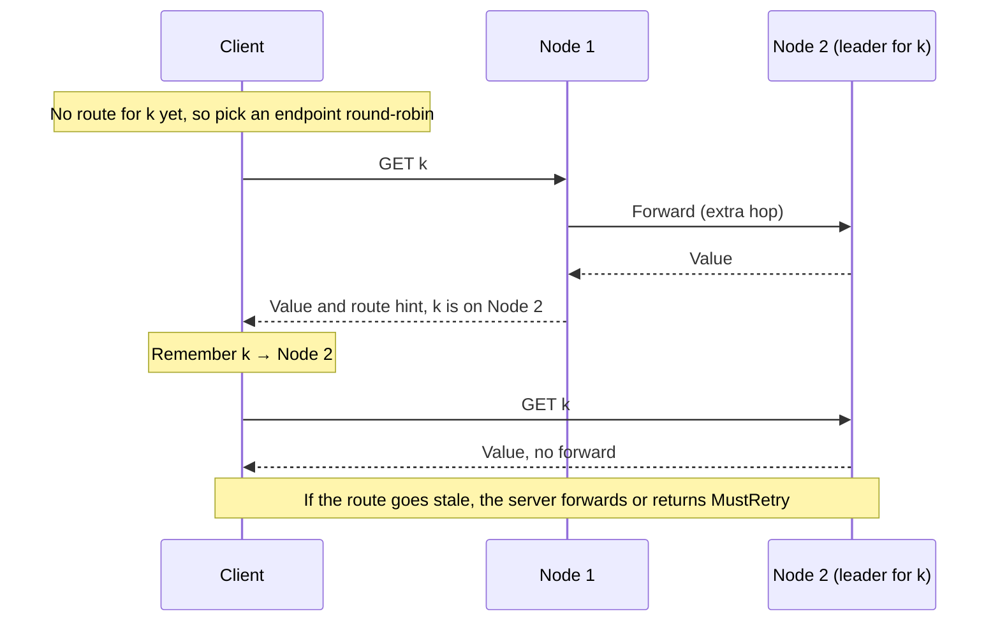

import Tabs from '@theme/Tabs';
import TabItem from '@theme/TabItem';

# Client Leader-Aware Routing

Kahuna accepts requests on every node. If a request lands on a node that is not the [leader](/docs/glossary/#leader-follower-and-learner) of the target [partition](/docs/glossary/#partition), that node forwards the request to the current owner. Client leader-aware routing removes many of those extra hops by letting the client learn where a resource lives and send later requests there directly.

The gain is lower latency and less work on the cluster. A request that goes straight to the partition leader skips one network hop between nodes, and nodes spend less effort forwarding traffic. Most applications get this without any change: the default `Auto` mode turns on learned routing when the client is configured with several endpoints. Change the mode only to turn routing off (`RoundRobin`), or to route even the first request for a resource directly (`Metadata`).

Routing is advisory. The server still re-resolves the key, lock, or sequence when the request arrives, checks that the key's range has not split or moved since the route was learned, and verifies leadership. A stale route costs a forward or retry, not a wrong result.



## Modes

Set `KahunaOptions.Routing` in .NET or `routing` in TypeScript:

| Mode (.NET / TypeScript) | Behavior |
|------|----------|
| `Auto` / `"auto"` | Default. Uses `Learned` when the client has several endpoints and `RoundRobin` when it has one. |
| `RoundRobin` / `"roundRobin"` | Rotates over configured endpoints without route learning. |
| `Learned` / `"learned"` | Reuses the endpoint reported by a previous response for the same resource. Unknown resources fall back to round-robin selection. |
| `Metadata` / `"metadata"` | Uses learned routes and also reads cluster routing metadata so unseen resources can route directly. |

<Tabs groupId="client-examples">
<TabItem value="dotnet" label=".NET">

```csharp
using Kahuna.Client;
using Kahuna.Client.Routing;

var client = new KahunaClient(
    [
        "https://node1:8082",
        "https://node2:8084",
        "https://node3:8086"
    ],
    options: new KahunaOptions
    {
        Routing = KahunaRoutingMode.Metadata
    }
);
```

</TabItem>
<TabItem value="typescript" label="TypeScript">

```ts
import { KahunaClient } from "kahuna-client";

const client = new KahunaClient({
  endpoints: [
    "https://node1:8082",
    "https://node2:8084",
    "https://node3:8086"
  ],
  routing: "metadata"
});
```

</TabItem>
</Tabs>

`Auto` is usually the right starting point. A single-endpoint client stays on `RoundRobin` because it cannot use hints that name other nodes unless those endpoints are also configured or mapped.

`Auto` looks only at the number of configured endpoints. A client with one endpoint and a `RoutingEndpointMap` (or `AllowUnlistedRoutingEndpoints`) still resolves to `RoundRobin` and ignores the map. If that client should follow hints to the mapped nodes, set `Learned` or `Metadata` explicitly.

To check which mode a client resolved, read `client.EffectiveRouting` in .NET or `client.routing` in TypeScript. Both return the mode in force, with `Auto` already resolved.

## What Routes

| Operation | Routing behavior |
|-----------|------------------|
| Point key/value operations | Routed by key after a route is learned or resolved from metadata. |
| Lock operations | Routed by lock resource in a separate routing domain from key/value keys. |
| Sequence operations | Routed by the sequence storage key rule. |
| Batch point operations | Server-dispatched, while per-item routes are learned from the response. |
| Prefix, bucket, and range scans | Server-dispatched because one coordinator owns fan-out, pagination, and merge. |
| Transaction scripts and sessions | Routed by coordinator identity, not by an individual data key. |
| Cluster, range, backup, and snapshot administration | Not routed by key. Range administration, cluster placement, and leave calls honor an explicit `nodeUrl` argument. Cluster membership, backup, restore, snapshot-hold, and history-hold calls take no `nodeUrl` and rotate through the configured endpoints in both clients. |

Forwarded point and batch reads re-resolve ownership at the receiving node. A follower that holds a copy of the partition does not answer from that copy; it forwards the request on. Each forwarded request carries a small hop budget, a limit on how many times it can be forwarded, so a brief disagreement about who leads cannot cause a forwarding loop. When the budget runs out, the node returns `MustRetry` instead of serving its local state. Forwarded sequence operations work the same way: a follower redirects them to the leader and refuses them when the budget runs out.

Batch calls intentionally stay server-dispatched. Splitting one batch into several client requests would make transport failures ambiguous per group, while the server already returns per-item outcomes and route hints.

## Server Advertisement

Servers include advisory route hints in REST and gRPC responses by default. Configure what endpoint a node advertises with:

| Flag | Meaning |
|------|---------|
| `--advertised-client-endpoint` | Base URL this node tells clients to dial. Empty derives it from the Raft endpoint and advertised scheme. |
| `--advertised-client-scheme` | Scheme prepended to peer Raft endpoints when deriving peer client URLs. Empty follows `--raft-grpc-scheme`. |
| `--disable-peer-endpoint-advertisement` | Do not name peer nodes in hints. Use this when peer client URLs cannot be derived from Raft endpoints. |
| `--disable-routing-hints` | Return no routing hints. Clients keep their configured endpoint selection. |

The default derived endpoint is:

```text
<advertised scheme><raft host>:<raft port>
```

Set `--advertised-client-endpoint` explicitly when clients reach a node through a different host or port than the cluster uses internally, such as container port mapping or separate internal and external DNS names.

In `MutualTls` deployments, routing hints must name application listeners, not the mTLS cluster listener. Set `--advertised-client-endpoint` on each node and use `--disable-peer-endpoint-advertisement` unless every peer application URL can be derived safely. A normal client cannot follow a hint that points at a listener requiring node certificates.

## Endpoint Mapping

A response cannot make the client dial an arbitrary address by default. A hint is accepted only when it resolves to a configured endpoint.

Use `RoutingEndpointMap` when servers advertise internal addresses but the application dials external addresses:

<Tabs groupId="client-examples">
<TabItem value="dotnet" label=".NET">

```csharp
var client = new KahunaClient(
    [
        "https://localhost:8082",
        "https://localhost:8084",
        "https://localhost:8086"
    ],
    options: new KahunaOptions
    {
        Routing = KahunaRoutingMode.Learned,
        RoutingEndpointMap = new Dictionary<string, string>
        {
            ["https://172.30.0.2:8082"] = "https://localhost:8082",
            ["https://172.30.0.3:8084"] = "https://localhost:8084",
            ["https://172.30.0.4:8086"] = "https://localhost:8086"
        }
    }
);
```

</TabItem>
<TabItem value="typescript" label="TypeScript">

```ts
const client = new KahunaClient({
  endpoints: [
    "https://localhost:8082",
    "https://localhost:8084",
    "https://localhost:8086"
  ],
  routing: "learned",
  routingEndpointMap: {
    "https://172.30.0.2:8082": "https://localhost:8082",
    "https://172.30.0.3:8084": "https://localhost:8084",
    "https://172.30.0.4:8086": "https://localhost:8086"
  }
});
```

</TabItem>
</Tabs>

Set `AllowUnlistedRoutingEndpoints = true` (`allowUnlistedRoutingEndpoints: true` in TypeScript) only when every advertised node URL is trusted and client-reachable, including nodes added after the client starts.

## Metadata Mode

`Metadata` mode reads `GET /v1/cluster/routing` or the equivalent gRPC `Cluster.GetRoutingMetadata` call. The map includes:

- hash-routing rules for normal key spaces, including [placement groups](/docs/distributed-keyvalue-store/buckets/#placement-groups) (related key spaces kept on the same partition)
- key-range descriptors and generations for range-routed key spaces
- sequence storage-key routing rules
- advisory partition leaders

The current hash algorithm identifier is `kahuna.placement-group-jump-xxh32-v1`. It names one exact rule: take the key space (the part of the key before the last `/`), reduce it to its placement group (the part of the key space before the first `|`), and hash that group to a partition with a jump consistent hash. Key spaces that share a placement group, such as `orders|rows/...` and `orders|by_customer/...`, route to the same hash partition.

The metadata read is not on the critical path of an operation. If no usable map is available, the operation goes out through learned routing or round-robin selection and the refreshed map helps later operations.

Clients refuse metadata they cannot interpret exactly, including unknown schema versions, unknown hash algorithms or separators, a range map that changed while the server was assembling the response, missing leaders, or key-range gaps. In those cases the client falls back instead of guessing.

## Cache and Metrics

Relevant client options. The .NET options are `TimeSpan` values; the TypeScript options are milliseconds:

| .NET option | TypeScript option | Default | Meaning |
|-------------|-------------------|---------|---------|
| `RouteCacheCapacity` | `routeCacheCapacity` | `4096` | Learned route entries kept in memory. |
| `RouteHintLifetime` | `routeHintLifetimeMs` | 60 seconds (`60000`) | Maximum age of a learned route before it must be observed again. |
| `RoutingEndpointCooldown` | `routingEndpointCooldownMs` | 5 seconds (`5000`) | Time an endpoint is skipped after a transport failure. |
| `RoutingMetadataLifetime` | `routingMetadataLifetimeMs` | 60 seconds (`60000`) | Metadata map lifetime in `Metadata` mode. |
| `RoutingEndpointMap` | `routingEndpointMap` | none | Maps server-advertised URLs to URLs this client dials. |
| `AllowUnlistedRoutingEndpoints` | `allowUnlistedRoutingEndpoints` | `false` | Allows dialing advertised endpoints that are neither configured nor mapped. |

The .NET client publishes routing counters under the `Kahuna.Client.Routing` meter. Every instrument name starts with `kahuna.client.routing.`:

| Counter | Meaning |
|---------|---------|
| `kahuna.client.routing.cache_hits` and `kahuna.client.routing.cache_misses` | Learned-route cache outcomes. |
| `kahuna.client.routing.metadata_hits` | Operations routed from the metadata map. |
| `kahuna.client.routing.hints_learned` | Accepted response hints. |
| `kahuna.client.routing.hints_rejected` | Dropped hints, tagged by `reason` (`endpoint_rejected`, `superseded`, `unknown_provenance`). |
| `kahuna.client.routing.endpoints_suppressed` | Endpoints put into failure cooldown. |
| `kahuna.client.routing.suppressed_routes_skipped` | Cached routes skipped because their endpoint was cooling down. |
| `kahuna.client.routing.metadata_refreshes` | Metadata reads issued. |
| `kahuna.client.routing.metadata_refreshes_coalesced` | Metadata reads served by another caller's in-flight read instead of a new request. |
| `kahuna.client.routing.metadata_refresh_failures` | Metadata reads that produced no usable map. |

If `hints_rejected` with `reason=endpoint_rejected` climbs while cache hits stay low, the server is advertising endpoints the client was not configured or mapped to dial.

The TypeScript client publishes no meter. For diagnostics, `client.router?.metrics` holds in-process counters with the same meanings (`cacheHits`, `cacheMisses`, `metadataHits`, `hintsLearned`, `hintsRejected`, `endpointsSuppressed`, `suppressedRoutesSkipped`, `metadataRefreshes`, `metadataRefreshesCoalesced`, `metadataRefreshFailures`), without a `reason` breakdown. `client.router` is `null` when the client uses `roundRobin`.

## Measured Effect

On a local three-node cluster with cleartext gRPC, in-memory storage, 12 partitions, 2,000 hot keys, and 64 concurrent `get` workers, learned routing reached 116,808 requests per second. The same benchmark with round-robin endpoint selection reached 72,188 requests per second, so removing the extra forwarding hop improved this read-heavy workload by about 62%.

Treat this as a concrete example, not a guaranteed ceiling. The benefit is largest when operations repeat resources and the client can reuse learned routes. Workloads dominated by writes still pay the Raft replication cost, and very large key spaces may need `Metadata` mode or a larger `RouteCacheCapacity` to keep hit rates high.

## Rollout

1. Upgrade servers. Route hints are additive and older clients ignore them.
2. Confirm what a node advertises with `GET /v1/cluster/routing`.
3. Configure `--advertised-client-endpoint` or `RoutingEndpointMap` if advertised URLs differ from dialed URLs.
4. Upgrade clients. A multi-endpoint client in `Auto` starts using learned routing.
5. Use `Routing = RoundRobin` (`routing: "roundRobin"`) for clients that should keep the old endpoint-selection behavior.
