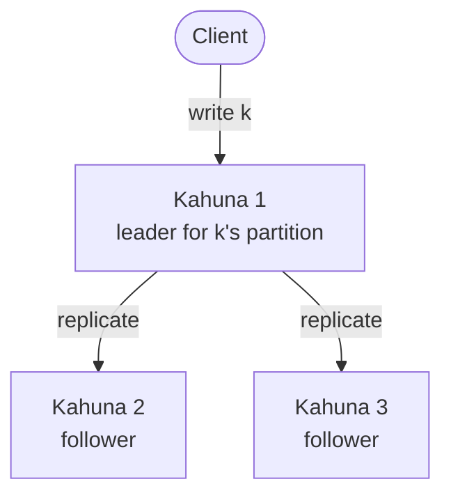

import Kahuna4 from './assets/kahuna4.png';
import Tabs from '@theme/Tabs';
import TabItem from '@theme/TabItem';

# Distributed Key/Value Store

Kahuna's **distributed key/value store** lets many application instances share state safely. If you have used Redis or etcd, the model is familiar: you `set` and `get` keys, optionally with an expiry. Unlike a single Redis node, persistent keys are replicated across several nodes, and every key carries a [revision](/docs/glossary/#revision) that you can use for compare-and-set (CAS) updates, historical reads, and multi-key transactions.

Each entry is a **key**, a unique name such as `config/prod/payments/max-refund`, and a **value**, which can be any bytes: a string, a number, or a JSON document. Any instance can read or write any key from any machine. For persistent keys, every reader sees the latest committed value, even while some cluster nodes are down. Ephemeral keys skip replication and live only in the memory of the node that leads their partition, so they are faster but are lost when that node restarts or leadership moves.

Use it for state that several processes must agree on:

- Configuration and feature flags that every instance must see the same way.
- Watches that notify services when persistent keys change.
- Service discovery entries that appear and expire with the instances they describe.
- Job, workflow, and reservation state, where two workers must not both act on the same item.
- Counters, quotas, and session data shared by a fleet of servers.

Compared with keeping this state in each process or in a single-node cache, Kahuna adds replication across nodes, strongly consistent reads, revision history, CAS updates, and multi-key transactions. It is not a general-purpose database: it has no SQL or secondary indexes, and it works best with small values and small transactional working sets.

<div style={{textAlign: 'center'}}>

</div>

## Key Characteristics

1. **Scalability**: Kahuna spreads keys across [partitions](/docs/glossary/#partition), and it can spread partition leadership across several machines.
2. **Fault Tolerance**: Persistent data is replicated with [Raft](/docs/glossary/#raft), so committed state can survive node failures.
3. **High Availability**: Clients can contact any node, and Kahuna routes each request to the current partition [leader](/docs/glossary/#leader-follower-and-learner).
4. **Strong Consistency**: For persistent keys, the partition leader orders every write and commits it through Raft. Ephemeral keys are ordered by the same leader but are not replicated.
5. **Low Latency**: Kahuna serves frequently used keys from memory and writes persistent state to disk in the background.
6. **Distributed Transactions**: [Transactions](/docs/distributed-keyvalue-store/transactions/) can change keys on several nodes at once:
   - [MVCC](/docs/glossary/#mvcc) (Kahuna keeps several versions of each key) provides snapshot reads and conflict detection, with pessimistic or optimistic locking.
   - The server, not the client, records which keys a transaction read, wrote, and locked (its [working set](/docs/internals/transaction-lifecycle/#basic-concepts)). Commit and rollback use that record.
   - Retried operations are deduplicated, so a retry does not apply a change twice.
   - When a transaction modifies several partitions, it commits with [two-phase commit](/docs/glossary/#two-phase-commit-2pc): every partition prepares its changes, then one commit or abort decision applies to all of them.
   - Optionally, the commit decision is stored durably, so a transaction whose writes are all persistent can be recovered after durable finalization starts.
   - [Priority admission](/docs/distributed-keyvalue-store/transaction-priority-admission/) lets latency-critical transactions start ahead of bulk work when a node is saturated and admission ceilings are enabled.

Each key belongs to one partition. For a persistent key, the partition leader orders every write and replicates it to the followers before the write succeeds. In this example, Kahuna 1 leads the partition that owns key `k`:



## Quick Example

Write a key, then read it back with its [revision](/docs/distributed-keyvalue-store/revisions/):

<Tabs groupId="client-examples">
<TabItem value="cli" label="CLI">

```kahuna
set `my-config` "my-value"
```
```text
r0 set 11ms
```

```kahuna
get `my-config`
```
```text
r0 my-value 13ms
```

</TabItem>
<TabItem value="dotnet" label=".NET">

```csharp
// Create or update a key/value pair and set an expiration of 10 seconds:
var result = await client.SetKeyValue(
  "my-config",
  "some-value",
  10000,
  durability: KeyValueDurability.Persistent
);

if (result.Success)
  Console.WriteLine("Key/value updated successfully with revision {0}", result.Revision);

result = await client.GetKeyValue(
  "my-config",
  KeyValueDurability.Persistent
);

if (result.Success)
{
  Console.WriteLine("Value: {0}", result.ValueAsString());
  Console.WriteLine("Revision: {0}", result.Revision);
}
```

</TabItem>
<TabItem value="typescript" label="TypeScript">

```ts
await client.set("my-config", "some-value", {
  expiry: 10_000,
  durability: "persistent"
});

const result = await client.get("my-config", {
  durability: "persistent"
});

if (result.success) {
  console.log(`Value: ${result.valueAsString()}`);
  console.log(`Revision: ${result.revision}`);
}
```

</TabItem>
</Tabs>

Every operation, with its parameters and return values, is in the [Key/Value API Reference](/docs/distributed-keyvalue-store/api/).

## Persistent or Ephemeral

Every key has a durability level, chosen on each operation:

- **Persistent** keys are replicated to a [quorum](/docs/glossary/#quorum) (a majority) of nodes through Raft and written to disk. They survive node crashes, restarts, and leader changes.
- **Ephemeral** keys live only in the memory of the partition leader. They are faster, but a crash, restart, leader change, or memory eviction loses them. Use them for data you can rebuild, such as caches, sessions, and rate-limit counters.

In Kahuna Script, `set`, `get`, and the other plain commands use persistent keys, and the `e`-prefixed commands (`eset`, `eget`, ...) use ephemeral keys. See [Durability Levels](/docs/architecture/durability-levels/).

## Pick the Right Tool

| You want to... | Use | Read |
|---|---|---|
| Update a key only if nobody changed it since you read it | Compare-and-set (CAS) on value or revision | [Compare-and-Set (CAS)](/docs/distributed-keyvalue-store/cas/) |
| Read an earlier value, or detect a change by its version number | Revisions, `AT <revision>`, `AS OF <timestamp>` | [Revisions](/docs/distributed-keyvalue-store/revisions/) |
| React when persistent keys change instead of polling | Watches on a key, prefix, or range | [Watch Persistent Key Changes](/docs/distributed-keyvalue-store/watches/) |
| Change several keys together, or write based on values you read | Transactions (scripts or interactive sessions) | [Transactions](/docs/distributed-keyvalue-store/transactions/) |
| Keep a small group of related keys on one partition and read them in one operation | Buckets and `get by bucket` | [Buckets](/docs/distributed-keyvalue-store/buckets/) |
| Let a large ordered key space, such as `users/000001` or `orders/2026/000001`, grow across partitions | Key-range routing (opt-in; hash routing is the default) | [Key-Range Sharding](/docs/distributed-keyvalue-store/key-range-sharding/) |
| Split a small range that receives too many writes | Load-based range splitting | [Load-Based Range Splitting](/docs/distributed-keyvalue-store/load-based-range-splitting/) |
| Know exactly what a transaction sees and when two transactions conflict | Read and lock rules | [Transaction Reads and Locks](/docs/distributed-keyvalue-store/read-and-lock-semantics/) |
| Keep reading "as of timestamp T" for a long-lived historical view | Snapshot holds | [Snapshot Holds](/docs/distributed-keyvalue-store/snapshot-holds/) |
| Look up the signature and examples of an operation | Set, Get, Delete, Extend, Exists, and the bucket, range, and prefix reads | [Key/Value API Reference](/docs/distributed-keyvalue-store/api/) |
