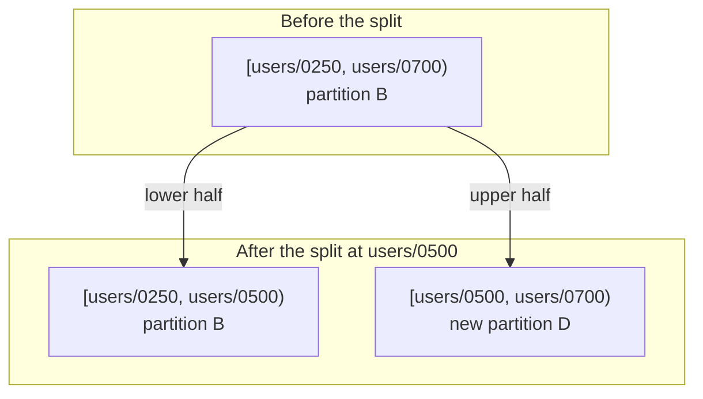
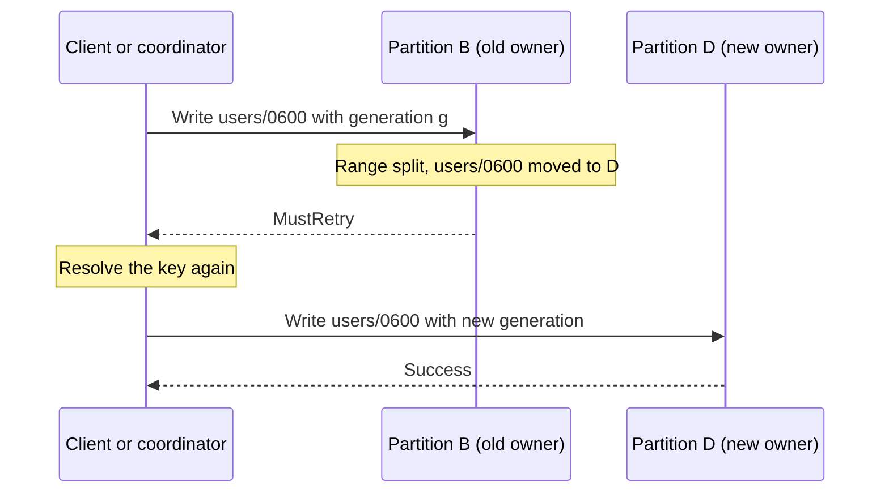

# Key-Range Sharding

By default, Kahuna decides which [partition](/docs/glossary/#partition) stores a key by hashing the key's key space (the part before the last `/`). This spreads unrelated data evenly without any planning, but it keeps each key space on exactly one partition. For a large key space such as `users/...` or `orders/2026/...`, that one partition then holds all of its data and takes all of its writes, and it cannot be split.

Key-range sharding removes that limit for the key spaces you choose. Keys stay in sorted order, the key space is cut into contiguous ranges that can live on different partitions, and Kahuna splits a range when it grows too large or too busy. Use it when:

- A key space may outgrow one partition, in data size or in write rate.
- You read keys in order or by range, such as all orders between two IDs, and want those reads to touch only the ranges they overlap.
- Transactions on different parts of a large key space should not contend with each other.

Keep the default hash routing for small key spaces, caches, configuration, and data you only access by exact key. If you only need a small group of related keys on one partition, [buckets](/docs/distributed-keyvalue-store/buckets/) are simpler.

## Key Spaces

A **key space** is the same boundary that defines a [bucket](/docs/distributed-keyvalue-store/buckets/#what-a-bucket-means): the part of a key before the last `/`. For example, `orders/2026/0001` belongs to key space `orders/2026`.

Kahuna decides the routing mode per key space, not per individual key, so hash-routed and range-routed key spaces coexist in the same cluster.

## Hash Routing

Hash routing is the default because it spreads unrelated workloads across partitions with very little planning.

That works well for:

- caches
- service configuration
- metadata that is read and written by many nodes
- key spaces where locality does not matter

In hash mode, all keys in the same key space route to the same partition because Kahuna hashes the key space boundary, not the full leaf key. That is what makes `get by bucket` possible for prefixes such as `services/`.

Hash routing can also co-locate related key spaces with a [placement group](/docs/distributed-keyvalue-store/buckets/#placement-groups), so that rows and their secondary indexes stored under separate prefixes land on the same partition.

## Key-Range Routing

Key-range routing is for key spaces where **adjacent keys should stay adjacent**.

Instead of hashing the key space to one partition forever, Kahuna stores a set of **range descriptors** for that key space. Each descriptor maps a contiguous half-open interval of keys to one partition:

```text
[-inf, users/0250)      -> partition A
[users/0250, users/0700) -> partition B
[users/0700, +inf)      -> partition C
```

This gives Kahuna three things hash routing cannot provide:

- **ordered locality** for keys such as `users/0001`, `users/0002`, `users/0003`
- **range-scoped reads** that only touch the ranges they overlap
- **range-scoped locking and contention**, so unrelated slices of a large key space do not block each other

When a slice grows hot or large, Kahuna can split it into two smaller slices and move the upper half to a different partition while preserving key order. This is the model used by systems such as Spanner and CockroachDB.

## Splits, Merges, and Fencing

When a key-range space grows, Kahuna can split one range into two smaller ranges. When two neighboring ranges become too small, Kahuna can merge them.

For example, splitting the range `[users/0250, users/0700)` at `users/0500` keeps the lower half on its partition and gives the upper half to a new partition:



Automatic splitting has two independent triggers. The count trigger splits a range after it reaches a configured number of keys. The opt-in load trigger splits a range whose persistent write rate and [write-ahead log](/docs/glossary/#write-ahead-log-wal) (WAL) backlog remain high, even when the range contains relatively few keys. Load-based splitting selects a split key from observed write distribution and requires [leader balancing](/docs/leader-balancing/) to relocate work across nodes.

See [Load-Based Range Splitting](/docs/distributed-keyvalue-store/load-based-range-splitting/) for configuration, metrics, and limitations.

Range moves are protected by a **generation fence**. The client or coordinator routes each write with the range descriptor generation it knows. If the range split or moved before the write is replicated, the write is rejected with `MustRetry`, and the caller resolves the key again and retries against the new range owner:



This prevents writes from silently landing on stale partitions after a split or merge.

Splits and merges also pause writes to the moving key interval during the copy and cutover window. Kahuna combines a range lock on the source partition with a replicated descriptor deadline, so writes that race with movement are refused retryably instead of being acknowledged on the old partition and lost after routing changes.

In short, a write that races a split or merge gets a retryable error and is never lost. Committed data, transaction records, and prepared [write intents](/docs/glossary/#write-intent) are replicated to the destination before cutover, and the partition IDs that a merge retires are never reused. The mechanics are in [Internals: Handoff and Retirement](#internals-handoff-and-retirement).

## Partition 0

The range-descriptor map is replicated on **partition 0 (the system partition)** so every node can resolve key-range ownership consistently.

At a high level:

- partition `0` is the system partition
- the range map is committed on partition `0` beside the cluster partition-map coordinator
- data ranges live on data partitions starting at partition `1`

That detail matters for maintainers and operators because the descriptor map is itself durable cluster state, not a local cache.

## Buckets or Key Ranges?

These features are related, but they are not the same thing:

- **[Buckets](/docs/distributed-keyvalue-store/buckets/)** are a single-partition grouping technique. They are ideal when a small or moderate prefix such as `services/` should stay together on one partition and be read with `get by bucket`.
- **Key ranges** are a scalable locality technique. They are ideal when keys must stay ordered, the key space may grow beyond one partition, and you need range-scoped locality and future splits.

Key spaces that often want key-range routing:

- `users/0001`, `users/0002`, `users/0003`
- `orders/2026/000001`, `orders/2026/000002`
- time-ordered event or ledger keys

`get by bucket` is a **single-partition** operation. It remains the right tool for hash-routed bucket prefixes and for small unsplit key spaces.

Once a key-range space has actually split, treat it as a multi-range ordered space and think in terms of **ordered range reads**, not "fetch the whole bucket from one partition". The cluster can still serve the data consistently, but the request may span multiple ranges.

## How a Key Space Becomes Range-Routed

Key-range routing is an explicit opt-in. The key space must be registered so Kahuna flips that space from hash mode to key-range mode and seeds its initial whole-space descriptor. You register once; every node picks up the routing mode from the committed descriptor map (see [Registration and reconciliation](#registration-and-reconciliation)).

The CLI contacts the configured endpoints to register and verify their local routing views:

```bash
kahuna-cli \
  -c "https://kahuna-1:8082,https://kahuna-2:8082,https://kahuna-3:8082" \
  --register-key-range users
```

Committed descriptors propagate the routing mode to other nodes; operators do not need to manually register each node for propagation. CLI fan-out verifies answering nodes. `Indeterminate` means local descriptor visibility was not established and can follow a committed proposal: re-read or retry instead of assuming registration was rolled back.

The registration response reports:

| Field | Meaning |
|-------|---------|
| `success` | The answering node routes the space by key range and sees at least one descriptor. |
| `status` | `Seeded`, `AlreadySeeded`, `Indeterminate`, `InvalidInput`, or `KeyRangeDisabled`. |
| `seeded` | This request committed the initial descriptor. False can still be success if another request already seeded it. |
| `routingMode` | The answering node's local routing mode for the key space. |
| `descriptorCount` | Descriptors visible to the answering node. |

`Indeterminate` means the node-local mode changed but the descriptor is not visible on that node yet. Re-read the range map before writing to the space.

Unregister a key space with:

```bash
kahuna-cli \
  -c "https://kahuna-1:8082,https://kahuna-2:8082,https://kahuna-3:8082" \
  --unregister-key-range users
```

## Inspect and Administer Ranges

Read the applied range map from any node:

```bash
kahuna-cli -c "https://kahuna-1:8082" --ranges
kahuna-cli -c "https://kahuna-1:8082" --ranges --key-space users
```

REST exposes the same map:

```http
GET /v1/ranges
GET /v1/ranges?keySpace=users
```

The response includes `initialized`, the answering node's `localEndpoint`, and one entry per key space. Each key-space entry includes its node-local `routingMode` plus ordered descriptors with `startKey`, `endKey`, `partitionId`, and `generation`.

For metadata-mode clients, `GET /v1/cluster/routing` also publishes the hash placement rule: algorithm `kahuna.placement-group-jump-xxh32-v1`, key-space separator `/`, placement-group separator `|`, hash pool size, and partition offset. Clients that do not understand the exact rule fall back instead of guessing.

Range scan page failures are visible through `kahuna.kv.scan_page_retry_budget_exhausted` and `kahuna.kv.scan_page_failed`. A non-zero rate means callers are receiving retryable or loud scan failures instead of silently truncated results.

Force a split at an exact key:

```bash
kahuna-cli \
  -c "https://kahuna-1:8082,https://kahuna-2:8082,https://kahuna-3:8082" \
  --split-range users \
  --split-key users/0500
```

REST:

```http
POST /v1/ranges/split
Content-Type: application/json

{"keySpace":"users","splitKey":"users/0500"}
```

Only the [leader](/docs/glossary/#leader-follower-and-learner) of the partition that owns the range map can split. A non-leader refuses with `NotLeader` and may include `leaderHint`.

The split response includes `determinate`. Use it before taking action:

| `status` | `determinate` | Meaning |
|----------|---------------|---------|
| `Succeeded` | `true` | The range split and `newPartitionId` serves the upper half. |
| `NotLeader` | `true` | Nothing was attempted. Retry against the hinted leader or another endpoint. |
| `NoRange` | `true` | The key space is unregistered or no descriptor covers the split key. |
| `InvalidSplitKey` | `true` | The key would create an empty range or is outside the covering range. |
| `BelowMinRangeSize` | `true` | The policy refused the split because one half would be too small. |
| `PartitionCreationFailed` | `true` | The map did not change, though an unused partition may have been created. Retry allocates a fresh partition ID. |
| `TransferFailed`, `QuiesceFailed`, `CutoverFailed`, `ConcurrentSplit`, `Indeterminate` | `false` | The map may still change. Re-read `GET /v1/ranges`. |

Run the merge pass on demand:

```bash
kahuna-cli -c "https://kahuna-1:8082" --merge-ranges
```

REST:

```http
POST /v1/ranges/merge
```

Merge scans every key-range space and folds adjacent ranges that are below the configured minimum. There is no per-key-space merge API and no request-level size override. A non-leader returns `NotLeader` instead of reporting `0` merges, so `0` means a leader actually ran the pass and found nothing eligible.

Range admin is also available through gRPC, `Kahuna.Client`, and the TypeScript client.

## Internals: Handoff and Retirement

This section describes the mechanics behind splits, merges, and registration. You do not need it to use key-range sharding.

### Handoff

Split/merge quiesce uses a leader-local `WriteFence` range lock: it blocks new mutations while allowing Shared readers and does not plant per-key intents. Descriptor transitions retain a generation fence and deadline. Data and completion receipts, transaction records, and prepared intents must be replicated at the destination before cutover. Handoff uses bounded batches (512 items, with a 1 MiB intent-byte target); a single oversized intent or same-key group can exceed those targets.

### Retirement

Merge cutover records `RetiredPartitionIds` in replicated metadata. A later partition 0 leader can finish removing the retired groups; partition identifiers are not reused. The backend remains node-global and range ownership determines slices to move or purge. With explicit replica placement, node-global storage does not mean every node stores every partition.

### Registration and reconciliation

Registration has two parts:

- registration flips the answering node locally, then seeds the initial descriptor through the partition 0 leader and waits for local visibility
- startup, live range-map apply, restore, and partition-0 snapshot installation reconcile each node's local routing registry from the committed descriptor map
