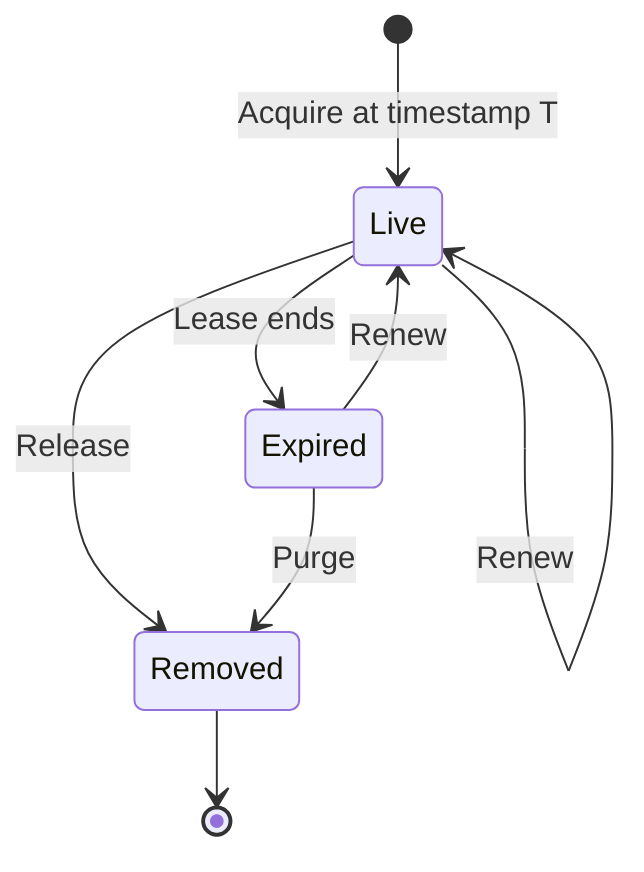

# Snapshot Holds

Historical reads with `AS OF <timestamp>` need old [revisions](/docs/glossary/#revision) that cleanup would otherwise remove. A snapshot hold protects the history still available at a chosen timestamp while the cluster continues accepting writes. Acquire it before relying on that history; it cannot restore revisions already lost or omitted during a transfer.

Use holds for long-lived historical views such as database branches, audit sessions, or tools that need to keep reading "as of timestamp T" for longer than normal revision cleanup might retain that history.

## What a Hold Protects

Kahuna supports historical reads with `AS OF <timestamp>` and the `snapshotMs` parameter in the .NET and TypeScript clients. Those reads return the newest revision whose commit timestamp is at or before the requested time.

Without a hold, old revisions are still subject to memory trimming and persistent revision retention. A snapshot hold pins the required history so cleanup does not remove the revision needed by the held timestamp.

## How It Works

A hold has:

- a `holderId`, chosen by the client
- a snapshot timestamp to protect
- a [lease](/docs/glossary/#lease) duration in milliseconds, after which the hold expires unless you renew it
- a server-generated `holdId`

`GetSnapshotFloor` reports the minimum timestamp of live, non-expired holds and their live count. Pruning uses a different protective floor: the minimum timestamp of **all registered holds**, including expired leases, until a replicated release or purge removes them. Persistent cleanup preserves the boundary revision at or before that protective floor and every newer revision.

The lifecycle of a hold: it protects history while it is registered, live or expired, and stops once a release or purge removes it:



Holds are replicated cluster state. You can contact any node; Kahuna routes acquire, renew, and release operations to the leader of [partition 0](/docs/glossary/#partition-0) (the system partition).

Durable holds are also recovered after restart. On startup, Kahuna gives restored holds a short grace window before treating leases that expired during downtime as purge-eligible. The default internal grace is five minutes. Renew the hold during that window to keep the protected timestamp active; otherwise the reaper can advance the snapshot floor after the grace expires.

## .NET Client

Acquire a hold before starting a long-lived historical view:

```csharp
using Kahuna.Client;
using Kahuna.Shared.KeyValue;
using Kommander.Time;

var client = new KahunaClient("https://node1:8082");

long branchTimestampMs = DateTimeOffset.UtcNow.ToUnixTimeMilliseconds();
HLCTimestamp timestamp = new(0, branchTimestampMs, uint.MaxValue);

(KeyValueResponseType type, string holdId, HLCTimestamp leaseExpiry) =
    await client.AcquireSnapshotHold(
        holderId: "branch/customer-analytics",
        timestamp,
        leaseMs: 300_000
    );

if (type != KeyValueResponseType.Set)
    throw new InvalidOperationException($"Could not acquire snapshot hold: {type}");
```

Use the same timestamp for historical reads:

```csharp
KahunaKeyValue value = await client.GetKeyValue(
    "config/prod/search/enable-new-ranking",
    KeyValueDurability.Persistent,
    snapshotMs: branchTimestampMs
);

List<KahunaKeyValue> services = await client.GetByBucket(
    "services/payments",
    KeyValueDurability.Persistent,
    snapshotMs: branchTimestampMs
);
```

Renew the hold before the lease expires:

```csharp
(KeyValueResponseType renewType, HLCTimestamp newLeaseExpiry) =
    await client.RenewSnapshotHold(holdId, leaseMs: 300_000);
```

Release the hold when the historical view is no longer needed:

```csharp
KeyValueResponseType releaseType = await client.ReleaseSnapshotHold(holdId);
```

Inspect the current floor:

```csharp
(HLCTimestamp effectiveFloor, int liveHolds) =
    await client.GetSnapshotFloor();
```

`GetSnapshotFloor()` only returns an authoritative floor. If the node cannot confirm the partition 0 leader, the client receives a `KahunaException` with `KeyValueErrorCode == KeyValueResponseType.MustRetry` instead of a misleading zero-floor response.

`AcquireSnapshotHold(holderId, timestamp, leaseMs)` is idempotent for the same `(holderId, timestamp)` pair. Calling it again returns the same hold id and renews the lease.

## TypeScript Client

Acquire a hold before starting a long-lived historical view:

```ts
import { KahunaClient, snapshotAt } from "kahuna-client";

const client = new KahunaClient({
  endpoints: ["https://node1:8082"]
});

const branchTimestampMs = Date.now();
const timestamp = snapshotAt(branchTimestampMs);

const hold = await client.acquireSnapshotHold(
  "branch/customer-analytics",
  timestamp,
  300_000
);
```

Use the same timestamp for historical reads:

```ts
const value = await client.get("config/prod/search/enable-new-ranking", {
  durability: "persistent",
  snapshotMs: branchTimestampMs
});

const services = await client.getByBucket("services/payments", {
  durability: "persistent",
  snapshotMs: branchTimestampMs
});
```

Renew or release the hold by `holdId`:

```ts
await client.renewSnapshotHold(hold.holdId, 300_000);
await client.releaseSnapshotHold(hold.holdId);

const floor = await client.getSnapshotFloor();
console.log(floor.effectiveFloor.physical, floor.liveHolds);
```

## REST Endpoints

Kahuna also exposes the hold API over REST:

| Endpoint | Purpose |
|----------|---------|
| `POST /v1/kv/snapshot-hold/acquire` | Acquire or renew a hold by `(holderId, timestamp)`. |
| `POST /v1/kv/snapshot-hold/renew` | Renew an existing hold by `holdId`. |
| `POST /v1/kv/snapshot-hold/release` | Release an existing hold by `holdId`. |
| `GET /v1/kv/snapshot-floor` | Return the authoritative effective floor and live hold count, or a retryable response when leadership cannot be confirmed. |

`leaseMs` must be greater than zero. Renew can revive an expired hold while it remains registered; after release or purge it returns `DoesNotExist`. Revival confirms partition 0 application before proving registration.

## Hold Limits

Snapshot holds default to a maximum requested lease of one day, 4096 registrations per holder, and 65,536 registrations cluster-wide. A lease above the bound returns `InvalidInput` on acquire or renew. A new registration over either count bound returns `SnapshotHoldLimitReached`; renewal and idempotent reacquisition of an existing hold do not consume a new slot. Release or replicated purge frees a slot. Bare lease expiry does not remove the registration.

Configure `--snapshot-hold-max-lease-ms`, `--snapshot-hold-max-per-holder`, and `--snapshot-hold-max-total`, or the corresponding [embedded options](/docs/embedded-kahuna-node/#client-request-limits). `0` removes the respective bound.

## History Across Replica and Range Moves

When a replica receives a whole-partition snapshot, or a split or merge moves keys to another partition, Kahuna carries the revisions needed at registered hold timestamps, including expired holds not yet purged. It also carries a recent continuous history window. It records which timestamps the transferred history can answer:

- Each carried hold protects its **exact timestamp**, not every timestamp between holds.
- Reads at or after the transfer's recorded **complete-from timestamp** have continuous coverage. Whole-partition exports normally start this window five seconds before export begins, subject to the source's own coverage limit.
- Other older timestamps return `MustRetry`, rather than a value or missing-key result based on incomplete history. This applies to point reads and scans, including keys whose current value happens to predate the requested timestamp.

A move records coverage in the replicated range descriptor; all replicas enforce it. A merge applies one coverage bound to the entire merged range, including keys that did not move. Whole-partition installation instead records a local, restart-persistent bound, so a replica with fuller history may answer a timestamp that an installed replica refuses.

Only holds the source can answer are carried. Registering an old hold after history has disappeared, or too late for the final move capture, cannot recover that history. Releasing a hold allows later cleanup; it does not promise indefinite retention of a transferred pin.

Do not retry a refused historical timestamp forever: the missing history may remain unavailable on that replica or range. Where your application permits it, restart the read or transaction at a fresh timestamp. For a long-lived view that requires the original timestamp, treat persistent refusal as an unavailable view and investigate its hold registration and transfer history.

On upgrade, a recorded whole-partition install without coverage metadata is conservatively fenced at startup time. Installing a snapshot from an older exporter without that metadata also refuses older reads. See [snapshot recovery](/docs/snapshot-and-raft-recovery/) and [fixed-timestamp read semantics](/docs/distributed-keyvalue-store/read-and-lock-semantics/#fixed-timestamp-reads).

## Operational Notes

- Renew well before the lease expires. If the holder stops renewing, the hold becomes purge-eligible. Protection ends when replicated removal commits; do not depend on a delay between expiry and purge.
- After a full-cluster restart, renew important holds promptly so they survive the startup grace window.
- Choose lease durations that are coarse enough to avoid making renewals a hot path.
- Snapshot holds protect persistent historical revisions. Ephemeral keys that have no durable history can still lose deep history outside the in-memory revision window.
- Holds protect history from cleanup; they do not freeze writes or make the rest of the cluster read-only.
- `SET ... NOREV` writes intentionally skip archived historical revisions, so a hold cannot make those skipped revisions readable later.

## Metrics

Snapshot holds publish metrics under the `Kahuna` meter:

| Metric | Meaning |
|--------|---------|
| `kahuna.snapshot_floor.live_holds` | Number of live, non-expired holds. |
| `kahuna.snapshot_floor.effective_floor_ms` | Physical millisecond component of the effective floor, or `0` when no hold is live. |
| `kahuna.snapshot_floor.prune_skipped_unconfirmed_total` | Prune cycles skipped because local partition 0 catch-up could not be confirmed. |
| `kahuna.snapshot_floor.prune_confirm_timed_out_total` | Catch-up confirmations exceeding the prune-confirm timeout; also counted as skipped prune cycles. Persistent increases indicate missing partition 0 catch-up. |
| `kahuna.snapshot_floor.missing_protected_version_total` | Fault counter that should remain `0`; it increments if cleanup ever tries to remove a floor-protected revision. |
| `kahuna.kv.snapshot_installed_history_refused_total` | Historical reads refused because a whole-partition install did not carry the requested timestamp. |
| `kahuna.kv.snapshot_range_history_refused_total` | Historical reads refused by a moved range's recorded history coverage. |

Alert if `kahuna.snapshot_floor.missing_protected_version_total` becomes non-zero. Use live hold count and effective floor age to understand how much history clients are pinning.

## Acquire and Prune Races

Acquire the hold before you depend on the history. A hold protects history that still exists; it never brings back revisions that cleanup already removed. If an acquire overlaps a cleanup pass, Kahuna can return `MustRetry`; retry with the same `(holderId, timestamp)`. A small cross-node race window remains, and a hold does not make an arbitrary timestamp safe to read.

Acquire/renew/release replication uses keyed deltas; the full local snapshot and partition 0 transfer still scale with registered hold count. Destructive pruning first confirms local application of partition 0; failure skips that prune cycle and retains queued cleanup keys. Confirmation waits at most `RevisionPruneConfirmTimeout` (default 1 second). After a timeout, `RevisionPruneConfirmRetryInterval` (default 5 seconds) delays another attempt; an immediate failure retries next cycle. This bounds how long cleanup can stall the background writer. A local prune-generation guard detects acquire overlapping a deletion pass and returns `MustRetry`, even if the hold was replicated. Retry the same `(holderId, timestamp)`.

This guard does not recreate history already deleted. Catch-up confirmation followed by sampling the protective floor is not a cluster-wide atomic acquire/prune barrier; a residual cross-node window remains. Holds protect retention, not an arbitrary timestamp's clock safety or cluster-wide snapshot consistency. See [historical read semantics](/docs/distributed-keyvalue-store/read-and-lock-semantics/#fixed-timestamp-reads).
