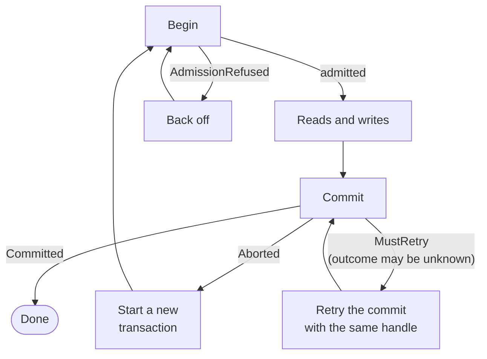

import Tabs from '@theme/Tabs';
import TabItem from '@theme/TabItem';

# Transactions

A **transaction** groups several reads and writes so they take effect together or not at all, like `BEGIN` ... `COMMIT` in a SQL database. Use one when a single business change touches more than one key, or when a write depends on a value you read first.

For example, a job dispatcher assigns job `jobs/1042` to worker `w-7` only if the job is still pending and the worker runs fewer than three jobs. That means reading two keys, checking both, and writing both back. Without a transaction, three things can go wrong:

- The dispatcher crashes after marking the job as assigned but before updating the worker's job count, so the job and the worker disagree (a partial update).
- Two dispatchers both read `pending` and assign the same job to different workers, and one assignment silently overwrites the other (a lost update).
- Another dispatcher assigns jobs while you read, so you see the job from before its change and the worker's count from after it (read skew).

Inside a Kahuna transaction, both writes commit together or neither does. With read validation or locks, a conflicting change by another client makes the transaction abort instead of producing a wrong result, and you retry it. This holds even when the keys live on different [partitions](/docs/glossary/#partition) and nodes.

The main differences from a SQL transaction: you choose pessimistic or optimistic [locking](#locking-modes); a normal read keeps the committed value it first saw for each key, instead of reading every key from one snapshot taken at `BEGIN`; and a commit can return `MustRetry`, an unknown outcome that you resolve by retrying the same commit.

Kahuna offers two ways to run a transaction:

- **[Scripts](/docs/scripts/)**: send the whole read-check-write logic to the cluster as one request. This is the simplest and fastest option when the logic fits in Kahuna Script.
- **Interactive transactions**: open a session from the [.NET](/docs/dotnet-client/) or [TypeScript](/docs/typescript-client/) client, run operations one by one with application code in between, and then commit or roll back.

**You do not need a transaction** for a single-key update. A plain `SET`, or a [compare-and-set](/docs/distributed-keyvalue-store/cas/) when the new value depends on the old one, is cheaper.

Client sessions and script transactions default to separate limits of 20,000 written keys and 20,000 acquired locks. See [Key/Value Request Limits](/docs/distributed-keyvalue-store/request-limits/#transactions) for counting and refusal behavior.

## How Kahuna Runs Transactions

Kahuna coordinates reads and writes across partition [leaders](/docs/glossary/#leader-follower-and-learner). For persistent keys, each partition stages the transaction's changes as replicated [write intents](/docs/glossary/#write-intent), and one commit-or-abort record (the [canonical decision](/docs/internals/transaction-lifecycle/#basic-concepts)) decides the outcome for all of them. Once that record says commit, the new values are visible, even if background cleanup (settlement) has not yet installed them as normal values. Ephemeral values, and transactions that mix persistent and ephemeral keys, do not have the same guarantees when a process is lost.

For interactive transactions, Kahuna uses a server-side **transaction coordinator**. The client keeps a session handle, but the server owns the authoritative working set: confirmed reads, writes, locks, range locks, prefix locks, and cleanup state. Commit and rollback use that server-owned state instead of trusting the client to send a final list of touched keys.

## What Isolation You Get

A Kahuna transaction does not read every key from one snapshot taken at `BEGIN`. What it sees, and which conflicts it catches, depends on how it reads and on its options:

| Reads and options | What you get |
|---|---|
| Latest reads (the default) | The first read of each key pins the committed value it sees, or that the key is absent. Later reads of that key in the same transaction compare against the pin. Reads of different keys can observe different moments. |
| `pessimistic` locking (the default) | The transaction locks each key before it reads or writes it; a script takes its locks up front. Another transaction cannot change a locked key until this one commits or rolls back. |
| `optimistic` locking, or `readValidation: trackAndValidate` | At commit, Kahuna re-checks every key the transaction read. If one changed, or another transaction holds a concurrent write intent on it, the transaction aborts instead of committing against a stale read. This prevents lost updates and write skew. |
| Bucket and range reads under `pessimistic` locking | A prefix or range lock blocks inserts, deletes, and updates inside the bucket or range, so keys cannot appear in or vanish from what you already read (phantoms). |
| Fixed `ReadTimestamp`, or `snapshot` in a script | Default fixed-timestamp reads return committed state at or before one past timestamp, within retained history, and do not register read validation. A script with `snapshot` is read-only. The lower-level `StatementSnapshot` read mode has different transactional behavior; see [Statement snapshot reads](/docs/distributed-keyvalue-store/read-and-lock-semantics/#statement-snapshot-reads). |

Transaction locks, including prefix and range locks, live in the partition leader's memory. A leader change drops them. The commit then refuses instead of committing work the lock no longer protected; see [Retry Outcomes](#retry-outcomes).

[Transaction Reads and Locks](/docs/distributed-keyvalue-store/read-and-lock-semantics/) gives the exact visibility rules, lock compatibility, and failover limits.

## Core Concepts

| Concept | Description |
|--------|-------------|
| **Session** | One transaction attempt. A script runs as one session on the server. An interactive transaction is a session you open from a client; its handle sends later operations, commit, and rollback to the server that owns it. |
| **Locking mode** | `pessimistic` (the default) takes locks as the transaction reads and writes. `optimistic` reads without exclusive locks and checks for conflicts at commit. See [Locking Modes](#locking-modes). |
| **Retry outcome** | A transaction that does not commit tells you how to retry. `Aborted` means start a new transaction. `MustRetry` means the outcome is not known yet: retry the same commit or rollback with the same handle. See [Retry Outcomes](#retry-outcomes). |

The internal terms used on the architecture and internals pages, such as coordinator, write intent, and canonical decision, are defined in the [transaction glossary](/docs/internals/transaction-lifecycle/#basic-concepts).

## Transaction API

A script with several statements, like the one below, normally runs as a transaction even without `begin`. An eligible single-command script runs directly, without opening a transaction.

```kahuna
set "services/auth" "localhost:8081"
set "services/matchmaking" "localhost:8082"
set "services/inventory" "localhost:8083"
```

### Basic Usage

The job assignment from the introduction, as one script. Values read with `get` arrive as strings, so the script converts the job count with `to_int`:

```kahuna
begin
 let job = get "jobs/1042"
 let load = get "workers/w-7"
 if job == "pending" && to_int(load) < 3 then
  set "jobs/1042" "w-7"
  set "workers/w-7" to_int(load) + 1
 end
 commit
end
```

### Example: Conditional Write Based on a Read

```kahuna
begin
 let config = get "settings/feature-x"
 if config == "enabled" then
   set "logs/feature-x" "used"
 end
 commit
end
```

The transaction keeps the committed value of `settings/feature-x` from its first read. With validation enabled, a competing change can abort a later operation or commit; retry the business operation in a new transaction after a definite abort.

## Using `get by bucket` inside a Transaction

In the default hash-routed model, all keys under one bucket prefix (for example `services/`) live on the same partition, so `get by bucket` is a consistent, transactional read of that group. See [Buckets and Transactions](/docs/distributed-keyvalue-store/buckets/#buckets-and-transactions) for an example and [Key-Range Sharding](/docs/distributed-keyvalue-store/key-range-sharding/) for key spaces that may split into several ranges; there, use an ordered range read instead of a bucket read.

In a **pessimistic** transaction, `get by bucket` also acquires a **prefix lock** for that bucket. That means concurrent inserts, deletes, or updates under the same bucket are blocked or aborted while the transaction is open, repeated reads of the same bucket stay idempotent, and `commit` or `rollback` releases the lock.

## Using Ordered Range Reads inside a Transaction

For ordered key spaces, interactive transactions also support **bounded range reads**:

```csharp
await using KahunaTransactionSession session = await client.StartTransactionSession(
    new() { Locking = KeyValueTransactionLocking.Pessimistic, Timeout = 5000 }
);

KeyValueGetByRangePageResult page = await session.GetByRange(
    prefix: "users",
    startKey: "users/000100",
    startInclusive: true,
    endKey: "users/000200",
    endInclusive: false,
    limit: 100,
    durability: KeyValueDurability.Persistent
);
```

`GetByRange(...)` is the right primitive when the working set is an ordered slice rather than a whole single-partition bucket.

In a **pessimistic** transaction, `GetByRange(...)` acquires a **range lock** over the requested interval. While held, the lock blocks conflicting inserts, deletes, and updates inside the interval; writes outside it can proceed. These locks live in the partition leader's memory: a leader change clears them, and renewal can leave gaps. `rollback` releases the recorded lock set. See [lock and failure semantics](/docs/distributed-keyvalue-store/read-and-lock-semantics/#transaction-locks).

Within the same transaction session, range reads also follow **read-your-own-writes** semantics: uncommitted inserts and updates made by the session are visible to later reads from that session, and uncommitted deletes stay hidden from that session's later reads.

## Locking Modes

Kahuna supports pessimistic and optimistic transactions. Choose the mode with the `locking` option.

| Mode | Behavior | Best fit |
|---|---|---|
| `pessimistic` (default) | Locks keys up front. Point reads can use point locks, bucket reads can use prefix locks, and ordered range reads can use range locks. | Hot keys, workflows where retries are expensive, and reads that must block phantoms. |
| `optimistic` | Reads proceed without exclusive locks and writes lock only the keys they modify. At commit, Kahuna revalidates the observed revisions and aborts on concurrent write intents over the read set. | Read-heavy workloads with low write contention. |

Pessimistic locking is the default. It is more conservative and can avoid wasted work under contention, but it can hold locks longer. Optimistic locking allows more read concurrency but relies on conflict detection at commit.

Optimistic reads avoid exclusive locks. The first latest read of each key records its committed value, or that the key is absent; this includes a value whose transaction committed but is not settled yet. Later point operations can abort immediately when that observation is stale; commit still validates dependencies. Retry definite aborts with a new transaction.

Transaction locks live in the partition leader's memory and have expiration, so they are not held forever. A leader change can drop them; see [Retry Outcomes](#retry-outcomes).

## Transaction Lifecycle

1. **Begin**: Kahuna assigns a transaction ID based on a [hybrid logical clock](/docs/glossary/#hybrid-logical-clock-hlc) (HLC) timestamp and creates a coordinator-owned session.
2. **Read and write**: Operations run on the responsible partition leaders, and the server records each confirmed effect. A retried interactive operation carries the same operation ID, so it returns the original result instead of applying the mutation twice.
3. **Validate**: Optimistic transactions, and transactions with read validation, re-check the keys they read and abort if one changed. They also abort if another transaction holds a concurrent write intent on a key that was read but not written, which prevents write skew. Pessimistic transactions lock keys, buckets, or ranges ahead of time to avoid conflicts and phantoms.
4. **Finalize**: The first commit, rollback, close, or cleanup attempt closes the transaction to new operations and freezes its working set. Commit then applies the write set through [two-phase commit](/docs/glossary/#two-phase-commit-2pc); rollback releases staged writes, locks, and [MVCC](/docs/glossary/#mvcc) read entries.

See [Distributed Transactions](/docs/architecture/distributed-transactions/) for the design, and [Transaction Lifecycle](/docs/internals/transaction-lifecycle/) for the step-by-step mechanics.

## Retry Outcomes

A transaction that does not commit returns a result that tells you what to do next. The diagram shows where each outcome sends you:



- **`Aborted`** is definite: the transaction did not commit, for example because of a conflict. To retry the business operation, start a **new** transaction and recompute from new reads.
- **`MustRetry`** means the outcome is not known yet, or transient work remains. The transaction **may have committed**. Retry the same commit or rollback with the **same** transaction or session handle, without adding new operations. Starting a fresh transaction is not a substitute for resolving an unknown commit, and a `MustRetry` or a transport timeout is not proof of rollback.
- **`AdmissionRefused`** means the node did not start the transaction because its admission queue was full or the admission wait expired. Retrying is safe; back off first. See [Transaction Priority Admission](/docs/distributed-keyvalue-store/transaction-priority-admission/).

A partition leader change can drop transaction locks, and reacquiring a lock cannot protect values read earlier. Commit then refuses instead of committing unprotected work: an interactive session returns `Aborted` with a `Lost lock: …` reason, and a self-contained script returns `MustRetry` so it can rerun as a new transaction. Detected data conflicts still return `Aborted`. See [Detecting Locks Lost During Failover](/docs/distributed-keyvalue-store/read-and-lock-semantics/#detecting-locks-lost-during-failover) and [Staged Writes and Commit Probes](/docs/distributed-keyvalue-store/read-and-lock-semantics/#staged-writes-and-commit-probes).

The [outcome contract](/docs/internals/transaction-lifecycle/#outcome-contract) lists every result, including `Committed`, `RolledBack`, and `Errored`.

## Durability Modes in Transactions

| Mode | Behavior |
|------|----------|
| **Persistent** | Commit depends on the replicated [Raft](/docs/glossary/#raft) [WAL](/docs/glossary/#write-ahead-log-wal) and durable decision. The materialized backend flush is asynchronous; process-loss durability requires persistent WAL storage and durable write settings. |
| **Ephemeral** | Leader-memory state; values and unprepared transaction staging can be lost on leadership or process loss. |

Example: `eset` stores `session:abc` with ephemeral durability (in memory), and `set` stores `session:xyz` with persistent durability (disk):

```kahuna
begin
 eset "session:abc" "active"
 set "session:xyz" "active"
 commit
end
```

See [Durability Levels](/docs/architecture/durability-levels/).

Key durability is separate from transaction **decision durability**. Persistent writes are crash-atomic in both the default `BestEffort` mode and `Durable` mode. `Durable` adds stricter rules: it rejects transactions that modify ephemeral keys. See [Durable Commit Decisions](/docs/architecture/distributed-transactions/#durable-commit-decisions) for the differences and when to use each.

## Best Practices

- **Group keys by prefix** when you want a single-partition transactional working set.
- Use **key-range routing** for large ordered spaces that may need to split over time.
- Use **ephemeral keys** for high-speed, non-critical paths.
- Consider **pessimistic locking** for highly contended keys to avoid retries.
- Use **durable decisions** when the server should reject any transaction that modifies an ephemeral key.
- Use **transaction priority** to keep latency-critical transactions from waiting behind bulk work when admission ceilings are enabled.
- Use **yielding transactions** for background maintenance that should lose to foreground writers instead of making them fail.
- Retry `MustRetry` with the same transaction/session handle and do not add new operations after finalization starts.
- Monitor retries to detect **hotspots** in your workload.

## Transaction Options

Options control a transaction's locking, timeout, reads, durability, and admission. Script transactions set them in `begin (...)`; see [BEGIN Options](/docs/scripts/semantics/#begin-options) for every script option with its values, default, and matching client option.

Interactive sessions take the options from the client. The .NET client exposes them on `KahunaTransactionOptions`; the TypeScript client exposes the same options using camel-case names on `TransactionOptions`.

| .NET option | TypeScript option | Default | Description |
|-------------|-------------------|---------|-------------|
| `Locking` | `locking` | `Pessimistic` / `"pessimistic"` | Chooses pessimistic or optimistic concurrency behavior. |
| `Timeout` | `timeout` | server default when `0` | Maximum transaction duration in milliseconds. |
| `AsyncRelease` | `asyncRelease` | `false` | Allows eligible post-commit cleanup to continue in the background. |
| `AutoCommit` | `autoCommit` | `true` | Carried in the protocol options, but interactive sessions still require an explicit commit. Disposal of a pending session rolls back. |
| `ReadValidation` | `readValidation` | `None` / `"none"` | Set to `TrackAndValidate` or `"trackAndValidate"` to record latest reads and validate them against revision or write-intent changes at commit. |
| `ReadTimestamp` | `readTimestamp` | zero HLC | Uses a fixed historical HLC timestamp for transaction point, bucket, range, and paginated-range reads. Do not combine it with read validation. |
| `DecisionDurability` | `decisionDurability` | `BestEffort` / `"bestEffort"` | Persistent writes are crash-atomic in both modes. `Durable` also rejects ephemeral modifications and requires a record anchor. |
| `Priority` | `priority` | `Normal` / `"normal"` | Admission priority used when `MaxConcurrentSessions` is enabled on the receiving node. |
| `AdmissionWaitMs` | `admissionWaitMs` | server default when `0` | Maximum time to wait for an admission slot before the transaction starts. The server clamps it to `MaxAdmissionWaitMs`. |
| `ConflictPolicy` | not yet exposed | `Normal` | Set to `Yield` in the .NET client when retryable maintenance work should yield point-key intents to foreground writers. See [Yielding Transactions](/docs/distributed-keyvalue-store/yielding-transactions/). |

`Priority` and the admission wait matter only when an operator enables a per-node transaction concurrency ceiling, which is disabled by default. Priority decides when a transaction starts, never how it locks or commits. See [Transaction Priority Admission](/docs/distributed-keyvalue-store/transaction-priority-admission/) for the queueing behavior and tuning.

## Interactive Transactions

Use an interactive transaction when your logic needs your own language and libraries between reads and writes. As with a database transaction, you start it, run operations, and then commit or roll back. Kahuna's server-side coordinator owns the confirmed working set and finalization state.

Interactive transaction sessions are available through both the gRPC and REST transports.

<Tabs groupId="client-examples">
<TabItem value="dotnet" label=".NET">

Start a session with `StartTransactionSession`, run operations on it, and commit:

```csharp
await using KahunaTransactionSession session = await client.StartTransactionSession(
    new KahunaTransactionOptions
    {
        Locking = KeyValueTransactionLocking.Optimistic,
        Timeout = 5000
    }
);

KahunaKeyValue job = await session.GetKeyValue("jobs/1042");
KahunaKeyValue load = await session.GetKeyValue("workers/w-7");

if (job.ValueAsString() == "pending" && load.ValueAsLong() < 3)
{
    await session.SetKeyValue("jobs/1042", "w-7");
    await session.SetKeyValue("workers/w-7", (load.ValueAsLong() + 1).ToString());
}

await session.Commit();
```

Call `Commit` explicitly when the work should become visible. Disposing a still-pending session rolls it back, which makes `await using` a safety net for exceptions and early returns.

The session exposes `Status`, `TransactionId`, `Handle`, and `RecordAnchorKey` for diagnostics and advanced integrations. Most applications should keep using the session object and let the SDK carry the routing identity.

A transaction can abort on a conflict, or when it meets another transaction's exclusive lock under pessimistic locking. Retry it from the client.

The clients provide helpers that rerun a transaction body with a short jittered backoff. Use them for operations whose repeated execution is safe:

```csharp
KahunaTransactionOptions txOptions = new()
{
    Locking = KeyValueTransactionLocking.Pessimistic,
    Timeout = 5000
};

await client.RetryableTransaction(txOptions, async (session, cancellationToken) =>
{
    KahunaKeyValue job = await session.GetKeyValue("jobs/1042");
    KahunaKeyValue load = await session.GetKeyValue("workers/w-7");

    if (job.ValueAsString() == "pending" && load.ValueAsLong() < 3)
    {
        await session.SetKeyValue("jobs/1042", "w-7");
        await session.SetKeyValue("workers/w-7", (load.ValueAsLong() + 1).ToString());
    }

    await session.Commit();
});
```

`RetryableTransaction(...)` starts a fresh transaction for each attempt. It retries `Aborted`, `MustRetry`, and `AlreadyLocked`, then gives up with a `KahunaException` if the budget is exhausted. Because `MustRetry` can represent an unknown commit outcome, this helper requires a business operation safe to repeat. For an unresolved durable finalize, retry the same identity instead.

Durable commit decisions can be requested when every modified key is persistent:

```csharp
KahunaTransactionOptions options = new()
{
    Locking = KeyValueTransactionLocking.Pessimistic,
    Timeout = 10_000,
    ReadValidation = ReadValidation.TrackAndValidate,
    DecisionDurability = DecisionDurability.Durable
};

await using KahunaTransactionSession session =
    await client.StartTransactionSession(options, cancellationToken);

await session.SetKeyValue(
    "jobs/1042",
    "w-7",
    durability: KeyValueDurability.Persistent,
    cancellationToken: cancellationToken
);

await session.SetKeyValue(
    "workers/w-7",
    "3",
    durability: KeyValueDurability.Persistent,
    cancellationToken: cancellationToken
);

bool committed = await session.Commit(cancellationToken);

if (!committed)
    throw new KahunaException("Commit must be retried", KeyValueResponseType.MustRetry);
```

`Commit(...)` and `Rollback(...)` return `true` when the requested terminal outcome is reached. A `false` result means the outcome is not known yet and the same finalization action should be retried with the same session handle. After commit or rollback starts, do not add new operations to the session.

</TabItem>
<TabItem value="typescript" label="TypeScript">

The TypeScript client exposes interactive transactions through `beginTransaction(...)` and `withTransaction(...)`.

```ts
await using session = await client.beginTransaction({
  locking: "optimistic",
  timeout: 5000
});

const job = await session.get("jobs/1042");
const load = await session.get("workers/w-7");

if (job.valueAsString() === "pending" && load.valueAsNumber() < 3) {
  await session.set("jobs/1042", "w-7");
  await session.set("workers/w-7", String(load.valueAsNumber() + 1));
}

await session.commit();
```

Disposing a still-pending session rolls it back. In runtimes without `await using`, call `await session.rollback()` or `await session[Symbol.asyncDispose]()` when abandoning the session.

Use `withTransaction(...)` when retryable conflicts should start a fresh attempt automatically:

```ts
await client.withTransaction(
  {
    locking: "pessimistic",
    timeout: 5000
  },
  async (session) => {
    const job = await session.get("jobs/1042");
    const load = await session.get("workers/w-7");

    if (job.valueAsString() === "pending" && load.valueAsNumber() < 3) {
      await session.set("jobs/1042", "w-7");
      await session.set("workers/w-7", String(load.valueAsNumber() + 1));
    }

    await session.commit();
  }
);
```

Durable commit decisions can be requested when every modified key is persistent:

```ts
await using session = await client.beginTransaction({
  locking: "pessimistic",
  timeout: 10_000,
  readValidation: "trackAndValidate",
  decisionDurability: "durable"
});

await session.set("jobs/1042", "w-7", { durability: "persistent" });
await session.set("workers/w-7", "3", { durability: "persistent" });

const committed = await session.commit();
if (!committed) {
  throw new Error("Commit must be retried");
}
```

</TabItem>
</Tabs>

A coordinator leadership change does not migrate an active session. Requests can find its original owner while that process remains reachable, including when another node forwards the request. The session itself is not replicated; participant lock loss can still abort it. See [session ownership after leader changes](/docs/internals/transaction-lifecycle/#session-ownership-after-leader-changes).

## Transactional Set-Many

A transactional set-many checks a group of writes before staging them, which helps prevent a failed conditional item from leaving unrelated rows staged in the session. Staging means holding an uncommitted value; the transaction still has to commit before other clients see it. Non-transactional batches remain independent writes, and delete-many does not use this set-many protocol.

Every item must name the same transaction. Mixing transaction IDs, mixing transactional and non-transactional items, or repeating a `(key, durability)` pair in a transactional batch returns `InvalidInput`.

| Situation | Result |
|-----------|--------|
| All items belong to one actor | Check and stage run in one actor turn. Any refusal leaves the whole batch unstaged. |
| Items span actors or partition leaders | All groups run a check round before any group starts staging. A refusal in that round leaves the whole batch unstaged. |
| A concurrent writer intervenes between rounds under optimistic locking | One group can stage while another refuses. Inspect every result and roll back the transaction if any items staged. |

A failed condition returns `NotSet`; a conflict returns its own transient type and holder information. Items that passed but were not staged return **`NotApplied`**. This is different from `Set`: they did not change the transaction's working set. After a transient refusal with no staged items, resend the whole batch, not just the conflicting item. An entirely refused registered batch folds no effects, allowing the same operation ID to be used on resend. With pessimistic locking, hold exclusive locks on every key before the batch to prevent the cross-round writer race. A transport failure can still leave the result uncertain; resolve or roll back the session rather than assuming nothing staged.

Kahuna Script preserves its statement-by-statement behavior when it internally batches leading `set` statements. If one conditional statement returns `NotSet`, the engine resends its `NotApplied` siblings without the refused statement. A failed condition therefore does not itself stop other successful script writes from committing. Transient failures stop that execution.

## Interactive Transactions vs Kahuna Scripts

Interactive transactions integrate more easily with application code, at the cost of more network round trips and more care when a failure leaves the outcome unresolved. Kahuna Scripts run entirely on the server, with fewer round trips and automatic lock management, but you write the logic in Kahuna Script. Choose based on how complex the logic is and how much latency you can accept:

### Interactive Transactions

**Advantages**
- **Familiarity and Easier Debugging**: You write the logic in your primary programming language (C#, JavaScript, etc.), making it easier to debug, maintain, and integrate with your development tools.
- **Better Integration**: Interactive transactions work directly with application-level logic, error handling, and native data structures.

**Disadvantages**
- **Increased Latency**: Requires multiple round-trips between the client and server, which can introduce additional delays.
- **More Retry Handling**: Network interruptions can leave commit or rollback unresolved. Retry that finalization with the same session handle; starting a fresh transaction is not a substitute for resolving an unknown commit.
- **Graceful Degradation Challenges**: In the event of partial failures (e.g., network partitions), locks can be held until the transaction times out. This can be mitigated by setting short transaction timeouts.

### Kahuna Scripts

**Advantages**
- **Atomic Execution**: The entire script executes atomically on the server (transaction coordinator). Writes to persistent keys stay atomic through node failures; writes to ephemeral keys are atomic only as long as there are no node failures or abnormal inter-node network conditions.
- **Automatic Lock Management**: Kahuna Scripts automatically release acquired locks in the presence of conflicts, reducing complexity and avoiding unwanted delays or retries.
- **Supports Complex Logic**: Scripts can include conditionals (`if`, `while`, etc.), loops, functions, and branching logic directly on the server.
- **Shared and Portable Logic**: The same Kahuna Script can be executed from multiple programming languages without modification or extra maintenance.
- **Reduced Round-Trips**: Operations are fully executed server-side, minimizing network latency between client and server.

**Disadvantages**
- **Potentially Harder to Maintain**: Kahuna Script syntax may be less familiar and harder to debug or test compared to your main programming language.
- **Script Size Limitations**: Large or complex business logic may be difficult to express and maintain within Kahuna Scripts.
