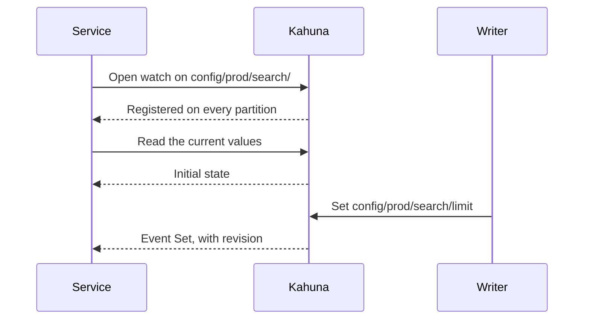

import Tabs from '@theme/Tabs';
import TabItem from '@theme/TabItem';

# Watch Persistent Key Changes

A service that keeps local copies of Kahuna data needs to know when those copies are stale. A key/value watch streams committed changes to one key, a prefix, or a key range. It can prompt a cache refresh, update a search index, or feed another service without repeatedly polling Kahuna. The idea is the same as an etcd watch. Unlike Redis keyspace notifications, each event carries the key's [revision](/docs/glossary/#revision), and with progress watermarks enabled a consumer can resume after a disconnect. Watches cover persistent keys only.

For a working CLI and client cache example, follow the [Watch Key Changes recipe](/docs/recipes/watch-key-changes/).

## Open a Watch

The clients open watches over persistent keys and return after registering them on every partition in the scope:

<Tabs groupId="client-examples">
<TabItem value="dotnet" label=".NET">

```csharp
using Kahuna.Client;
using Kahuna.Shared.KeyValue;

await using KahunaWatch watch = await client.WatchKeyValues(
    new KeyValueWatchRequest(
        KeyValueWatchScope.ForPrefix("config/prod/search/"),
        KeysOnly: true),
    cancellationToken);

await foreach (KeyValueWatchFrame frame in watch.ReadAllAsync(cancellationToken))
{
    if (frame.Event is { } change)
        Console.WriteLine($"{change.Kind}: {change.Key}");
    else if (frame.IsTerminal)
        Console.WriteLine($"Watch ended: {frame.Type}");
}
```

</TabItem>
<TabItem value="typescript" label="TypeScript">

```ts
import { watchPrefix } from "kahuna-client";

await using watch = await client.watchKeyValues({
  scope: watchPrefix("config/prod/search/"),
  keysOnly: true
});

for await (const frame of watch) {
  if (frame.type === "event") {
    console.log(`${frame.event!.kind}: ${frame.event!.key}`);
  } else if (frame.type === "lagged" ||
             frame.type === "historyUnavailable" ||
             frame.type === "refused") {
    console.log(`Watch ended: ${frame.type}`);
  }
}
```

</TabItem>
</Tabs>

Open the watch before reading the initial state. The watch reports changes after registration; it does not send the current value when it opens. Dispose it when done to close the streams on its serving nodes (`await using` in TypeScript, or `await watch.close()`).

In this order, any change committed after your read still reaches you as an event:



| Scope | .NET factory | TypeScript factory | Matches |
|---|---|---|---|
| Key | `ForKey("orders/42")` | `watchKey("orders/42")` | One exact key. |
| Prefix | `ForPrefix("orders/")` | `watchPrefix("orders/")` | Any key beginning with that text. |
| Range | `ForRange("orders", "orders/100", "orders/200")` | `watchRange("orders", "orders/100", "orders/200")` | Direct children of the `orders` key space from `orders/100` inclusive to `orders/200` exclusive. |

Prefix comparisons are ordinal. A range covers one key space: `orders/150` matches the example, while `orders/150/lines` does not. A prefix can span many [partitions](/docs/glossary/#partition). The client opens streams on the [replicas](/docs/glossary/#replica-and-replication-factor) needed to cover them, even when no single node hosts the whole scope.

## What the Stream Reports

An `Event` frame describes a committed `Set`, `Deleted`, or `Extended` mutation. It carries the key, kind, revision, commit timestamp, transaction ID, and partition ID. A `Set` also carries the new value unless `KeysOnly` is true. Deletes and extends have no value in the event. There is no previous value.

`Extended` means the key's expiry was refreshed. It **does not advance the revision**. The passing of an expiry time sends no watch event: expiration is local eviction rather than a committed mutation. A watch on ephemeral keys is refused because their writes do not enter the replicated log.

For a key, first deliveries of new revisions arrive in revision order, but an older event may be repeated. Events for different keys or partitions do not form one commit timestamp order. If you apply `Set` and `Deleted` values from events, discard revisions you have already applied. Handle `Extended` separately because it keeps the same revision; re-reading the key is a simple way to refresh its value and expiry. A keys-only watch is useful when every event triggers a read or cache eviction.

## When a Watch Ends

A watch can end with `Lagged` if its buffer fills, a connection drops, a serving partition changes, or the node cannot prove a continuous stream. `HistoryUnavailable` means a requested replay cannot be proven complete. `Refused` reports a watch that could not be opened. No events follow a terminal frame, and changes may be missing just before it.

For a cache, register a new watch and then refresh all state it covers. Registering first closes the gap between the new read and later changes. The [recipe](/docs/recipes/watch-key-changes/) shows this pattern for one flag. A service should also retry transient failures to open a watch with backoff.

## Resume a Complete Change Feed

Consumers that must process every change need progress watermarks and retained history. A `Progress` frame gives a timestamp for one partition: no event at or below that timestamp will arrive later on that partition. Store the latest watermark **for each partition** after your consumer has committed its own progress. Resume from those watermarks, never from the timestamp of the last event; events between progress frames can arrive out of timestamp order.

Progress frames and resume require `--commit-admission-lag-ms` to be positive and equal on every node. The default is `0`, which supports live watches but sends no progress watermarks. With the window enabled, a prepare or write whose timestamp falls outside the admitted window is refused retryably. Direct writes that first load the key from the backend mint their commit timestamp after that read, so cold-read latency does not consume their admission window. A larger lag window accommodates slower commits but keeps watermarks further behind. See [Server Configuration](/docs/server-configuration/#keyvalue-watch-and-history).

The .NET client can try automatic resume with `WatchKeyValues(request, autoResume: true)`; TypeScript uses `client.watchKeyValues(request, { autoResume: true })`. They reopen interrupted node streams from their latest progress watermarks when they have one for every partition in that stream. Replayed events can repeat. Range-map changes, watermark violations, refusals, and `HistoryUnavailable` still end the watch.

The log needed for replay can be compacted. A history hold pins a partition's log from a timestamp on its replicas for a leased period. The watch does not acquire holds automatically; consumers must acquire, renew, advance, and release them. A hold improves the chance of replay, but cannot restore history already lost. On `HistoryUnavailable`, rebuild from a fresh snapshot before continuing. The [source guide](https://github.com/kahunakv/kahuna/blob/main/docs/keyvalue-watch-streams-guide.md) walks through the snapshot and history hold workflow.

## Buffer and Connection Limits

A watch can overflow its own frame capacity or byte limit, or be ended because aggregate node buffering is too large. The per-watch byte default is 64 MiB; `--watch-max-buffered-bytes-per-node` defaults to **1 GiB** across all watches (`0` is unbounded). When a frame would exceed the node budget, the broker ends the watch currently buffering the most with `Lagged(Overflow)`, which may be a different watch from the one receiving that frame. Replay buffers and frames waiting behind pending intents count too. These are buffer accounting limits, not total process heap limits.

Keep the aggregate budget above `--max-value-bytes`. `kahuna.kv.watch.node_budget_overflows_total` counts these terminations; they also appear in `kahuna.kv.watch.streams_lagged_total`. Refresh or resume through the usual [watch recovery flow](#when-a-watch-ends); increasing one watch's capacity does not bypass the node budget.

REST watches write an SSE keep-alive comment after 15 idle seconds by default (`--watch-sse-keepalive-seconds`; `0` disables it). SSE clients ignore the comment. A failed keep-alive write closes the request and unregisters its watch; this helps detect disconnected idle clients, without guaranteeing an exact disconnect deadline.

`--max-concurrent-connections` defaults to 16,384 across the server's Kestrel listeners. Excess connections close immediately; `0` removes the cap. Peer connections count when Raft uses those listeners, so leave capacity for peers to reconnect. A connection can carry several watches; this limit is separate from watch-count limits. See [Server Configuration](/docs/server-configuration/#keyvalue-watch-and-history) for all watch limits.

## Interfaces

The .NET and TypeScript clients support watches over gRPC and REST. The server also provides bidirectional gRPC `Watch` and `POST /v1/kv/watch` as a server-sent-events stream. `kahuna-cli` can watch a prefix interactively or with `--watch`.

See [Revisions](/docs/distributed-keyvalue-store/revisions/) for per-key revision behavior and [Snapshot Holds](/docs/distributed-keyvalue-store/snapshot-holds/) for retaining historical values during snapshot reads. Snapshot holds protect key/value revisions; history holds protect the partition log used by watch replay.
