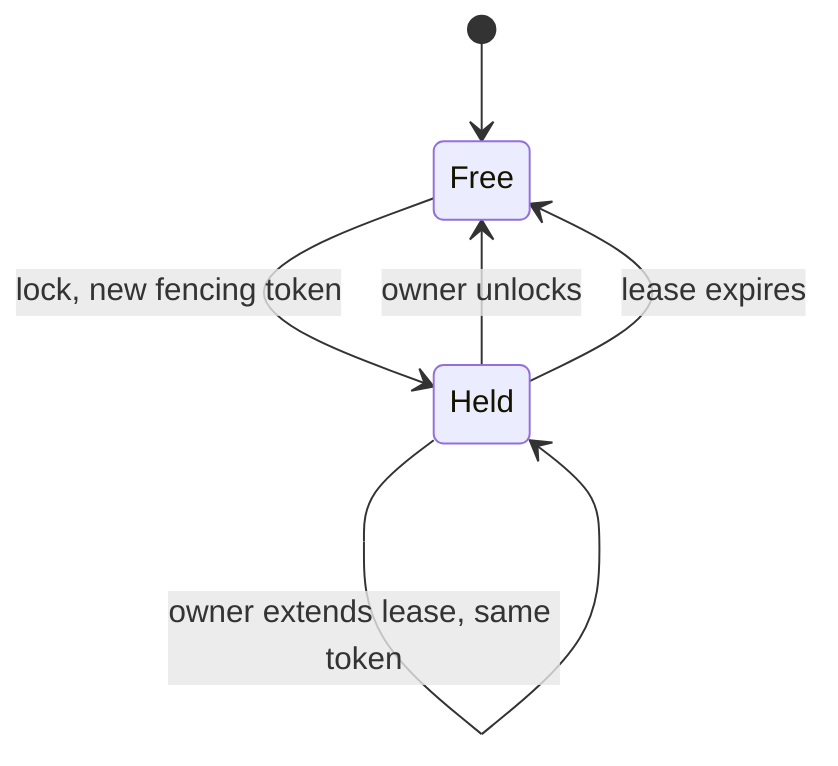

# Distributed Locks

import Tabs from '@theme/Tabs';
import TabItem from '@theme/TabItem';

In one process, a mutex or a `lock` statement guarantees that only one thread enters a critical section. Across several servers there is no shared memory to hold that mutex, and any server can pause or lose its network connection while it holds the lock. A distributed lock gives processes on different machines the same guarantee: one owner at a time, so they do not modify a shared resource concurrently.

Kahuna adds what a single-process lock does not need:

- **A [lease](/docs/distributed-locks/leases/):** every lock expires unless its owner extends it, so a crashed or disconnected owner cannot block it forever.
- **A [fencing token](/docs/distributed-locks/fencing-tokens/):** a number that increases each time the lock changes hands, so the resource you protect can reject a late write from an owner whose lease already expired.
- **Replication for persistent locks:** a persistent lock is stored by the replicas of its [partition](/docs/glossary/#partition) and committed by a [quorum](/docs/glossary/#quorum) through [Raft](/docs/glossary/#raft), so it stays consistent through node and network failures. Ephemeral locks are faster, but they live only in the partition leader's memory and are lost on a restart or leader change.

Kahuna batches persistent acquire, extend, and release operations per partition before proposing them to Raft. Bursts of requests that touch locks on the same partition therefore share fewer [WAL](/docs/glossary/#write-ahead-log-wal) appends and quorum round trips, with the same fencing-token and lease semantics.

A lock is either free or held. Only the current owner can extend or unlock it; a lock request from another owner is refused until the lease ends:



## Use Cases

- **Leader Election**: Elect a single leader in a cluster of services. Only one node should act as the leader at any time (e.g., for scheduling, replication). A distributed lock ensures only one process "wins" and holds the leadership.
- **Preventing Double Execution of Scheduled Jobs**: Ensure a cron job or background worker is executed only once across multiple nodes. In a horizontally scaled system, multiple nodes might try to run the same job. A distributed lock prevents multiple executions of the same scheduled task.
- **Safe Deployment CI/CD Coordination**: Prevent multiple CI/CD pipelines from deploying the same environment simultaneously. Two deployment jobs could conflict and cause downtime. Use a lock to serialize deployments.
- **Database Migration Coordination**: Ensure that only one service performs schema migration at startup. If multiple services run migrate up concurrently, it may corrupt the schema. Use a lock to ensure only the first instance runs migrations.
- **Session Control / Login Exclusivity**: Allow only one active session per user. Used in banking apps, gaming, admin consoles, etc.
- **Distributed Queue Consumer Coordination**: Keep two consumers from processing the same message at the same time. A lock alone does not guarantee the message is processed only once, because a consumer can crash after doing the work and before recording it. Record completion too; see [Idempotent Jobs](/docs/recipes/idempotent-jobs/).
- **Throttling or Rate-Limiting Across Services**: A global rate limit is a shared counter rather than a lock. Use the [distributed rate limiters](/docs/distributed-rate-limiting/), which also include lease-based concurrency limits.
- **External System Coordination**: Ensure only one node writes to an external system (e.g., shared database, billing API, payment gateway) to avoid double charges or inconsistent writes.

## API

The lock API has four operations: lock, unlock, extend, and get.

### Lock

<Tabs groupId="client-examples">
<TabItem value="api" label="API">

```csharp
Task<KahunaLock> GetOrCreateLock(
    string resource,
    TimeSpan expiry,
    LockDurability durability = LockDurability.Persistent
);
```

- **resource:** The identifier for the resource you want to lock.
- **expiry:** The duration for the lock lease.
- **durability:** Defines whether the lock durability is **Ephemeral** or **Persistent**.

**Returns:**
- **IsAcquired:** `true` if the lock was successfully acquired.
- **FencingToken:** A monotonically increasing token for that lock resource. Downstream systems can reject operations with an older token.
</TabItem>
<TabItem value="cli" label="CLI">

Acquire a lease on the resource `locks/tasks/123` for 10 seconds in the interactive shell:

```text
kahuna-cli> lock locks/tasks/123 10000
f1 acquired 786f947d8a6643f0b939865f72aa512a
```

Acquire a lease using command line arguments:

```bash
kahuna-cli --lock locks/tasks/123 --expires 10000
```
```text
f4 acquired 4e3c5d8ee76a4a1db268c81b048a002a
```

</TabItem>
<TabItem value="dotnet" label=".NET">

Acquire a lock in C#:

```csharp
await using KahunaLock myLock = await client.GetOrCreateLock(
    "balance-" + userId, 
    TimeSpan.FromSeconds(5)
);

if (myLock.IsAcquired)
{
    Console.WriteLine("Lock acquired!");

    // implement exclusive logic here
}
```
</TabItem>
<TabItem value="typescript" label="TypeScript">

```ts
const lock = await client.acquireLock("balance-" + userId, {
  expiry: 5000,
  durability: "persistent"
});

if (lock.acquired) {
  console.log("Lock acquired");

  // implement exclusive logic here
}
```

</TabItem>

<TabItem value="rest" label="REST">

Acquiring a lock from the REST API:

```bash
curl --location 'https://kahuna-dev.company.internal/v1/locks/try-lock' \
    --header 'Content-Type: application/json' \
    --data '{"resource":"locks/tasks/123", "owner":"ZTU5NDMwNjIzNTgxNDRiNGIwYmJmZjg4NjhmNzA2M2Q=", "expiresMs":10000, "durability":1 }'
```

`owner` is a byte array, so the REST API sends and returns it base64-encoded (here, the UTF-8 bytes of `e5943062358144b4b0bbff8868f7063d`). `durability` is numeric: `1` is persistent, `0` is ephemeral.

Response (`type` `0` means locked):

```json
{"servedFrom":"","type":0,"fencingToken":0,"route":{"partitionId":1,"endpoint":"https://kahuna-dev.company.internal","provenance":2,"generation":0}}
```

</TabItem>

</Tabs>

---

### Unlock

<Tabs groupId="client-examples">
<TabItem value="api" label="API">

```csharp
Task<bool> Unlock(
    string resource,
    byte[] owner,
    LockDurability durability = LockDurability.Persistent
);
```

- **resource:** The identifier for the resource to unlock.
- **owner:** The unique identifier for the lock previously used to acquire the lock.
- **durability:** Defines whether the lock durability is **Ephemeral** or **Persistent**.

**Returns:**
- **Unlocked:** `true` if the resource was successfully unlocked.

</TabItem>
<TabItem value="cli" label="CLI">

Unlock the acquired lease on the resource `locks/tasks/123` in the interactive shell:

```text
kahuna-cli> lock locks/tasks/123 10000
f1 acquired 786f947d8a6643f0b939865f72aa512a

kahuna-cli> unlock locks/tasks/123
f1 unlocked
```

Unlock the acquired lease using command line arguments:

```bash
kahuna-cli --lock locks/tasks/123 --expires 60000
```
```text
f4 acquired 4e3c5d8ee76a4a1db268c81b048a002a
```

```bash
kahuna-cli --unlock locks/tasks/123 --owner 4e3c5d8ee76a4a1db268c81b048a002a
```
```text
unlocked
```

</TabItem>
<TabItem value="dotnet" label=".NET">

Acquire a lock and release it manually in C#:

```csharp
KahunaLock myLock = await client.GetOrCreateLock(
    "balance-" + userId, 
    TimeSpan.FromSeconds(5)
);

if (myLock.IsAcquired)
{
    Console.WriteLine("Lock acquired!");

    // implement exclusive logic here
}

// Manually release the lock
bool unlocked = await myLock.TryUnlock();
```
</TabItem>
<TabItem value="typescript" label="TypeScript">

```ts
const lock = await client.acquireLock("balance-" + userId, {
  expiry: 5000
});

if (lock.acquired) {
  console.log("Lock acquired");

  // implement exclusive logic here
}

await lock.release();
```

</TabItem>
<TabItem value="rest" label="REST">

```bash
curl --location 'http://kahuna-dev.company.internal/v1/locks/try-unlock' \
    --header 'Content-Type: application/json' \
    --data '{"resource":"locks/tasks/123", "owner":"ZTU5NDMwNjIzNTgxNDRiNGIwYmJmZjg4NjhmNzA2M2Q=", "durability":1}'
```

Response (`type` `3` means unlocked):

```json
{"servedFrom":"","type":3,"fencingToken":0,"route":{"partitionId":1,"endpoint":"https://kahuna-dev.company.internal","provenance":2,"generation":0}}
```

</TabItem>
</Tabs>

---

### Extend

<Tabs groupId="client-examples">
<TabItem value="api" label="API">

```csharp
Task<(bool, long)> TryExtendLock(
    string resource,
    byte[] owner,
    TimeSpan duration,
    LockDurability durability = LockDurability.Persistent
);
```

- **resource:** The identifier for the resource you want to extend.
- **owner:** A unique identifier for the lock, usually associated with the client or process requesting the lock. It must be the current owner of the lock.
- **duration:** The new lock lease duration.
- **durability:** Defines whether the lock durability is **Ephemeral** or **Persistent**.

**Returns:**
- **Extended** (first item): `true` if the lock was successfully extended. If the lease already expired or another owner holds the lock, the call throws a `KahunaException` instead.
- **FencingToken** (second item): The current fencing token for that lock resource. Extending a lock keeps the same owner and token.

</TabItem>
<TabItem value="cli" label="CLI">

Extends the acquired lease on the resource `locks/tasks/123` in the interactive shell:

```text
kahuna-cli> lock locks/tasks/123 10000
f1 acquired 449941a969f74f8eb3d81cc70e5ab2ae

kahuna-cli> extend-lock locks/tasks/123 60000
f1 extended 449941a969f74f8eb3d81cc70e5ab2ae
```

Extend the acquired lease using command line arguments:

```bash
kahuna-cli --lock locks/tasks/123 --expires 60000
```
```text
f4 acquired 4e3c5d8ee76a4a1db268c81b048a002a
```

```bash
kahuna-cli --extend-lock locks/tasks/123 --owner 4e3c5d8ee76a4a1db268c81b048a002a --expires 60000
```
```text
f4 extended
```
</TabItem>
<TabItem value="dotnet" label=".NET">

Acquire a lock and extend it in C#:

```csharp
await using KahunaLock myLock = await client.GetOrCreateLock(
    "balance-" + userId, 
    TimeSpan.FromSeconds(5)
);

if (myLock.IsAcquired)
{
    Console.WriteLine("Lock acquired!");

    // implement exclusive logic here

    // Extend the lock
    await myLock.TryExtend(TimeSpan.FromSeconds(60));
}

```
</TabItem>
<TabItem value="typescript" label="TypeScript">

```ts
await using lock = await client.acquireLock("balance-" + userId, {
  expiry: 5000
});

if (lock.acquired) {
  // implement exclusive logic here
  await lock.extend(60_000);
}
```

</TabItem>
<TabItem value="rest" label="REST">

```bash
curl --location 'http://kahuna-dev.company.internal/v1/locks/try-extend' \
    --header 'Content-Type: application/json' \
    --data '{"resource": "locks/tasks/123", "owner": "ZTU5NDMwNjIzNTgxNDRiNGIwYmJmZjg4NjhmNzA2M2Q=", "expiresMs": 60000, "durability": 1}'
```

Response (`type` `2` means extended):

```json
{"servedFrom":"","type":2,"fencingToken":0,"route":{"partitionId":1,"endpoint":"https://kahuna-dev.company.internal","provenance":2,"generation":0}}
```

</TabItem>

</Tabs>

---

### Get

<Tabs groupId="client-examples">
<TabItem value="api" label="API">

```csharp
Task<KahunaLockInfo?> GetLockInfo(
    string resource,
    LockDurability durability = LockDurability.Persistent
);
```

- **resource:** The identifier for the resource you want to get information.
- **durability:** Defines whether the lock durability is **Ephemeral** or **Persistent**.

**Returns:**
- **Owner:** The current owner of the lock.
- **FencingToken:** The current fencing token for that lock resource.

</TabItem>
<TabItem value="cli" label="CLI">

Obtains information about the lock `locks/tasks/123` in the interactive shell:

```text
kahuna-cli> lock locks/tasks/123 10000
f1 acquired 449941a969f74f8eb3d81cc70e5ab2ae

kahuna-cli> get-lock locks/tasks/123
f1 449941a969f74f8eb3d81cc70e5ab2ae
```

`get-lock` is available only in the interactive shell, and only for locks acquired in the same session. There is no single-command `kahuna-cli` option to read lock information; use a client or the REST API instead.
</TabItem>
<TabItem value="dotnet" label=".NET">

Read information about a lock in C#:

```csharp
await using KahunaLock myLock = await client.GetOrCreateLock(
    "group-leader-" + groupId,
    expiry: TimeSpan.FromSeconds(5)
);

if (!myLock.IsAcquired)
{
    Console.WriteLine("Lock not acquired!");

    var lockInfo = await myLock.GetInfo();

    if (lockInfo?.Owner is not null)
    {
        Console.WriteLine($"Lock owner: {Encoding.UTF8.GetString(lockInfo.Owner)}");
        Console.WriteLine($"Expires: {lockInfo.Expires}");
    }
}

```
</TabItem>
<TabItem value="typescript" label="TypeScript">

```ts
await using lock = await client.acquireLock("group-leader-" + groupId, {
  expiry: 5000
});

if (!lock.acquired) {
  const lockInfo = await client.getLockInfo("group-leader-" + groupId);

  if (lockInfo?.owner) {
    console.log(`Lock owner: ${new TextDecoder().decode(lockInfo.owner)}`);
    console.log(`Expires: ${lockInfo.expires.physical}`);
  }
}
```

</TabItem>
<TabItem value="rest" label="REST">

```bash
curl --location 'https://kahuna-dev.company.internal/v1/locks/get-info' \
    --header 'Content-Type: application/json' \
    --data '{"resource": "locks/tasks/123", "durability": 1}'
```

Response (`type` `4` means the lock information was found; `expires` is a hybrid logical clock timestamp, with `l` in Unix milliseconds):

```json
{"servedFrom":"","type":4,"owner":"ZTU5NDMwNjIzNTgxNDRiNGIwYmJmZjg4NjhmNzA2M2Q=","expires":{"n":3,"l":1792804089571,"c":0},"fencingToken":0,"route":{"partitionId":1,"endpoint":"https://kahuna-dev.company.internal","provenance":2,"generation":0}}
```

</TabItem>

</Tabs>

## Important Considerations

- **Choose the durability per lock.** A persistent lock survives node restarts and leader changes, and its fencing token always increases. An ephemeral lock is faster but lives only in the partition leader's memory. A node restart, a leader change, or eviction of an idle lock entry loses it: another worker can acquire it before the lease would have ended, and its fencing token count restarts at `0`. Use ephemeral locks only where a short overlap between two holders is acceptable. See [Durability Levels](/docs/architecture/durability-levels/) and [Leases During a Leader Change](/docs/distributed-locks/leases/#leases-during-a-leader-change).
- **A lease can end while its owner is still working.** Extend the lease as you work and stop when an extend fails ([Renewing a Lease](/docs/distributed-locks/leases/#renewing-a-lease)). Send the [fencing token](/docs/distributed-locks/fencing-tokens/) with every write to the resource you protect, so a late writer is rejected.
