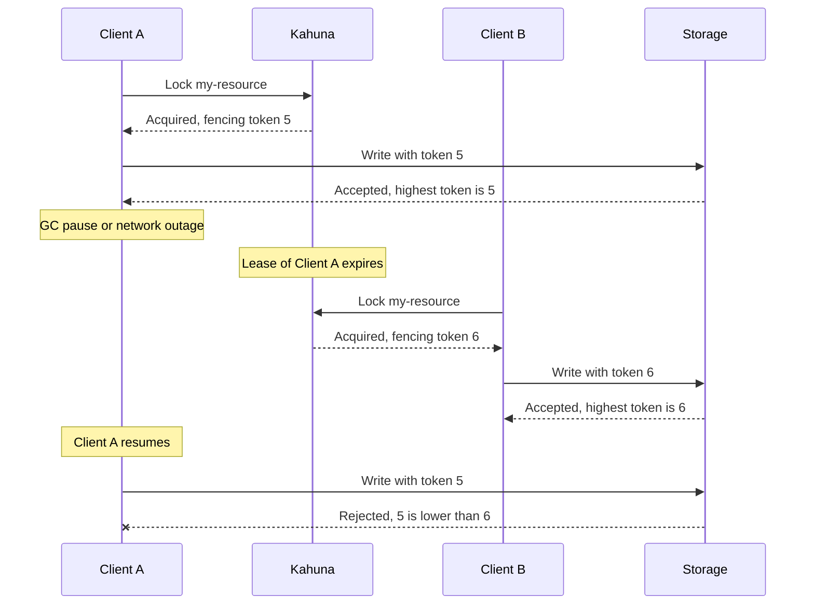

import Tabs from '@theme/Tabs';
import TabItem from '@theme/TabItem';


# Fencing Tokens

A lock [lease](/docs/distributed-locks/leases/) can expire while its holder is still running. A long garbage-collection pause, a slow network, or an overloaded VM can freeze a process for longer than its lease. Kahuna then correctly gives the lock to another client, but the paused process does not know that. When it resumes, it continues as if it still held the lock, and two processes write to the same resource.

A paused process cannot check anything while it is paused, so the lease alone cannot prevent this. A **fencing token** lets the protected resource itself reject the late writer.

A fencing token is a number that increases each time the lock is acquired. Kahuna returns it as `FencingToken` with every lock acquisition.

Use fencing tokens when a lock protects writes to another system, such as a database, a file store, or an external API, and a duplicate or out-of-order write would cause damage. The protected system must store the highest token it has accepted and reject lower ones; Kahuna cannot perform that check for systems outside the cluster.

## Lock Acquisition

A client acquires a lock on a resource name, such as `my-resource`, with a lease. Kahuna keeps a fencing token for each lock, an incrementing counter.

## Using the Fencing Token

When a client acquires the lock, it receives the fencing token and sends it with every operation to the services the lock protects. Each service rejects an operation whose token is lower than the highest one it has seen.

## Handling Client Failures

If a client pauses or crashes and its lease expires, Kahuna does not delete the lock; the lease simply stops being valid.
Another client can now acquire the lock with a new lease and gets the previous fencing token plus one.
For persistent locks the token always increases. For ephemeral locks it increases only while the lock entry stays in the partition leader's memory: after a node restart, a leader change, or eviction of an idle entry, the count restarts at `0`.
When the first client resumes, downstream systems reject its operations because its fencing token is lower.



## Checking the Token in the Protected Resource

The check and the write must happen in one step. If the resource first reads the highest token and then writes in a separate request, a late writer can slip in between.

When the protected data lives in Kahuna, one [Kahuna Script](/docs/scripts/) does both. It stores the highest accepted token next to the data and rejects an older one. The script runs as one transaction, so the check and both writes take effect together or not at all:

```kahuna
let last = get @token_key
if not is_null(last) && to_int(@token) < to_int(last) then
  throw "stale fencing token"
end
set @token_key @token
set @data_key @data
```

Keys and values are strings, so `to_int` compares the tokens as numbers (otherwise `"10"` would sort before `"9"`). An equal token is accepted, so the current holder can write several times. `throw` rolls the transaction back, and the client receives the error.

Pass the fencing token from the lock:

<Tabs groupId="client-examples">
<TabItem value="dotnet" label=".NET">

```csharp
const string WriteIfNotStale = """
    let last = get @token_key
    if not is_null(last) && to_int(@token) < to_int(last) then
      throw "stale fencing token"
    end
    set @token_key @token
    set @data_key @data
    """;

try
{
    await client.ExecuteKeyValueTransactionScript(
        WriteIfNotStale,
        parameters: [
            new() { Key = "@token_key", Value = "reports/daily/fencing-token" },
            new() { Key = "@data_key", Value = "reports/daily" },
            new() { Key = "@token", Value = myLock.FencingToken.ToString() },
            new() { Key = "@data", Value = report }
        ]
    );
}
catch (KahunaException ex) when (ex.Message.StartsWith("stale fencing token"))
{
    // A newer lock holder already wrote. Discard this result.
}
```

</TabItem>
<TabItem value="typescript" label="TypeScript">

```ts
const writeIfNotStale = client.loadScript(`
let last = get @token_key
if not is_null(last) && to_int(@token) < to_int(last) then
  throw "stale fencing token"
end
set @token_key @token
set @data_key @data
`);

try {
  await writeIfNotStale.run({
    parameters: [
      { key: "@token_key", value: "reports/daily/fencing-token" },
      { key: "@data_key", value: "reports/daily" },
      { key: "@token", value: String(lock.fencingToken) },
      { key: "@data", value: report }
    ]
  });
} catch (error) {
  if (!(error instanceof Error && error.message.startsWith("stale fencing token"))) throw error;
  // A newer lock holder already wrote. Discard this result.
}
```

</TabItem>
</Tabs>

For a resource outside Kahuna, apply the same rule with that system's single conditional write, for example an update that only succeeds when the stored token is not higher than yours.

## Additional Recommendations

Long GC pauses and poor network conditions can still make two processes believe they hold the same lock. To reduce the risk:

 - In clients built with garbage-collected languages and platforms, prioritize using concurrent or low-pause GC algorithms to avoid prolonged stop-the-world events that could delay lease renewals or lock releases.
 - Send the fencing token with every write to a protected resource, so a stale holder's writes are rejected.
 - Configure automatic lease expiration with a safety buffer that accounts for potential GC pauses, poor network conditions, retry delays, and temporary unavailability of external services.
