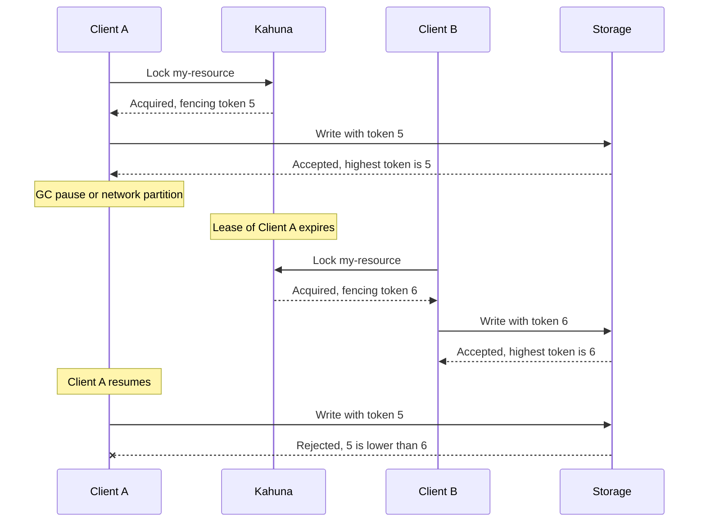

# Fencing Tokens

A lock [lease](/docs/distributed-locks/leases/) can expire while its holder is still running. A long garbage-collection pause, a slow network, or an overloaded VM can freeze a process for longer than its lease. Kahuna then correctly gives the lock to another client, but the first process does not know that yet. When it resumes, it continues as if it still held the lock, and two processes write to the same resource.

Leases alone cannot prevent this, because a paused process cannot check anything while it is paused. A **fencing token** lets the protected resource itself reject the late writer.

A fencing token is a monotonically increasing number (e.g., version number) issued every time a lock is acquired. It acts as a logical timestamp to resolve stale client operations. Kahuna returns it as `FencingToken` with every lock acquisition.

Use fencing tokens when a lock protects writes to another system, such as a database, a file store, or an external API, and a duplicate or out-of-order write would cause damage. The protected system must store the highest token it has accepted and reject lower ones; Kahuna cannot perform that check for systems outside the cluster.

How Leases + Fencing Tokens can provide Strong Mutual Exclusion:

## Lock Acquisition:

A client tries to acquire a lock by creating a key in Kahuna (e.g., my-lock-resource) with a lease.
Along with the key, Kahuna maintains a fencing token, typically an incrementing counter.

## Using the Fencing Token:

When a client successfully acquires the lock, it receives the fencing token.
All downstream services that the client interacts with must validate the fencing token.
These services should reject any operation with a stale fencing token (i.e., a token lower than the highest one they've seen).

## Handling Client Failures:

If a client pauses or crashes and its lease expires, Kahuna deletes the lock key.
Another client can now acquire the lock with a new lease and gets a higher fencing token.
Even if the first client resumes and tries to perform actions, downstream systems will reject its operations because its fencing token is outdated.

Example Flow:

- Client A acquires the lock with fencing token #5.
- Client A writes to a resource, passing #5.
- Client A experiences a network partition or pause.
- Kahuna lease expires, and Client B acquires the lock with fencing token #6.
- Client B writes to the same resource, passing #6.
- Client A comes back online and tries to write again with fencing token #5, but downstream systems reject it because they've already processed token #6.

## Additional Recommendations:

Since long GC pauses or occasional poor network conditions can lead to situations where two processes believe they hold the same lock, it’s important to follow these best practices:

 - In clients built with garbage-collected languages and platforms, prioritize using concurrent or low-pause GC algorithms to avoid prolonged stop-the-world events that could delay lease renewals or lock releases.
 - Use fencing tokens whenever possible to prevent conflicts and duplicate processing in cases where two clients mistakenly assume ownership of the same lock.
 - Configure automatic lease expiration with a safety buffer that accounts for potential GC pauses, poor network conditions, retry delays, and temporary unavailability of external services.
