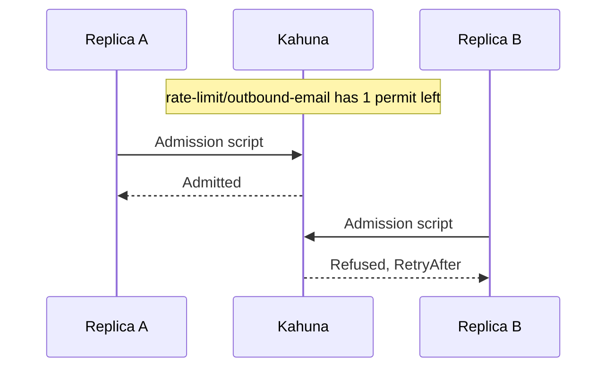

import Tabs from '@theme/Tabs';
import TabItem from '@theme/TabItem';

# Distributed Rate Limiting

A rate limiter rejects or delays work once a caller exceeds an allowed budget, such as 100 requests per minute per user or 20 outbound emails per 10 seconds. It protects your services, downstream APIs, and paid quotas from overload and abuse.

.NET already includes rate limiters in `System.Threading.RateLimiting`, and the ASP.NET Core rate-limiting middleware builds on them, but they count in the memory of one process. When your application runs as several replicas behind a load balancer, each replica enforces its own copy of the limit:

```text
Limit: 100 requests/minute per user

In-memory limiter, 5 replicas:   each replica allows 100  ->  the user gets up to 500
Kahuna limiter, 5 replicas:      all replicas share 100   ->  the user gets 100
```

The effective limit also changes every time the application scales up or down. A common fix is a shared counter in Redis, updated with `INCR` or a Lua script. Kahuna's limiters take the same approach: they keep the budget in one shared key, so every replica draws from the same counter and the limit holds regardless of the replica count.

**Use them when** a limit must hold across all instances of an application: per-user or per-tenant API quotas, calls to a third-party API with a hard quota, or a cap on concurrent jobs across a worker fleet. **Keep the in-memory limiters when** a per-instance limit is acceptable, because each Kahuna admission decision costs a network round trip to the cluster.

The .NET client provides four limiters that implement the standard `System.Threading.RateLimiting.RateLimiter` API, so they work with the ASP.NET Core rate-limiting middleware and with code that already uses that API. The TypeScript client (`kahuna-client`) provides the same four limiters (`KahunaFixedWindowRateLimiter`, `KahunaSlidingWindowRateLimiter`, `KahunaTokenBucketRateLimiter`, and `KahunaConcurrencyLimiter`), plus `KahunaPartitionedRateLimiter`, `rateLimitKeyFor`, and Express, Connect, and `node:http` middleware in `kahuna-client/middleware`. For custom algorithms built with scripts, see the [Rate Limiting recipe](/docs/recipes/rate-limiting/).

Use the same limiter type, [durability](/docs/glossary/#durability), and settings on every replica sharing a key. Settings are copied when a limiter is constructed; changing the options object afterward has no effect. Reserve separate keys for unrelated policies. Each caller interprets the state with its own configuration, so changing limits or sharing a key between algorithms is not a coordinated migration.

## Packages

The APIs below target .NET 10 and require Kahuna 1.10.11 or later:

```bash
dotnet add package Kahuna.Client
# For ASP.NET Core middleware integration:
dotnet add package Kahuna.Client.AspNetCore
```

`Kahuna.Client.RateLimiting` contains the limiters and partition helpers. The separate ASP.NET Core package supplies extensions in `Microsoft.AspNetCore.RateLimiting`; worker applications do not need the ASP.NET Core shared framework.

In TypeScript, `npm install kahuna-client` provides the limiters; the HTTP middleware is the `kahuna-client/middleware` entry point of the same package and depends on no web framework.

## Choosing an Algorithm

Each limiter keeps its state in Kahuna under the `Key` you configure. Every admission decision runs one short [Kahuna Script](/docs/scripts/) on the server that reads the state, decides, and writes the state back as a single transaction. A separate read followed by a write would let two replicas see the same count and both be admitted. Window and token-bucket scripts read the time from `hlc()`, the cluster's [hybrid logical clock](/docs/glossary/#hybrid-logical-clock-hlc), instead of the application's wall clock.

In the diagram, two replicas share one token-bucket key with one permit left. Their admission scripts take effect one at a time, so only the first is admitted:



| Class | State and admission rule |
|---|---|
| `KahunaFixedWindowRateLimiter` | One counter with windows aligned to `hlc()`'s physical milliseconds. Each window admits up to `PermitLimit` permits. Requests on opposite sides of a boundary can spend two windows' budgets close together. |
| `KahunaSlidingWindowRateLimiter` | One value containing segment counters. Permits are reclaimed when their segment leaves the window. This is a segmented approximation, not an exact rolling timestamp log. |
| `KahunaTokenBucketRateLimiter` | One value containing tokens and last replenishment time. A missing bucket starts at `TokenLimit`; requests add `TokensPerPeriod` for each elapsed whole `ReplenishmentPeriod`, capped at the limit. No refill timer is required. |
| `KahunaConcurrencyLimiter` | One expiring key per acquired lease directly under `<Key>/`. Admission sums live lease permits and creates a new lease if capacity remains. |

Time and window boundaries:

- `hlc()` returns the physical (millisecond) component of the HLC on the coordinating node. It is not a monotonic elapsed-time timer, so clock advances can move window and refill boundaries.
- Fixed-window and replenishment durations are truncated to whole milliseconds.
- The sliding-window segment length is `floor(Window.TotalMilliseconds / SegmentsPerWindow)`, so the effective window can be shorter than configured.
- A sliding window can return a segment's permits up to one segment early, before each individual request in it is a full window old.

## Direct Client Use

<Tabs groupId="client-examples">
<TabItem value="dotnet" label=".NET">

```csharp
using Kahuna.Client;
using Kahuna.Client.RateLimiting;
using System.Threading.RateLimiting;

KahunaClient kahuna = new(["https://kahuna1:8082", "https://kahuna2:8084"]);

await using KahunaTokenBucketRateLimiter limiter = new(kahuna, new()
{
    Key = "rate-limit/outbound-email",
    TokenLimit = 20,
    TokensPerPeriod = 5,
    ReplenishmentPeriod = TimeSpan.FromSeconds(10)
});

using RateLimitLease lease = await limiter.AcquireAsync(1);
if (!lease.IsAcquired)
{
    if (lease.TryGetMetadata(MetadataName.RetryAfter, out TimeSpan retryAfter))
        Console.WriteLine($"Retry after {retryAfter}");
    return;
}

await SendEmailAsync();
```

</TabItem>
<TabItem value="typescript" label="TypeScript">

```ts
import { KahunaClient, KahunaTokenBucketRateLimiter } from "kahuna-client";

const kahuna = new KahunaClient({
  endpoints: ["https://kahuna1:8082", "https://kahuna2:8084"]
});

await using limiter = new KahunaTokenBucketRateLimiter(kahuna, {
  key: "rate-limit/outbound-email",
  tokenLimit: 20,
  tokensPerPeriod: 5,
  replenishmentPeriodMs: 10_000
});

const lease = await limiter.acquire(1);
if (lease.acquired) {
  await sendEmail();
} else if (lease.retryAfterMs !== null) {
  console.log(`Retry after ${lease.retryAfterMs} ms`);
}
```

</TabItem>
</Tabs>

Both limiters run the same scripts against the same key, so a .NET replica and a TypeScript replica configured like this spend one shared budget. Pass a `CancellationToken` (.NET) or `{ signal }` (TypeScript) to bound the wait when a queue is enabled.

Use `AcquireAsync`: synchronous `AttemptAcquire` always refuses because it cannot perform the required network I/O. Permit counts may range from zero to the configured limit; an oversized request throws. An asynchronous zero-permit request checks whether at least one permit is available without consuming it. It does not reserve capacity for a later call.

Disposing a window or token-bucket lease does not refund consumed permits. A concurrency lease starts background release when disposed; keep it alive for the duration of the work.

## HTTP Middleware Policies

<Tabs groupId="client-examples">
<TabItem value="dotnet" label=".NET">

```csharp
using Kahuna.Client;
using Kahuna.Client.RateLimiting;
using Microsoft.AspNetCore.RateLimiting;
using System.Globalization;
using System.Threading.RateLimiting;

var builder = WebApplication.CreateBuilder(args);
builder.Services.AddSingleton(new KahunaClient(
    ["https://kahuna1:8082", "https://kahuna2:8084"]));

builder.Services.AddRateLimiter(options =>
{
    options.RejectionStatusCode = StatusCodes.Status429TooManyRequests;
    options.OnRejected = (context, _) =>
    {
        if (context.Lease.TryGetMetadata(MetadataName.RetryAfter, out TimeSpan retryAfter))
            context.HttpContext.Response.Headers.RetryAfter =
                Math.Ceiling(retryAfter.TotalSeconds).ToString(CultureInfo.InvariantCulture);
        return ValueTask.CompletedTask;
    };

    options.AddKahunaFixedWindowLimiter("api", o =>
    {
        o.PermitLimit = 100;
        o.Window = TimeSpan.FromMinutes(1);
    });

    options.AddKahunaTokenBucketLimiter("per-client",
        context => context.Connection.RemoteIpAddress?.ToString() ?? "unknown",
        o =>
        {
            o.TokenLimit = 20;
            o.TokensPerPeriod = 5;
            o.ReplenishmentPeriod = TimeSpan.FromSeconds(10);
        });
});

var app = builder.Build();
app.UseRateLimiter();
app.MapGet("/status", () => "ok").RequireRateLimiting("api");
app.MapPost("/work", () => Results.Accepted()).RequireRateLimiting("per-client");
app.Run();
```

</TabItem>
<TabItem value="typescript" label="TypeScript">

```ts
import express from "express";
import { KahunaClient } from "kahuna-client";
import { kahunaRateLimit } from "kahuna-client/middleware";

const kahuna = new KahunaClient({
  endpoints: ["https://kahuna1:8082", "https://kahuna2:8084"]
});

const app = express();

// Key: rate-limit/api
const api = kahunaRateLimit({
  client: kahuna,
  policy: "api",
  fixedWindow: { permitLimit: 100, windowMs: 60_000 }
});

// Keys: rate-limit/per-client/<address>
const perClient = kahunaRateLimit<express.Request>({
  client: kahuna,
  policy: "per-client",
  partitionBy: (req) => req.ip ?? "unknown",
  tokenBucket: { tokenLimit: 20, tokensPerPeriod: 5, replenishmentPeriodMs: 10_000 }
});

app.get("/status", api, (req, res) => res.send("ok"));
app.post("/work", perClient, (req, res) => res.sendStatus(202));
app.listen(3000);
```

</TabItem>
</Tabs>

In ASP.NET Core, the four extensions are `AddKahunaFixedWindowLimiter`, `AddKahunaSlidingWindowLimiter`, `AddKahunaTokenBucketLimiter`, and `AddKahunaConcurrencyLimiter`. Each accepts a policy name and configuration callback, optionally a `Func<HttpContext, string>` partition selector, and optionally an explicit client as the last argument. Otherwise the client comes from request services. The middleware follows its initial synchronous refusal with asynchronous acquisition. For identity-based partition selectors, configure authentication and place its middleware before `UseRateLimiter`.

In TypeScript, `kahunaRateLimit` from `kahuna-client/middleware` works with Express, Connect, and `node:http`. For a handler that takes a `Request` and returns a `Response` (Hono, Bun, Deno, route handlers), wrap it with `withKahunaRateLimit`. A refused request gets status 429 and a `Retry-After` header in whole seconds when the cluster can tell when the budget frees up; `rejectionStatusCode` and `onRejected` change the answer. Invalid settings throw when the middleware is built. Close each policy when the application stops: `await api.policy.close()`.

Without a partition selector (`partitionBy` in TypeScript), the default state key is `rate-limit/<policy>`. With one, it is `rate-limit/<policy>/<partition>`; an empty partition string uses the policy key. Both clients name the same keys, so a .NET replica and a TypeScript replica with the same policy name and settings share one budget, provided their partition selectors return the same string for the same caller. In .NET the callback receives this default in `o.Key` and can replace it; in TypeScript, set `keyPrefix` or pass a settings function. The callback runs once at registration to validate settings and again when each partition limiter is created. Partition strings are concatenated directly into stored keys; hash sensitive identifiers and choose names that avoid collisions.

Outside middleware, build partitioned limiters with `KahunaRateLimitPartition.GetFixedWindowLimiter`, `GetSlidingWindowLimiter`, `GetTokenBucketLimiter`, or `GetConcurrencyLimiter` in .NET, or with `KahunaPartitionedRateLimiter` and `rateLimitKeyFor` in TypeScript:

<Tabs groupId="client-examples">
<TabItem value="dotnet" label=".NET">

```csharp
using PartitionedRateLimiter<string> tenants =
    PartitionedRateLimiter.Create<string, string>(tenant =>
        KahunaRateLimitPartition.GetFixedWindowLimiter(kahuna, tenant, key => new()
        {
            Key = KahunaRateLimitPartition.KeyFor("tenant-api", key),
            PermitLimit = 1000,
            Window = TimeSpan.FromMinutes(1)
        }));
```

</TabItem>
<TabItem value="typescript" label="TypeScript">

```ts
import {
  KahunaFixedWindowRateLimiter,
  KahunaPartitionedRateLimiter,
  rateLimitKeyFor
} from "kahuna-client";

await using tenants = new KahunaPartitionedRateLimiter((tenant) =>
  new KahunaFixedWindowRateLimiter(kahuna, {
    key: rateLimitKeyFor("tenant-api", tenant),
    permitLimit: 1000,
    windowMs: 60_000
  })
);

const lease = await tenants.acquire("tenant-17");
```

</TabItem>
</Tabs>

Disposal of an idle partition does not delete its budget state. A later limiter using the same key resumes whatever state remains in Kahuna.

## Settings and Queueing

| Common option | Default | Meaning |
|---|---|---|
| `Key` | empty; required | Shared state key or concurrency bucket. |
| `Durability` | `Ephemeral` | Memory state; lost state resets counters or releases concurrency capacity. `Persistent` uses persistent script commands and durable transaction finalization. |
| `QueueLimit` | `0` | Maximum **permits**, not requests, waiting in this process. Zero refuses without queueing. |
| `QueueProcessingOrder` | `OldestFirst` | Local queue order. `NewestFirst` can refuse oldest waiters to make room. |
| `FailureMode` | `Throw` | Behavior when a decision cannot be obtained: propagate, admit (`Allow`), or refuse (`Deny`). |
| `MaxRetries` | `8` | Additional attempts for `Aborted` or `MustRetry`, with randomized bounded backoff. Other failures are not retried by the limiter. |

The TypeScript limiters take the same options in camelCase (`key`, `durability`, `queueLimit`, `queueProcessingOrder`, `failureMode`, `maxRetries`) with the same defaults and the same retry rule. Durations are milliseconds: `windowMs`, `replenishmentPeriodMs`, `leaseDurationMs`, and `queuePollIntervalMs`.

Required settings per algorithm:

- **Fixed and sliding windows:** a positive `PermitLimit` and window.
- **Sliding windows** also need `SegmentsPerWindow` between 1 and 1000, and at least one millisecond per segment.
- **Token buckets:** positive `TokenLimit` and `TokensPerPeriod`, and a replenishment period of at least one millisecond.
- **Concurrency:** a positive `PermitLimit`, a `LeaseDuration` of at least 30 ms (default 30 seconds), and a `QueuePollInterval` of at least 1 ms (default 50 ms).

Queues and fairness are local, even though the budget is shared:

- Window and bucket refusals normally carry `RetryAfter`. It is a computed wait, not a reservation or a guarantee of admission. Concurrency refusals have no retry time.
- Queued requests retry after the `RetryAfter` delay, or poll every 50 ms when there is none. The concurrency limiter polls at its configured `QueuePollInterval`.
- A local concurrency release wakes the queue after its release attempt completes.
- Cancellation removes a waiting request. With a queue enabled, `Deny` can keep a caller waiting through cluster failures; use cancellation to bound the wait.

`GetStatistics()` reports this limiter's successful/failed lease counts and local queued permit count. Available permits reflect its last observation, potentially already spent by another replica; these are not cluster-wide authoritative statistics.

## Guarantees and Failure Limits

Each decision is a transaction, so when callers compete for the same budget, Kahuna's transaction conflict handling makes their admissions take effect one at a time. This does not make a request and its external work one transaction, or provide exactly-once admission across a lost response. Do not assume a transport failure means no state was consumed. See [transaction outcome handling](/docs/architecture/distributed-transactions/).

`FailureMode.Allow` grants a lease without recording a cluster permit when acquisition fails, so it deliberately stops enforcing the limit. `Deny` refuses instead; `Throw` exposes the error. Caller cancellation remains cancellation under all three modes.

Choose durability by what a reset costs you, because the two levels differ in both price and failure behavior:

- **Ephemeral** (the default) keeps the state only in the memory of the [partition](/docs/glossary/#partition) leader. An admission costs no replication, but a node restart, a leader change, or eviction loses the state: window and bucket budgets start over, and held concurrency permits are freed.
- **Persistent** turns every granted admission into a replicated write. The script's write commits only after a [quorum](/docs/glossary/#quorum) of the partition's replicas accepts it, so each admission pays [Raft](/docs/glossary/#raft) replication latency. A refusal writes nothing.

See [Durability Levels](/docs/architecture/durability-levels/) for the general trade-off.

Persistent state is replicated and stored on disk, so it survives restarts and failover, but persistence does not eliminate clock effects, TTL expiry, uncertain responses, or lease renewal failures. Fixed-window and token-bucket ephemeral scripts can use the [single-key fast path](/docs/scripts/single-key-fast-path/). Sliding-window scripts and concurrency bucket scans use the general transaction path.

Concurrency leases renew about every `LeaseDuration / 3` with a conditional write that only updates an existing key, so an expired lease is not recreated.

- When a renewal returns `NotSet`, the limiter removes its local held-lease entry and wakes its queue. A network failure alone leaves the lease eligible for another renewal round.
- Renewal is best-effort. If the key expires while its holder is still working, another caller can acquire that capacity. The returned lease does not signal the loss or cancel the work.
- The limiter bounds the number of live permit keys, not the number of operations still running after a pause or a lost connection. No [fencing token](/docs/glossary/#fencing-token) protects the external work.

Releasing and disposing:

- Lease disposal deletes the key in the background. If the delete fails, the key expires on its own.
- Limiter disposal stops renewal and refuses queued waiters. It does not immediately delete outstanding leases.
- Async limiter disposal waits for release tasks that are already pending, so dispose held leases before the limiter when prompt release matters.
- Do not store unrelated keys directly under a concurrency limiter's bucket: its admission script reads every live value there as a permit count.
