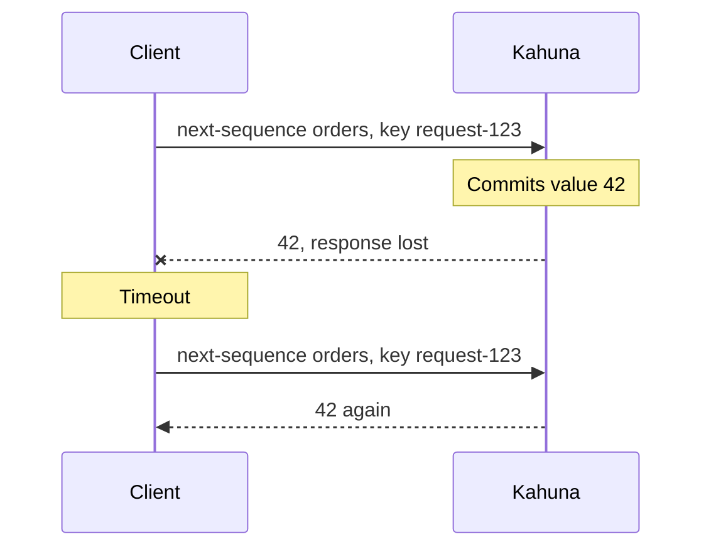

import Tabs from '@theme/Tabs';
import TabItem from '@theme/TabItem';

# Idempotent Retries

An idempotency key lets you retry a sequence allocation safely when you do not know whether the first attempt succeeded, the same way an idempotency key on a payment API keeps a retry from charging twice. `next` and `reserve` both accept an optional idempotency key.

## Why It Matters

A client can time out after Kahuna commits an allocation but before the response reaches the caller. Without an idempotency key, the retry allocates a new value, so one business operation gets two IDs, for example two order numbers for one order. The first value is never used, which also leaves a gap.

With an idempotency key, retrying the same allocation request returns the original committed allocation.

## Example Flow

The client sends `next-sequence orders` with the idempotency key `request-123`, loses the response, and retries with the same key:



## Choosing a Key

Derive the key from the business operation, not from the request, for example `order-{orderId}`. Every retry of that operation then sends the same key, even when a different process or a redelivered message makes the retry. A key generated fresh for each attempt does not protect anything.

<Tabs groupId="client-examples">
<TabItem value="dotnet" label=".NET">

```csharp
long orderNumber = await client.NextSequenceValue(
    "orders",
    idempotencyKey: $"order-{orderId}"
);
```

</TabItem>
<TabItem value="typescript" label="TypeScript">

```ts
const orderNumber = await client.nextSequenceValue("orders", {
  idempotencyKey: `order-${orderId}`
});
```

</TabItem>
</Tabs>

Calling this twice for the same `orderId` returns the same number both times, within the retention limits below. A key describes one request: retrying it with a different `count` in `reserve` fails with `InvalidInput` instead of returning a different allocation.

## How Long a Retry Is Recognized

Kahuna stores idempotency records in the sequence's replicated record, so they survive restarts and leader changes. It does not keep them forever. Two limits apply to each sequence:

| Limit | Default | Server option |
|---|---|---|
| Records kept per sequence | 256; the oldest is dropped first | `--sequencer-idempotency-retention-max` (`0` removes the cap) |
| Age of a record | 10 minutes | `--sequencer-idempotency-retention-ttl`, in seconds (`0` disables age pruning) |

A retry within both limits returns the original allocation. After its record is dropped, a retry with the same key allocates **new** values, so the operation gets a second number and the first becomes a gap. On a sequence that receives more than 256 keyed requests within 10 minutes, the count limit is reached first and the effective window is shorter.

If retries can arrive later than that, for example when a queue redelivers a message hours later, store the allocated value with the business record and check it before allocating again. See [Server Configuration](/docs/server-configuration/#workers-and-runtime) for the options.

## When to Use It

Use idempotency keys for:

- HTTP clients with automatic retry policies.
- Job workers that may restart while processing.
- Message consumers that may receive duplicate messages.
- Any allocation request where duplicate consumption would be expensive or unsafe.

## Gaps

Kahuna guarantees uniqueness and monotonicity for committed allocations, not universal gaplessness.

Gaps can still happen when:

- A request commits and the caller retries without the same idempotency key.
- A retry arrives after its idempotency record was dropped (see [How Long a Retry Is Recognized](#how-long-a-retry-is-recognized)).
- A caller reserves a range and does not consume every value.
- A sequence owner abandons the unused part of an in-memory block after restart, eviction, or ownership change.
- A sequence is deleted and recreated with new parameters.
- A sequence is updated, which starts a new incarnation and clears old idempotency records.

If a domain requires strict auditability, store the allocated value together with the business operation that consumed it.

## Updates and Incarnations

Idempotency records belong to the sequence incarnation that created them. When `update` changes a sequence, Kahuna increments `Incarnation` and clears the idempotency map. Retrying an old idempotency key after the update allocates from the new incarnation instead of replaying an allocation from the old one.
