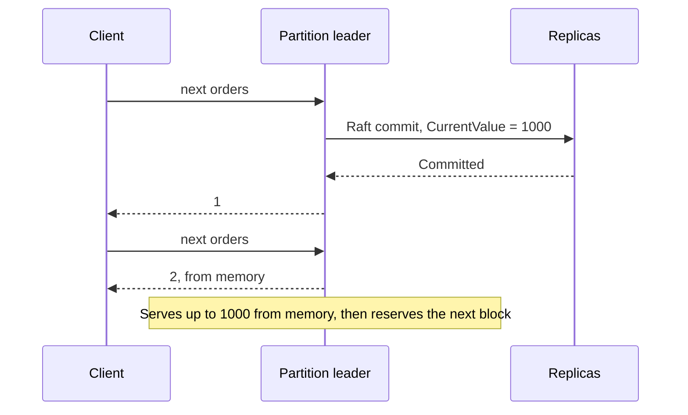
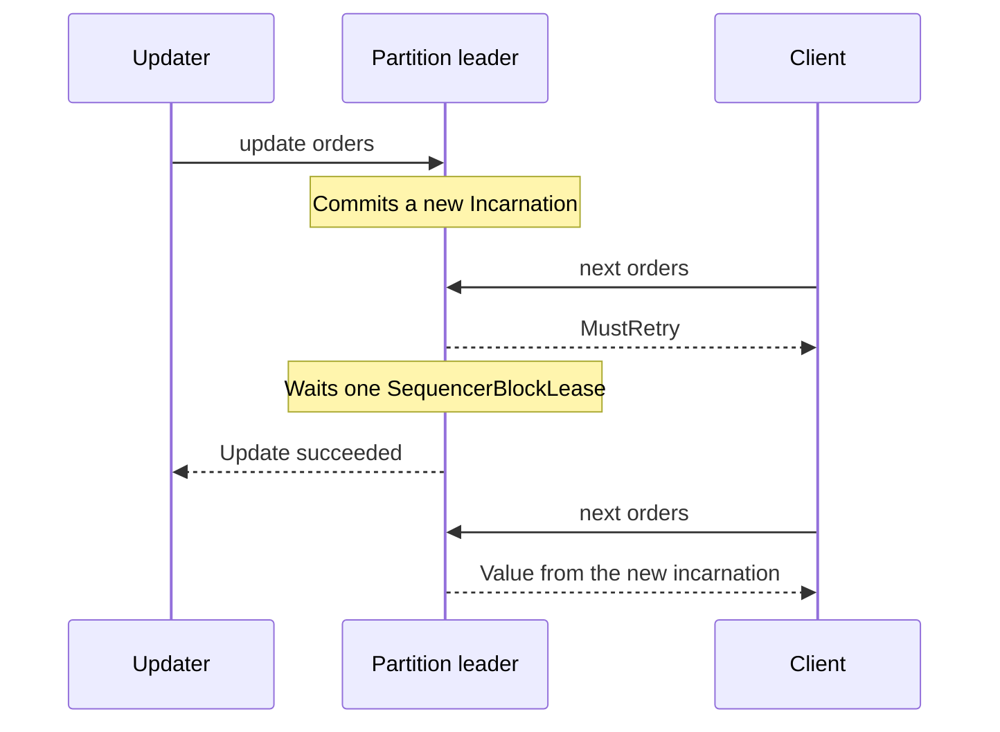

# Sequence Model and Allocation

A Kahuna sequence is a named counter, like a database identity column that several services can share. Values increase per sequence name, not globally across every sequence in the cluster. Read this page to understand how values are allocated, why `CurrentValue` can be ahead of the values your application has used, and what an update changes.

## State

| Field | Description |
|-------|-------------|
| `Name` | The sequence name, such as `orders` or `tenant-a/invoices`. |
| `CurrentValue` | The highest committed value for the sequence. |
| `InitialValue` | The starting point. The first allocated value is `InitialValue + Increment`. |
| `Increment` | The step between allocated values. |
| `MaxValue` | Optional upper bound. |
| `BlockSize` | Optional per-sequence block size. If unset, the sequence follows the server-wide `SequencerBlockSize`. |
| `Incarnation` | Value-stream generation. It increases when the sequence is updated. |
| `Revision` | Sequence metadata revision. |
| `Durability` | Currently `Persistent`. |
| `CreatedAt` | [Hybrid logical clock (HLC)](/docs/glossary/#hybrid-logical-clock-hlc) timestamp when the sequence was created. |
| `UpdatedAt` | HLC timestamp when the sequence was last changed. |

Defaults:

- `InitialValue`: `0`
- `Increment`: `1`
- `MaxValue`: `null`
- `BlockSize`: `null`
- `Durability`: `Persistent`

With the defaults, the first allocated value is `1`.

The sequence record is stored under the reserved internal key `__kahuna:sequences:{name}`. Public key/value and lock APIs reject the `__kahuna:` namespace so application code cannot overwrite sequence state directly.

## Next Value

`next` allocates one value. The sequence is owned by the [leader](/docs/glossary/#leader-follower-and-learner) of its partition, which usually serves the value from an in-memory block that it already reserved durably.

With the default block size of `1000`, the first allocation for a sequence created at `0` reserves `1..1000` in one [Raft](/docs/glossary/#raft) commit. `GetSequence` then reports `CurrentValue = 1000`, even if only a few values from that block have been handed out. Treat `CurrentValue` as the reserved high-water mark, not the last value consumed by an application.

The diagram shows the first two `next` calls on a new `orders` sequence. Only the first one waits for a Raft commit:



## Range Reservation

`reserve` allocates a contiguous range. If `orders` has `CurrentValue = 100`, `Increment = 1`, and the caller reserves `50`, Kahuna returns:

```text
Start = 101
End = 150
Count = 50
```

Range reservations for the same sequence do not overlap. After the reservation commits, the sequence current value is `150`.

## Block Size

`SequencerBlockSize` controls how many values the owner reserves in one durable write. The owner reserves a block with a [compare-and-set](/docs/glossary/#compare-and-set-cas) on the sequence record, which fails if the record changed since the owner read it. A larger block amortizes one Raft commit across more values. A smaller block reduces skipped values after restarts, evictions, or ownership changes.

A sequence can override the server-wide value with its own `blockSize` at create or update time:

```bash
kahuna-cli --create-sequence invoices --block-size 1
kahuna-cli --update-sequence invoices --current-value 5000 --block-size 1
kahuna-cli --update-sequence invoices --remove-block-size
```

Use `blockSize = 1` for domains that need one durable commit per value. This is safer for strict human-facing numbering, but it is much slower than cached blocks.

## Updating a Sequence

`update` rewrites sequence parameters without deleting the record. It can set:

| Field | Effect |
|-------|--------|
| `currentValue` | New reserved high-water mark. The next value is this value plus `increment`. |
| `increment` | New positive step between values. |
| `initialValue` | New recorded starting value. It does not move the counter by itself. |
| `maxValue` | New upper bound. |
| `removeMaxValue` | Remove the upper bound. |
| `blockSize` | New per-sequence block size. Must be at least `1`. |
| `removeBlockSize` | Return the sequence to the server-wide block size. |

An update starts a new `Incarnation` and clears stored idempotency entries. Guarantees such as uniqueness are scoped to one incarnation, so lowering `currentValue` can intentionally reissue numbers used by an older incarnation.

A node that owned the sequence earlier may still hold an old in-memory block. So that it cannot keep serving values from that block, Kahuna waits one `SequencerBlockLease` (five seconds by default) before reporting a successful update, and allocations for that sequence return `MustRetry` in the meantime:



Client and proxy deadlines for sequence updates should be longer than `SequencerBlockLease`.

If `SequencerBlockLease` is `0`, sequence update is refused because stale blocks cannot be safely waited out.

## Max Value

If `MaxValue` is set and an allocation would exceed it, Kahuna returns `MaxValueExceeded` and does not partially allocate the request.

For example, if `CurrentValue = 98`, `MaxValue = 100`, and a caller reserves `5`, the request fails because it would need `99..103`.
