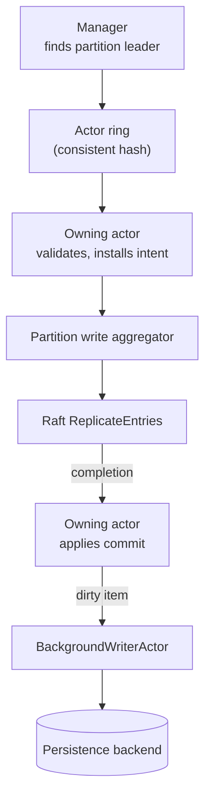

# Actor Model

An actor is a single-threaded owner of state: it holds part of a node's in-memory data and processes one message at a time, so the code inside it needs no locks. Read this page to understand where a request waits inside a node and why work on one key never races with other work on the same key.

Kahuna builds its actors on the Nixie actor library. They are not just a concurrency convenience; they define the ownership boundaries for locks, key/value entries, proposals, and background persistence.

## Why Actors

Actors give Kahuna:

- Single-message-at-a-time execution for each worker.
- Predictable ownership of in-memory maps and B-trees.
- Backpressure through actor mailboxes and bounded request admission.
- Separate pools for ephemeral and persistent objects.
- A clean split between request routing, proposal handling, and state mutation.

## Manager Layer

`KahunaManager` creates the main subsystems:

- `LockManager`
- `KeyValuesManager`
- `SequencerManager`
- `TransactionCoordinator`
- `BackgroundWriterActor`
- the selected `IPersistenceBackend`

The managers are responsible for locating [partition](/docs/glossary/#partition) leaders, forwarding remote requests, and choosing the right actor ring or router.

## Lock Actors

`LockManager` starts separate fixed rings for ephemeral and persistent lock actors:

- `ephemeral-lock-*`
- `persistent-lock-*`

Like key/value routing, a `LockActorRing` resolves the owning actor by consistent hash at the call site, so a lock request reaches its actor without a router-actor mailbox hop.

`LockActor` keeps lock state in memory in a dictionary keyed by resource name. It processes operations such as acquire, extend, release, and get. Because each actor processes one message at a time, lock ownership and [fencing-token](/docs/glossary/#fencing-token) updates are serialized for the resources routed to that actor.

Persistent locks queue dirty state to `BackgroundWriterActor` after committed changes.

## Key/Value Actors

`KeyValuesManager` starts separate fixed rings for ephemeral and persistent key/value actors:

- `ephemeral-keyvalue-*`
- `persistent-keyvalue-*`

`KeyValueActor` keeps an ordered in-memory B-tree of `KeyValueEntry` values. It also tracks:

- [Write intents](/docs/glossary/#write-intent) for individual keys
- Prefix write intents for bucket reads
- Range locks and range-oriented routing state
- Active proposals
- Recent revisions
- [MVCC](/docs/glossary/#mvcc) entries

Consistent-hash routing keeps operations for the same key or bucket stable across a worker set. Key/value routing resolves the target actor directly at the call site rather than through a separate router actor. This avoids an extra mailbox hop on the hot path and keeps the same key-to-actor mapping.

Each key/value actor can also reject ordinary user messages when its bounded inbox is full. Kahuna maps that rejection to retryable `MustRetry` backpressure. Control messages such as proposal completions, cache-coherence updates, flush acknowledgements, collection, and snapshot-floor probes are exempt so a hot-key flood cannot strand already in-flight work.

## Replication Submission

Persistent lock mutations and persistent key/value mutations both use the shared partition write aggregator.

For a direct persistent key/value write or a persistent lock mutation, the owning `KeyValueActor` or `LockActor` validates the mutation, installs the replication intent, serializes the log record, and submits a compact request to the aggregator. The aggregator performs the [Raft](/docs/glossary/#raft) `ReplicateEntries` call off the actor mailbox and sends completion back to the owning actor.

A request that changes durable state is not considered committed simply because a local actor accepted it. The mutation must be replicated and committed through Raft first.

The diagram follows a persistent write through these actors, from the manager to the materialized backend.

## Transaction Coordination

The transaction coordinator owns transaction-wide state, but participant work still runs through the key/value actors that own the affected keys, buckets, or ranges.

For interactive transactions, the coordinator records operation registration, confirmed effects, locks, read observations, finalization state, and optional durable decision metadata. Background actors handle the long-running maintenance paths:

- `TransactionReaperActor` closes and rolls back abandoned sessions when it can do so safely.
- `PreparedIntentRecoveryActor` settles or presume-aborts durable prepared intents on partitions this node currently leads.

## Background Writer

`BackgroundWriterActor` is a dedicated actor for materialized persistence. Lock and key/value actors enqueue dirty items, and the background writer flushes them in batches. This avoids blocking request actors on every backend write.

The background writer also tracks partitions that need checkpoints after dirty objects are flushed. For durable transaction decisions, checkpointing must persist completion receipts and coordinator decision snapshots before advancing the [write-ahead log (WAL)](/docs/glossary/#write-ahead-log-wal) retention floor for the relevant partition.
