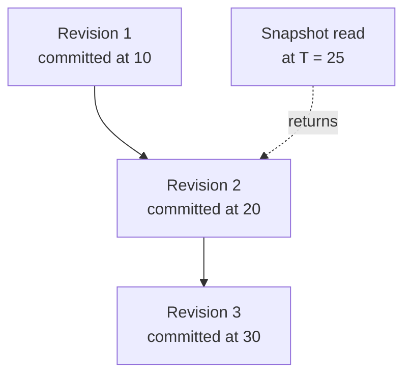

# MVCC and Transactions

MVCC (multi-version concurrency control) means keeping several versions of each key instead of overwriting one value in place. Kahuna uses it to hold a transaction's proposed values next to the committed value, and to keep older committed revisions for historical reads. Read this page for the per-key details behind transaction conflicts and snapshot reads: MVCC entries, write intents, revisions, and the snapshot floor that protects long-lived historical reads.

The transaction coordinator, operation registration, the finalization fence, and [two-phase commit](/docs/glossary/#two-phase-commit-2pc) are described in [Transaction Lifecycle](/docs/internals/transaction-lifecycle/). For the design and when to use each mode, see [Distributed Transactions](/docs/architecture/distributed-transactions/).

## Transaction IDs

Transactions use [Hybrid Logical Clock (HLC)](/docs/glossary/#hybrid-logical-clock-hlc) timestamps as transaction IDs. HLC timestamps provide ordering that works across nodes while still preserving causal progression. MVCC entries and write intents are keyed by this ID.

## MVCC Entries

`KeyValueEntry` stores the current value and metadata for a key. It can also hold `MvccEntries`, keyed by transaction ID. Each `KeyValueMvccEntry` contains a proposed or versioned value plus revision, expiration, state, and HLC metadata.

This lets Kahuna keep transactional state separate from the committed current value until the transaction commits.

The first latest transactional point read pins a committed value or absence per key, including a committed unsettled intent. These pins do not form a common transaction-start snapshot. Follow-up point reads or writes can abort immediately if the observation is stale; finalization still validates registered dependencies.

Snapshot reads are different. A read at a fixed HLC timestamp selects the newest revision whose commit timestamp is at or before that timestamp. Because it is a historical view, it does not create a live read dependency for latest-state validation.

In this example (timestamps simplified), revision 3 committed after the read timestamp, so a read at `T = 25` returns revision 2.

## Write Intents

A write intent records that a transaction intends to modify a key. Kahuna uses write intents to prevent conflicting updates and to make commit/rollback deterministic.

There are three important levels:

- **Key write intent**: protects a single key.
- **Prefix write intent**: protects a bucket or prefix, which matters for operations such as `get by bucket`.
- **Range write intent or lock**: protects an ordered interval, which matters for bounded range reads.

Prefix and range locks block conflicting mutations while held. They are leader-local and can disappear on failover; range renewal is best-effort, so validation remains necessary.

Pessimistic transactions acquire these locks before or during operations; optimistic transactions read without exclusive locks and validate read observations and concurrent write intents at commit. See [Locking Modes](/docs/distributed-keyvalue-store/transactions/#locking-modes).

Unprepared session-owned write intents and no-expiry range locks have a liveness ceiling. If the owning transaction disappeared and the ceiling has passed, the next touch can drop the orphaned state instead of letting it block reads or scans forever. Prepared durable intents are exempt because their outcome belongs to the canonical decision record.

## Revisions and Snapshots

Each key tracks a revision counter. Reads can request a specific revision, and recent revisions can be cached. Transactions use revision and HLC metadata to decide which value is visible and whether a concurrent write invalidates a commit attempt.

`SET ... NOREV` still advances the current revision but intentionally skips the archived historical revision record. That reduces write amplification for cache-style values, but it also means a skipped revision cannot be served later by `GET ... AT <revision>` or by a historical snapshot read that needs that exact archived version.

## Snapshot Floor

The MVCC snapshot floor protects historical reads that must remain valid for longer than the normal revision-retention window. A client acquires a leased snapshot hold at timestamp `T`; while that hold is live, cleanup must keep the revision that was visible at or before `T`, plus every newer revision.

The reported effective floor is the minimum timestamp across live holds. The pruning floor includes all registered holds, even expired ones, until replicated release or purge. Hold state is replicated through [partition 0](/docs/glossary/#partition-0) (the system partition) and restored from local snapshots. Acquire, renew, and release operations can enter through any node, but they are routed to the partition 0 leader before being committed.

The floor constrains both revision cleanup paths:

- In memory, Kahuna keeps the normal newest `RevisionRetention` revisions, the floor boundary, and committed archive revisions whose backend flush is still pending. Unflushed revisions can exceed the retention target.
- On disk, persistent revision cleanup must not delete the boundary revision or anything newer, even when count-based or age-based retention would otherwise remove it.

Historical reads first try the in-memory archive. If the requested timestamp is older than the in-memory window, persistent read paths fall back to on-disk revision history. Point reads, range reads, bucket reads, and prefix scans all use the same rule: return the newest revision whose commit timestamp is at or before the requested snapshot timestamp.

When a snapshot floor pins a boundary revision, the in-memory archive can become the pinned boundary plus the newest retained revisions. If the revisions between them have been trimmed from memory, Kahuna treats a boundary hit inside that gap as a cache miss and falls back to persisted revision history. This prevents a held floor from returning an older value when a newer disk-only revision is actually visible at the requested timestamp.

Large snapshot scans can continue through backend revision history without loading every scanned key back into the hot actor cache. This keeps historical analytics and recovery-style reads from displacing current working-set entries just because old revisions live on disk.

Persistent cleanup is budgeted. A targeted cleanup pass deletes at most `PersistentRevisionCleanupBatchSize` records and stops when `PersistentRevisionCleanupTimeBudget` expires, leaving remaining keys queued for later. This keeps revision pruning from monopolizing the persistence writer when a small set of keys has very deep history.

After restart, durable snapshot holds are loaded with a startup grace window before expired leases are purged. That grace keeps a timestamp protected long enough for a holder to renew after full-cluster downtime, provided the underlying historical revisions are still present.

The hold API is described in [Snapshot Holds](/docs/distributed-keyvalue-store/snapshot-holds/).

## Historical Read Fences

Safe-time waits cover live writers that may commit at or before the requested timestamp. The serving actor folds eligible read timestamps into its HLC, and durable commit timestamps are minted above the maximum participant staged timestamp. A read more than five seconds ahead of the serving HLC returns `MustRetry` instead of being served unfenced; `kahuna.kv.snapshot_clock_fence_refused_total` counts refusals. Retry the same cluster-minted timestamp once the clock catches up; a caller-created future timestamp may remain refused.

Disk-history fallback returns `MustRetry` while needed committed revisions are unflushed. `kahuna.kv.revisions.retained_unflushed_total` counts retention beyond the memory target; `kahuna.kv.revisions.history_reads_fenced_total` counts fenced fallback reads. TTL uses the current read time, not historical time. Snapshot holds protect retention and cannot recreate pruned or `NOREV` history.

See [Transaction Reads and Locks](/docs/distributed-keyvalue-store/read-and-lock-semantics/) for newer-head precedence over lingering intents, point-lock convergence, and range-lock compatibility. [Durable Settlement](/docs/internals/durable-settlement/) covers the optional materializing-resolve encoding.

The shared default for in-memory `RevisionRetention` is **4** across core, embedded, and server configuration. `--revisions-to-cache` is applied on clustered servers and rejects values below 1. Persistent keys can consult older disk history subject to retention/fences; ephemeral keys cannot recover older revisions after memory history is trimmed.
