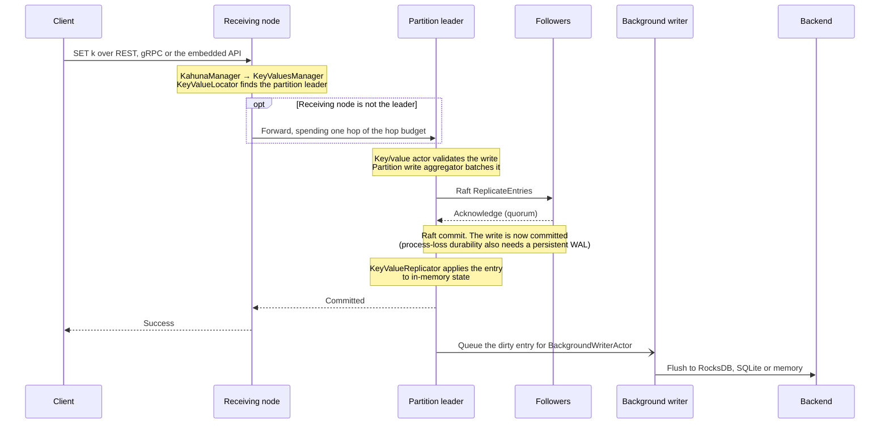

# Request Flow

Read this page when you diagnose request latency, unexpected forwarding between nodes, or a `MustRetry` result. It follows a request through a Kahuna node: transport, routing, [actors](/docs/glossary/#actor), [Raft](/docs/glossary/#raft), transaction coordination, and background persistence.

## Entry Points

A request can enter Kahuna through:

- REST
- gRPC
- the embedded in-process API
- inter-node gRPC forwarding

The public transport layer parses the request and calls the `IKahuna` surface. From there, `KahunaManager` delegates to the subsystem that owns the operation:

| Operation family | Manager |
|------------------|---------|
| Locks | `LockManager` |
| Key/value operations | `KeyValuesManager` |
| Scripts and transactions | `KeyValuesManager` plus `TransactionCoordinator` |
| Sequences | `SequencerManager` |
| Backup and restore | `BackupService` |

Clients may contact any node. If the receiving node is not the leader for the target [partition](/docs/glossary/#partition), Kahuna routes or forwards the request to the current leader. With replica placement, the receiving node may also be a non-host for that partition; it resolves a hosting replica and forwards the request instead of rejecting it only because it has no local copy.

When routing hints are enabled, successful key/value, lock, and sequence responses can include the client-reachable endpoint for the resolved owner. The hint is emitted after the server has already resolved the request, so it affects only later client endpoint selection.

Forwarded requests carry a small hop budget. During elections or placement-map transitions, two nodes can briefly disagree about the right owner for a partition. When the hop budget is exhausted, Kahuna returns `MustRetry` instead of forwarding again, so clients retry after the routing view settles.

Transaction priority admission runs only after this leader routing. Followers do not queue transaction starts they will not execute. When a script or interactive session is admitted after waiting, Kahuna starts it with the [HLC](/docs/glossary/#hybrid-logical-clock-hlc) timestamp from admission time, not from the time it first entered the queue.

## Routing

Routing decides which partition and actor own the operation.

- Point key/value operations route by key.
- Bucket reads route by bucket prefix.
- Ordered range reads route through range metadata.
- Lock operations route by resource name.
- Sequence operations route through the sequence's reserved key/value key.
- Live transaction sessions route by coordinator key.
- Durable transaction decisions route by record anchor key.

Bucket, prefix-lock, and range-lock prefixes are normalized before routing. A bare key-space name and the same name with one trailing slash resolve to the same actor and partition.

Routing has two layers:

1. **Partition routing** finds the Raft partition leader that is allowed to commit the operation.
2. **Actor routing** chooses the local actor worker that owns the in-memory state for that key, bucket, range, or resource.

This split lets Kahuna distribute ownership across the cluster while keeping each actor's mutable state single-threaded.

## Persistent Key/Value Write

A normal persistent key/value write follows this path:



The important boundary is Raft commit. A persistent write is not durable just because the local actor accepted it. The mutation becomes committed only after the partition's Raft group commits the log entry, and it survives process loss only when the Raft log uses persistent WAL storage with durable write settings.

After commit, Kahuna applies the log entry to the in-memory state machine and queues materialized persistence. The background writer flushes the latest state and selected revision history to the configured backend. Later checkpoints allow Raft to compact older [write-ahead log (WAL)](/docs/glossary/#write-ahead-log-wal) entries that are no longer needed for normal recovery or [point-in-time recovery (PITR)](/docs/glossary/#point-in-time-recovery-pitr).

## Ephemeral Key/Value Write

An ephemeral write follows the same routing to the partition leader and its ephemeral key/value actor, but it updates only that leader's in-memory state, with no Raft proposal and no backend flush. See [Durability Levels](/docs/architecture/durability-levels/) for what ephemeral values survive.

## Reads and Snapshot Reads

Latest reads route to the partition leader that owns the key, bucket, or range. The actor reads from its in-memory state first. For historical reads, Kahuna selects the newest archived revision whose commit timestamp is at or before the requested snapshot timestamp.

Historical reads use this order:

1. Try the in-memory revision archive.
2. If the required persistent revision is older than the in-memory window, fall back to persisted revision history.
3. Return only keys visible at the requested HLC timestamp.

Snapshot range scans can continue from persisted revision history off the hot actor path when the needed revision is no longer cached. That keeps large historical scans from forcing old keys back into the actor's current working set.

Snapshot holds can pin a timestamp so cleanup does not remove the persistent revisions needed by a long-lived historical view.

## Script Execution

Kahuna Script runs server-side. The script executor parses the script, binds parameters, and uses the transaction coordinator for multi-statement or explicit transaction execution.

```text
client
  -> ExecuteKeyValueTransactionScript
  -> ScriptTransactionExecutor
  -> TransactionCoordinator
  -> command execution through KeyValuesManager
  -> stage MVCC entries
  -> prepare and commit or rollback
```

Simple one-command scripts may be optimized into the direct command path. Multi-statement scripts and explicit `begin` blocks use the full transaction path.

When `MaxConcurrentTransactions` is enabled, multi-statement and explicit transaction scripts pass through the script transaction admission gate. Single-command scripts do not open a transaction and are not gated.

## Interactive Transaction Operation

Interactive transaction sessions are available over gRPC and REST. A session begins with a transaction handle that contains a transaction ID and coordinator key.

When `MaxConcurrentSessions` is enabled, session start passes through the session admission gate. The session holds that slot until it commits, rolls back, or is reaped.

Each transaction-scoped operation follows a registered path:

```text
client session call
  -> operation ID and declaration
  -> route to transaction coordinator
  -> BeginOperation
  -> route to participant leader
  -> execute read, write, lock, extend, or delete
  -> CompleteOperation with confirmed effects
  -> fold effect into server-owned working set
```

The operation ID is stable for one logical SDK call. If a response is lost and the same operation is retried, the coordinator and participant cache can recognize it and avoid applying the same mutation twice.

Only confirmed effects enter the transaction working set. Failed conditional writes and failed lock acquisitions are not committed to the working set.

## Commit and Rollback

Commit, rollback, close, and abandoned-session cleanup share one finalization gate.

Finalization follows this shape:

1. Close the transaction to new operations.
2. Wait for operations registered before the close to finish or reach a safe retry state.
3. Freeze the server-owned working set.
4. Split the working set into read-only, ephemeral, persistent, or mixed commit paths.
5. Validate reads when the policy requires it.
6. Prepare modified participants through [two-phase commit](/docs/glossary/#two-phase-commit-2pc).
7. Decide commit or abort.
8. Release locks, [write intents](/docs/glossary/#write-intent), and [MVCC](/docs/glossary/#mvcc) read state.
9. Retain the terminal outcome for a bounded idempotency window.

A retryable finalization failure returns `MustRetry`. The session stays closed to new operations, and the caller should retry the same commit or rollback with the same handle.

## Durable Commit Decision Flow

When the frozen working set modifies persistent keys, finalization prepares replicated intents on every modified partition and records the outcome in one canonical transaction record, under either decision-durability policy. With the default deferred settlement, `Committed` returns once that record is durable, and reads that meet a still-pending intent resolve it through the record. See [Durable-Intent Two-Phase Commit](/docs/internals/transaction-lifecycle/#durable-intent-two-phase-commit) for the full sequence and [Completion Receipts](/docs/internals/transaction-lifecycle/#completion-receipts-and-range-movement) for how recovery proves a participant already committed.

## Recovery and Background Work

Several background paths continue after request handling:

- `BackgroundWriterActor` flushes materialized persistent state and revision history.
- Raft restore replays committed logs after restart.
- `TransactionReaperActor` closes and rolls back abandoned sessions when possible.
- `PreparedIntentRecoveryActor` resolves prepared intents from canonical transaction records.
- Backup and PITR jobs flush storage checkpoints and copy committed WAL segments.
- Range split and merge operations transfer correctness metadata before cutover.

These paths use the same routing and leadership rules as request traffic. A background actor that no longer leads the relevant partition must retry or let the new leader continue.

## Failure Boundaries

The request flow has a few important boundaries:

- A local actor accepting work is not the same as a persistent commit; Raft commit is the durable ordering point.
- The transaction coordinator owns the working set; clients do not supply it at commit time.
- `MustRetry` means the caller should retry the same operation or finalization, not start adding new work to a closed transaction.
- Durable decision mode protects the durable finalization path, not the whole active transaction from `Begin`.
- Ephemeral data can participate in transactions, but it cannot be part of a durable commit decision.

For the full transaction path, see [Transaction Lifecycle](/docs/internals/transaction-lifecycle/).
