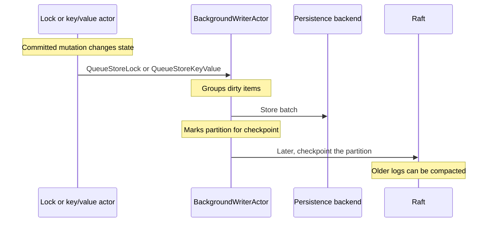

# WAL and Persistence

Read this page to understand what a persistent write survives after it commits, and why a node's disk use grows or shrinks over time. Kahuna has two durability layers that serve different purposes:

- **Raft WAL**: the authoritative replicated operation log managed by Kommander, Kahuna's [Raft](/docs/glossary/#raft) library.
- **Kahuna persistence backend**: materialized lock and key/value state used for fast recovery and lookup.

Keeping these layers separate matters. The WAL records committed operations in order. The persistence backend stores the latest durable object state and selected revision data.

## Raft WAL

Every persistent mutation goes through a Raft [partition](/docs/glossary/#partition). The partition leader appends a log entry and replicates it to followers. Once the entry is committed, Kahuna applies it to the in-memory state machine.

The Raft WAL is responsible for:

- Preserving committed operation order
- Allowing followers to catch up
- Restoring uncheckpointed committed logs after restart
- Supporting leader failover without losing committed operations

Kahuna uses Kommander for Raft. Depending on configuration, WAL storage can be backed by memory, RocksDB, or SQLite.

## Direct Write Coalescing

Persistent partition writes use a leader-local partition write aggregator before they enter Raft. The aggregator can combine non-transactional `SET`, `DELETE`, `EXTEND`, persistent lock acquire, extend, and unlock proposals, durable transaction-finalization records, and durable settlement records for the same partition into one `ReplicateEntries` call.

This optimization applies across requests. A `SetManyKeyValues(...)` call and independent single-key writes can land in the same partition queue if they target the same partition at the same time.

The aggregator does not coalesce ephemeral writes or open transaction staging. Ephemeral writes do not use Raft, and open transactions stage [write intents](/docs/glossary/#write-intent) through the transaction coordinator. Durable transaction records enter the aggregator when finalization writes canonical records, prepared-intent deltas, materialization records, and settlement deltas. By default, committed durable values materialize by reference to the prepared intent already held on each replica.

See [Partition Write Coalescing](/docs/architecture/partition-write-coalescing/) for tuning options and metrics.

## Materialized State

Kahuna's persistence backend is represented by `IPersistenceBackend`. It stores:

- Lock entries
- Key/value entries
- Key/value revisions
- Bucket/prefix lookup data
- Checkpointed transaction recovery metadata such as completion receipts and coordinator decisions

Implementations include:

- `MemoryPersistenceBackend`
- `RocksDbPersistenceBackend`
- `SqlitePersistenceBackend`

Persistent lock and key/value [actors](/docs/glossary/#actor) keep hot state in memory. Dirty entries are queued to `BackgroundWriterActor`, which writes batches to the backend.

## Background Flush

`BackgroundWriterActor` batches writes with limits on item count and packet size. It retries failed backend writes with jittered backoff. If a storage write still fails, the dequeued batch is retained in memory and retried on the next flush cycle instead of being dropped. The partition remains unflushed, so checkpoints and WAL compaction cannot advance past data whose only durable copy is still the Raft log.

Kahuna also bounds this unflushed backlog. `PersistenceMaxUnflushedItems` and `PersistenceMaxUnflushedBytes` cap committed key/value state that is waiting for the background writer. When either bound is exceeded, ordinary persistent writes receive retryable backpressure while terminal durable transaction work keeps reserved headroom to finish recovery-sensitive decisions and settlement.

The flush path, from a committed mutation to WAL compaction:

## Checkpoints

Checkpoints connect materialized persistence with Raft log compaction. Once dirty state for a partition has been written, the background writer can ask Raft to replicate a checkpoint for that partition. After checkpointing, the system does not need to replay all older logs to reconstruct the same state.

`--checkpoint-interval` controls how often a dirty partition is allowed to checkpoint after flushes. The interval starts when the partition first becomes dirty after its last checkpoint; later writes do not keep pushing the timer forward. That means a continuously written partition can still checkpoint periodically and keep its Raft WAL compactable. A shorter interval advances the WAL retention floor sooner and can reduce retained Raft log size, but it rewrites snapshots more often. A longer interval reduces checkpoint churn but lets the WAL grow further between compaction opportunities.

Durable transaction recovery metadata participates in this ordering. Transaction records, prepared-intent snapshots, and completion receipts must be durable before the checkpoint allows WAL retention to move past log entries that may be needed to reconstruct them.

## PITR Retention

Point-in-time recovery intentionally keeps committed WAL entries beyond the latest materialized-state checkpoint. Kahuna derives a protected log position from `PitrWindow` and `BaseSnapshotInterval`, approximately corresponding to `now - PitrWindow - BaseSnapshotInterval`, and prevents normal compaction from crossing that position.

Full backups wait for the apply barrier, flush pending materialized writes, create a backend checkpoint, and verify artifact sizes and checksums before publishing the manifest. Incremental backups then preserve committed WAL slices after that base image. Restore opens the checkpoint, verifies artifacts at point of use, and replays key/value mutations whose transaction commit [HLC](/docs/glossary/#hybrid-logical-clock-hlc) is at or before the selected timestamp. See [Backups and Point-in-Time Recovery](/docs/backups-and-point-in-time-recovery/) for the operational model, API surface, and restore constraints.

## Revision Cleanup

Persistent revision cleanup removes historical `key~revision` rows only when count, age, and registered snapshot-hold rules allow it. Cleanup after writes is targeted by key and bounded by both `PersistentRevisionCleanupBatchSize` and `PersistentRevisionCleanupTimeBudget`, so a revision-heavy key cannot starve the background flush path. Keys not reached within the time budget stay queued for the next cycle.

## Persistent vs Ephemeral

Only persistent state goes through Raft and materializes to the backend. Ephemeral objects stay in memory and still participate in actor routing and expiration logic, but they are not restart-safe; see [Durability Levels](/docs/architecture/durability-levels/).

## Settlement Durability Floors

Opt-in materializing settlement can derive multiple key/value rows at one Raft index. The application-durability floor stays at that index until all derived rows and required transaction-store snapshots/receipts are durable. Removed intents whose rows await flush remain in the settled-intent restart snapshot. See [Durable Settlement](/docs/internals/durable-settlement/#durability-replay-and-recovery).

Archive revisions still awaiting flush are retained beyond `RevisionRetention`; historical disk fallback can return `MustRetry` rather than answer from incomplete history. Destructive pruning first confirms local system-partition application and uses the protective registered-hold floor. See [Snapshot Holds](/docs/distributed-keyvalue-store/snapshot-holds/#acquire-and-prune-races).
