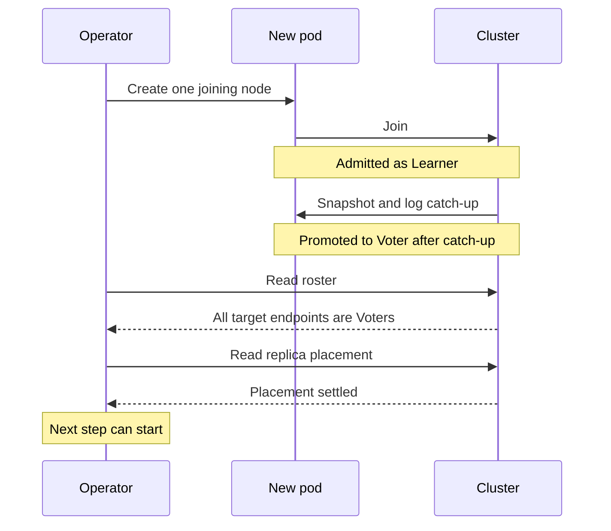
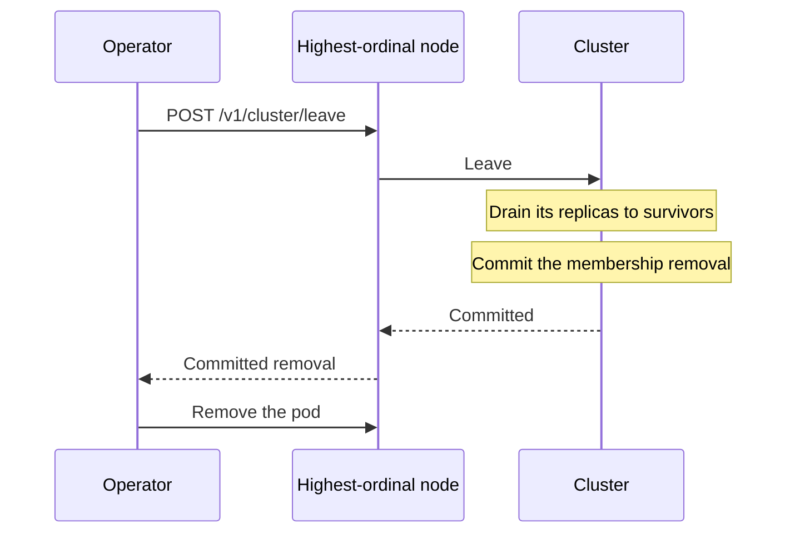

# Kubernetes Operator

The [Kahuna Kubernetes operator](https://github.com/kahunakv/kahuna-k8s-operator) takes over the repeatable work of running a Kahuna cluster: growing and shrinking it, scheduling backups, and rolling out new versions. You declare the cluster you want in a `KahunaCluster` resource, the way a Deployment declares stateless pods, and the operator coordinates the steps across nodes.

The operator is currently **alpha** (API version `kahuna.kahunakv.io/v1alpha1`).

| What you need | What you configure | What the operator handles |
|---|---|---|
| More capacity when traffic grows, less when it falls | An instance count, or autoscaling targets and limits | Adds nodes, waits for catch-up, and decommissions departing nodes before removing them. |
| Regular, recoverable backups | Full and incremental schedules, shared storage, and retention | Finds the backup coordinator, maintains the chain, retries failed attempts, and reports results. |
| A newer Kahuna version without shutting down the whole cluster | The server image version | Replaces instances one at a time and holds the rollout when membership is not ready. |

You do not have to run a separate membership script, maintain a backup cron job, or stop every server for an upgrade. Storage, TLS, and workload sizing remain deployment choices; the operator automates the cluster lifecycle around them.

## Scale to the Capacity You Need

Choose a fixed number of instances or let Kahuna's write traffic and queue pressure drive scaling within your limits. The operator handles joining, catch-up, and removal in both cases, one node at a time. Its built-in autoscaler does not require a separate metrics stack.

For example, this configuration lets a cluster grow from four to nine instances and shrink when demand subsides:

```yaml
spec:
  replicas: 4
  replication:
    factor: 3
  autoscaling:
    minReplicas: 4
    maxReplicas: 9
    targetWritesPerSecond: 2000
    targetQueueDepth: 32
```

These are fields to add to the complete cluster definition below. Starting with more instances than the [replication factor](/docs/glossary/#replica-and-replication-factor) (copies of each partition) avoids an initial conversion from full replication, where every node stores every partition: four instances with three data replicas is a suitable starting topology. Set traffic targets from your workload; they are not throughput guarantees.

Prefer a fixed size? Set `spec.replicas` with autoscaling disabled. [Switching back to manual control](#scale-manually-or-pause-autoscaling) takes one patch. The operator still performs the membership work; you do not resize individual containers or remove cluster members yourself.

## Scheduled Full and Incremental Backups

**Set the backup policy once and let the operator run it.** Full backups establish a coordinated recovery point; incrementals capture subsequent changes without requiring another full copy each time.

Add this to your cluster definition, replacing `shared-files` with a StorageClass that supports a shared ReadWriteMany volume:

```yaml
spec:
  backup:
    schedule: "0 2 * * *"                 # Full backup daily at 02:00 UTC
    incrementalSchedule: "*/15 * * * *"   # Incremental every 15 minutes
    volume:
      claim:
        size: 100Gi
        storageClassName: shared-files
    retention:
      maxChains: 7
```

The operator creates and mounts the shared backup volume, configures the servers, and generates a manifest-signing key unless you provide one. After the cluster finishes its configuration rollout, the first full backup starts without waiting for the next daily slot. Subsequent full and incremental runs follow their schedules. Status shows the last successful backup and any failures; failed attempts remain due and are retried.

This removes the work of picking the coordinator, finding the latest parent, and wiring up a recurring backup job. Retention keeps whole recovery chains together, and the newest chain is always retained. Keep the backup volume **and signing-key Secret**: both outlive deletion of the cluster resource and are needed for recovery. Restore remains a separate, deliberate operation; see [Backups and Point-in-Time Recovery](/docs/backups-and-point-in-time-recovery/).

<details>
<summary>Backup storage, version requirements, and failure handling</summary>

- Multi-node clusters need shared ReadWriteMany storage. You can use an existing claim with `volume.claimName` instead. A default block-storage class may not support shared mounts; `BackupVolumeReady` reports binding failures.
- Backups with replica placement need a server that composes the coordinated image from all partitions even when no single node holds the whole dataset; see the [version requirement](/docs/backups-and-point-in-time-recovery/#replica-placement-coverage). The operator rejects recognized older release tags for this topology; an unknown image tag is not a compatibility check. The example below pins 1.12.8.
- A backup starts only once the cluster is ready on its requested image/configuration. It runs in the background; scaling and upgrades are not blocked for its duration. A topology change or unavailable partition capture can require a retry.
- Full schedules and optional incremental schedules use UTC unless prefixed with `CRON_TZ=<zone>`. Missed slots collapse into one run. Keep incrementals within the server's retained WAL window; the server can substitute a full if a chain can no longer be extended.
- Failures back off from one minute up to 30 minutes. Temporary refusals where no node takes the backup retry after 15 seconds; if they persist for five minutes they count as failures. Inspect `BackupFailing` and `status.backup` rather than assuming every scheduled slot produced an artifact.
- If an incremental parent is missing, the operator starts a new full chain. The operator disables periodic server GC on the shared catalog to avoid deleting another node's in-progress artifacts; cleanup still runs after backups.
- `backup.suspend: true` pauses new scheduled runs; it does not cancel an existing run. The backup target is shared volume storage, not a built-in GCS integration. Automatic restore and seed-on-scale workflows are separate from scheduled backup support.

</details>

## Rolling Upgrades Without a Cluster-Wide Shutdown

**Change the image version; the operator coordinates the rollout.** It replaces instances one at a time, allowing the remaining replicas to serve, and pauses when the committed membership is unreadable or has not converged. You do not need to stop the entire cluster, upgrade every machine manually, and bring it back in order.

For example, to request the current pinned version:

```bash
kubectl -n kahuna patch kahunacluster kahuna --type=merge \
  -p '{"spec":{"image":"kahunakv/kahuna:1.12.8"}}'
kubectl -n kahuna rollout status statefulset/kahuna --timeout=15m
```

This supports upgrades while a healthy replicated cluster stays available, provided the remaining replicas can form each [partition](/docs/glossary/#partition)'s [quorum](/docs/glossary/#quorum) (a majority of its replicas) and the versions support a rolling transition. Applications should retry transient failures during leader handoff or connection replacement; it is not a guarantee that every individual request completes uninterrupted. A standalone instance or a partition with only one replica cannot stay available while that replica restarts. Check the target version's compatibility notes before upgrading.

## Get Running

The following setup installs the operator, creates a cluster, and connects an application. The later reference sections explain the safeguards and troubleshooting details.

### Install the Operator

You need Kubernetes storage provisioning for the requested PVCs, Helm, and network access from the operator to the Kahuna pods. These commands install the operator from its source chart; they do not create a Kahuna cluster:

```bash
git clone https://github.com/kahunakv/kahuna-k8s-operator.git
cd kahuna-k8s-operator
helm install kahuna-operator ./charts/kahuna-operator \
  --namespace kahuna-system --create-namespace
kubectl create namespace kahuna
```

The chart defaults to one operator instance with leader election. `watchNamespace` can restrict its watched namespace, but RBAC remains cluster-scoped; this is not a security boundary. Optional chart `metrics.serviceMonitor` exposes **operator** metrics, not Kahuna's JSON dashboard metrics.

### Create a Cluster Ready for Autoscaling

This example starts with **four nodes and a replication factor of three**, so initial placement can distribute partitions immediately. Kahuna servers can also convert legacy fully replicated partitions (stored on every node, the default without a replication factor) to placed replicas when a positive factor and the placement rebalancer are enabled; the operator enables rebalancing with `spec.replication`. Growth may wait while conversion and replica movement settle. Older server versions do not have this conversion path. See [Migration Notes](/docs/replica-placement/#migration-notes).

First supply a PKCS#12 keystore in the cluster's namespace:

```bash
kubectl -n kahuna create secret generic kahuna-tls \
  --from-file=certificate.pfx=/path/to/certificate.pfx
```

Use a certificate appropriate for the peer and client DNS names. Alternatively, with cert-manager already installed, replace `secretRef` below with `certManager.issuerRef`; the operator then creates the `Certificate`, PKCS#12 password Secret, and wildcard peer SAN. Exactly one TLS source is required.

:::caution
The example sets `insecureSkipVerify: true`, which disables inter-node server-certificate verification. That is also the operator's default, so a self-signed keystore works out of the box. For production, issue the certificate from an issuer the server image trusts and set `insecureSkipVerify: false`.
:::

Save this as `kahuna.yaml`:

```yaml
apiVersion: kahuna.kahunakv.io/v1alpha1
kind: KahunaCluster
metadata:
  name: kahuna
  namespace: kahuna
spec:
  replicas: 4
  image: kahunakv/kahuna:1.12.8
  partitions: 16
  replication:
    factor: 3
  storage:
    backend: rocksdb
    data:
      size: 100Gi
    pvcRetentionPolicy: Retain
  tls:
    secretRef:
      name: kahuna-tls
    keystoreKey: certificate.pfx
    insecureSkipVerify: true
  resources:
    requests:
      cpu: "1"
      memory: 2Gi
  autoscaling:
    minReplicas: 4
    maxReplicas: 9
    targetWritesPerSecond: 2000
    targetQueueDepth: 32
    scaleUpStabilizationSeconds: 60
    scaleDownStabilizationSeconds: 300
    tolerancePercent: 10
```

```bash
kubectl apply -f kahuna.yaml
kubectl -n kahuna get kahunacluster kahuna -w
kubectl -n kahuna wait --for=condition=RosterConverged \
  kahunacluster/kahuna --timeout=10m
```

The sizes and targets are starting examples, not capacity guarantees. Choose partition count and resources for the workload: adding nodes redistributes existing placed partitions, but cannot spread one hot key's writes across leaders. With factor 3, a data partition still needs a majority of its three replicas; nine cluster nodes do not give that partition nine copies or tolerance of four replica failures. System membership spans all nodes. See [Replica Placement](/docs/replica-placement/) and [Leader Balancing](/docs/leader-balancing/).

A password-protected supplied keystore also needs `tls.passwordSecretRef: {name: <secret>, key: <key>}`. The operator enables plaintext listeners for its probes and management calls; restrict pod and Service access with your network policy. This TLS setup is not node mTLS; see [Node Transport Security](/docs/node-transport-security/) for that separate server mode.

### Connect an Application

The operator creates a ClusterIP client Service named after the resource, and a headless `<name>-peer` Service for node identity. Default client ports are HTTP/gRPC `2070` and HTTPS/gRPC `2071`; node-to-node [Raft](/docs/glossary/#raft) traffic uses `8082`. In this example, in-cluster clients can use `http://kahuna.kahuna.svc.cluster.local:2070` or the TLS client port with a matching trusted certificate.

For local inspection:

```bash
kubectl -n kahuna port-forward service/kahuna 2070:2070
# In another terminal:
curl http://127.0.0.1:2070/v1/cluster/membership
curl http://127.0.0.1:2070/v1/cluster/placement
```

A client Service can route to any ready node; Kahuna forwards requests to the partition leader. For direct client routing, advertise and map reachable **client** endpoints rather than the peer Raft port. Pod DNS/IP hints generally cannot be followed from outside Kubernetes. See [Client Leader-Aware Routing](/docs/client-routing/).

<details>
<summary>Scaling reference: signals, timing, and safeguards</summary>

## How Traffic-Based Scaling Works

The controller polls `GET /v1/dashboard/metrics` on all eligible ready pods, with a steady autoscaling resync of 15 seconds. Keep the dashboard enabled and reachable: passing `--disable-dashboard` through `spec.extraArgs` removes the `/v1/dashboard/*` JSON routes, including this one, and breaks traffic-based scaling. No metrics-server, external HPA, or Prometheus adapter is needed for these signals.

Each target is compared with one per-node metric: how many key/value writes the node admits per second, and how many client proposals wait in its Raft queues.

| Field | Signal |
|---|---|
| `targetWritesPerSecond` | Average per-node rate of `kahuna.kv.write.admitted`, a cumulative **direct** key/value write admission counter. It is not total successful requests or transactional write throughput. |
| `targetQueueDepth` | Average per-node sum of `raft.executor.client_queue_depth` across partition executors: pending client proposals, including transactional pressure. It does not measure read latency or CPU utilization. |

At least one positive target is required. The controller computes the largest available signal-to-target ratio. Outside the tolerance band, it recommends `ceil(current desired replicas × ratio)`, clamped to `minReplicas` and `maxReplicas`. For example, four nodes averaging 4,000 writes/s against a 2,000 target recommend eight. After the scale-up window it requests **five**, waits for membership, readiness, and replica-placement convergence, then measures again. It does not jump straight to eight.

The scale-up and scale-down windows default to 60 and 300 seconds; tolerance defaults to 10%. These are continuous **observed direction** windows, not a historical maximum-recommendation algorithm. A return to the band, a direction change, or a nonconverged cluster clears the corresponding streak. Each step restarts stabilization. Catch-up, placement, scheduling, and draining add time beyond the window, so the window is not a scaling completion deadline.

Write rates need two accepted samples at least ten seconds apart. Counter/time resets or a new pod UID require a new baseline; an operator restart also loses rate baselines, while desired count and stabilization timestamps remain in status. Missing metric rows in an otherwise successful response count as zero. Unknown write-rate baselines are different: another known signal can justify growth, but a missing configured signal prevents traffic-driven shrink. If any metrics request fails, the traffic decision holds. Read-only saturation may not trigger either signal; this is not a general CPU, memory, latency, or read-QPS autoscaler.

Before growing, the operator reads replica placement. An unreadable placement view prevents growth. While any active data partition still reports legacy full replication, the operator caps autoscaled growth at **three nodes**, independent of the configured factor; the operator never creates more than three data copies through autoscaled growth. `AutoscalingLimited` explains the block; current servers can clear pending conversion through the placement rebalancer. With placed partitions, `replication.factor` can be 1–3; factor 1 sacrifices replica fault tolerance.

While autoscaling is enabled, `spec.replicas` only initializes the target, clamped to the bounds. Later edits to it do not override the autoscaler. Bounds edits clamp the desired count immediately, while actual membership still changes one node at a time; a traffic sampling failure does not undo that explicit clamp. `status.autoscaling.recommendedReplicas` is already clamped to the bounds; it is not the uncapped demand.

</details>

## Scale Manually or Pause Autoscaling

Without `spec.autoscaling`, edit `spec.replicas`. To switch this example to a fixed size of four in one patch:

```bash
kubectl -n kahuna patch kahunacluster kahuna --type=merge \
  -p '{"spec":{"autoscaling":null,"replicas":4}}'
```

Removing autoscaling without updating `replicas` hands control back to its old value and can start an unexpected scale. Do not attach an HPA to the managed StatefulSet or edit its count directly: the operator reconciles that object from the custom resource.

Scale-up creates one joining node at a time and waits for the expected roster to contain all target endpoints as Voters. Further scaling also waits for replica placement to settle; committed membership alone does not prove data movement has finished. One scale-up step looks like this:



Scale-down asks the highest-ordinal node to leave through `POST /v1/cluster/leave`; only a committed removal/already-absent response permits removal of its reachable pod. A refusal or HTTP error holds the current size. On a cluster with replica placement, the departing node is drained before its removal commits:



If the departing pod is already missing or has no IP, the controller cannot ask it to leave and relies on membership eviction; it will not take another step until the roster converges.

`replicas: 2` is rejected. A standalone one-node resource cannot transition to or from a multi-node cluster; create a separate resource and migrate. Counts of four or six are valid intermediate/target sizes, but an even-sized fully replicated group has the same failure tolerance as the preceding odd size.

PVCs are retained on scale-down by default. `storage.pvcRetentionPolicy: Delete` makes Kubernetes reclaim scaled-away PVCs, and loses their local state. Deleting a `KahunaCluster` retains its PVCs regardless of that scale-down setting; deleting the resource is not a coordinated node-by-node decommission of the entire cluster.

## Observe and Troubleshoot

```bash
kubectl -n kahuna get kahunacluster kahuna -o yaml
kubectl -n kahuna get pods,pvc
kubectl -n kahuna describe kahunacluster kahuna
kubectl -n kahuna logs kahuna-0 --tail=100
```

| State or symptom | Check |
|---|---|
| `status.phase: Bootstrapping` | Keystore availability, PVC binding, peer DNS/connectivity, and founder logs. The peer Service publishes not-ready addresses so quorum can form. |
| `Available=True`, `RosterConverged=False` | Some capacity is serving, but a membership change is incomplete. `Available` is a readiness/quorum summary, not proof all data partitions are healthy. Inspect `status.members` and the serving cluster. |
| `AutoscalingLimited=True` | Condition message: unavailable metrics/placement, maximum node count, or fully replicated partitions. |
| `recommendedReplicas` exceeds `desiredReplicas` | Stabilization, one-node stepping, or a ceiling may be holding the next step. Inspect window timestamps and conditions. |
| A new node stays `Learner` (not yet a voter) | Catch-up progress, snapshot transfer, placement, and join timeout logs. Readiness alone does not certify roster convergence. |
| Scale-down holds | Departing pod reachability, leave response, remaining replica placement, and decommission drain timeout. Keep the pod until removal is confirmed. |
| Backups wait or fail | `BackupVolumeReady`, `BackupFailing`, and `status.backup`: shared storage binding, image compatibility, rollout readiness, and the latest attempt outcome. |

A joining node goes through two waits, each with its own timeout. Admission and initialization use `--raft-join-timeout` (default 60,000 ms). Promotion from [learner](/docs/glossary/#leader-follower-and-learner) to voter, which waits for the node to catch up, uses a **no-progress** timeout (`--raft-join-promotion-stall-timeout`, default 300,000 ms): it fires when catch-up stops advancing, not when catch-up is merely slow. Promotion can take longer while commit indexes, new partitions, or snapshot receipt/install show progress. The stall timeout must exceed the promotion stable window plus node-update interval. These have no typed operator fields; use `spec.extraArgs` when adjustment is justified:

```yaml
spec:
  extraArgs:
    - --raft-join-timeout
    - "120000"
    - --raft-join-promotion-stall-timeout
    - "600000"
```

Do not add `--disable-dashboard` to `extraArgs` on an autoscaled cluster: it removes the metrics endpoint the autoscaler polls.

A post-admission join failure attempts withdrawal from the roster; withdrawal is best-effort and caller cancellation does not invoke it. Verify membership rather than assuming an exception removed a learner.

<details>
<summary>Deployment reference: updates, storage, and recovery limits</summary>

## Updates, Storage, and Recovery Limits

Configuration/image changes update the pod template and cause rolling updates; the controller holds updates when membership is unreadable or nonconverged. Scaling changes topology outside the template so it does not restart existing nodes merely to change the peer list. TLS Secret contents alone do not change the generated script hash: do not assume certificate rotation automatically rolls pods.

`partitions`, storage backend/revision, and WAL backend/revision are immutable. The reconciler does not update existing StatefulSet volume-claim templates, so editing a requested size in the custom resource is not an implemented PVC expansion workflow. An optional `storage.wal` template gives WAL a separate volume. Default anti-affinity is a soft preference; configure `affinity` or `topologySpreadConstraints` for the failure-domain placement you require.

When updating the operator CRD, apply it before the Helm upgrade; `helm upgrade` does not replace the chart's `crds/` files:

```bash
kubectl apply -f charts/kahuna-operator/crds/kahunaclusters.yaml
helm upgrade kahuna-operator ./charts/kahuna-operator --namespace kahuna-system
```

Scheduled backups are configured through `spec.backup`, including shared storage mounts and signing-key setup. The operator does not automatically restore a cluster or seed new pods from those backups. New nodes normally use a [Raft snapshot](/docs/glossary/#snapshot) plus log catch-up. Kahuna servers can copy and verify a full backup base image before replay and join, but that still requires explicit bootstrap orchestration. The stock server does not register a GCS provider merely through `extraArgs`. See [PITR Bootstrap](/docs/pitr-bootstrap/) for the server workflow and [Backups](/docs/backups-and-point-in-time-recovery/) for recovery semantics.

</details>
