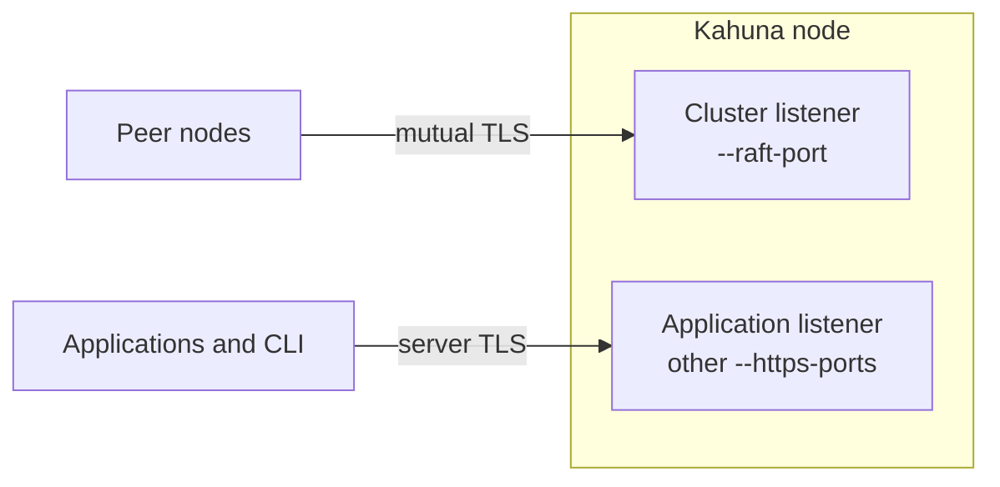

# Node Transport Security

Kahuna nodes trust each other: they replicate [Raft](/docs/glossary/#raft) log entries, forward client requests, and take part in each other's transactions. Without node authentication, any process that can reach a node's internal ports could pose as a peer and send it forged replication or transaction messages. Node transport security makes each node prove its identity before peers accept its traffic.

Kahuna can authenticate node-to-node traffic with mutual TLS (mTLS), where both ends of a connection present a certificate. In `MutualTls` mode, each node presents a certificate to peers and verifies the peer certificate's thumbprint, a SHA-256 hash that identifies one certificate, before accepting internal traffic.

Use this for production clusters where the Raft port or internal Kahuna gRPC calls could be reached by anything other than trusted nodes.

## What It Protects

| Traffic | `MutualTls` | `SharedSecret` |
|---------|-------------|----------------|
| Raft traffic | Authenticated | Authenticated |
| Key/value and lock forwarding | Authenticated | Not authenticated |
| Sequence forwarding | Authenticated | Not authenticated |
| Internal [two-phase commit](/docs/glossary/#two-phase-commit-2pc) participant calls | Authenticated | Not authenticated |
| Application clients and CLI calls | Not covered | Not covered |

`SharedSecret` protects Raft only. Use `MutualTls` when you need full node-to-node coverage.

Administrative HTTP and gRPC surfaces are still application-facing. Configure [admin authorization](/docs/admin-operations-authorization/) to require a key for membership changes, range changes, backups, and restore. Read-only views, the dashboard, health endpoints, and ordinary data access remain ungated; protect their reachability with network controls.

## Basic Setup

Each node needs:

- an HTTPS certificate for the listener
- a client certificate to present to peers, or the same certificate reused as the client certificate
- the SHA-256 thumbprints of peer client certificates it accepts
- the SHA-256 thumbprints of peer server certificates it pins when dialing peers (pinning means it accepts only those certificates, not any certificate the system trust store accepts)

```bash
kahuna-server \
  --initial-cluster node2:8082 node3:8082 \
  --raft-host node1 \
  --raft-port 8082 \
  --https-certificate /etc/kahuna/node1.pfx \
  --https-ports 2071 8082 \
  --node-auth-mode MutualTls \
  --trusted-client-cert-thumbprint <node1> <node2> <node3> \
  --trusted-server-cert-thumbprint <node1> <node2> <node3> \
  --advertised-client-endpoint https://node1:2071 \
  --disable-peer-endpoint-advertisement
```

Point peers at the cluster listener. Point applications at an application listener. A normal `KahunaClient` cannot complete the client-certificate handshake required by the cluster listener.

## Flags

The `MutualTls` setup above uses these flags:

| Flag | Default | Meaning |
|------|---------|---------|
| `--node-auth-mode` | `Disabled` | Node authentication mode: `Disabled`, `SharedSecret`, or `MutualTls`. |
| `--client-certificate` | `--https-certificate` | PKCS#12 certificate this node presents to peers in `MutualTls` mode. `--client-certificate-password` defaults to `--https-certificate-password`. |
| `--trusted-client-cert-thumbprint` | none | SHA-256 thumbprints of peer certificates this node accepts. |
| `--trusted-server-cert-thumbprint` | system trust store | SHA-256 thumbprints this node pins when dialing peers. |

`SharedSecret` options (`--node-shared-secret`, `--node-auth-header`, `--node-auth-clock-skew`) and `--node-require-tls` (default `true`) are listed in [Server Configuration: Node Transport Security](/docs/server-configuration/#node-transport-security). Listener flags such as `--allow-plaintext-listener` are in [Network and TLS](/docs/server-configuration/#network-and-tls).

Thumbprints are SHA-256 fingerprints of the DER-encoded certificate. Colons, spaces, and letter case are ignored.

```bash
openssl x509 -in node1.crt -noout -fingerprint -sha256
openssl pkcs12 -in node1.pfx -nokeys -passin pass: \
  | openssl x509 -noout -fingerprint -sha256
```

## Listener Behavior

When `MutualTls` is enabled, the node splits its HTTPS ports into a cluster listener for peers and application listeners for clients:



| Listener | Behavior |
|----------|----------|
| HTTPS port equal to `--raft-port` | Cluster listener. Requires client certificates from peers. |
| Other `--https-ports` | Application listeners. Server TLS only. |
| `--http-ports` | Not bound unless `--allow-plaintext-listener` is set. |
| `--grpc-cleartext-ports` | Not bound unless `--allow-plaintext-listener` is set. |

Kahuna also stops binding cleartext listeners whenever an HTTPS certificate is configured, unless `--allow-plaintext-listener` is set. This applies outside `MutualTls` too.

## Routing Hints

[Routing hints](/docs/client-routing/) are advisory endpoints that servers return in responses so clients can call the node that holds a key directly. They should advertise client-reachable application endpoints, not the mTLS cluster listener.

In mTLS deployments, set `--advertised-client-endpoint` on every node and use `--disable-peer-endpoint-advertisement` unless peer application URLs can be derived safely. You can also disable hints entirely with `--disable-routing-hints`.

## Certificate Rotation

Certificates are loaded at startup, so rotation requires rolling restarts:

1. Add the new certificate thumbprints to every node's trusted client and server thumbprint lists.
2. Restart nodes one at a time.
3. Switch the rotating node to the new certificate.
4. Restart that node.
5. Remove the old thumbprints from every node.
6. Restart nodes one at a time.

Use one certificate per node in production. A shared certificate proves cluster membership but cannot identify or revoke one node independently.

## Startup Checks

A node refuses to start when `MutualTls` is configured without an HTTPS certificate, trusted client thumbprints, HTTPS Raft schemes, or an HTTPS listener on `--raft-port`.

It also refuses `MutualTls` with `--raft-allow-insecure-certificate-validation`, because pinned peer identity and insecure validation conflict.

If a node-only call is refused, the receiving node logs the reason, such as `CertificateRequired`, `CertificateUntrusted`, `CertificateExpired`, or `TlsRequired`.
