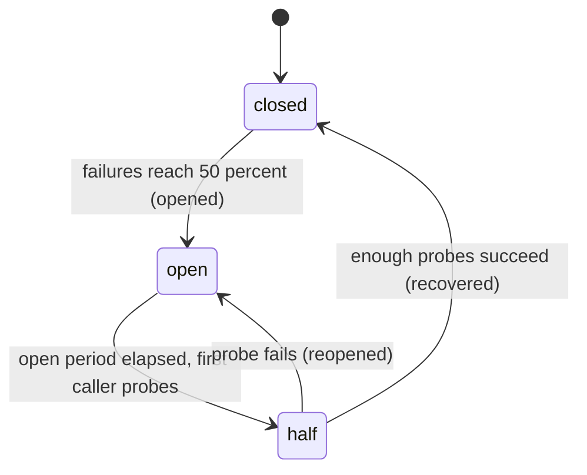

import Tabs from '@theme/Tabs';
import TabItem from '@theme/TabItem';

# Distributed Circuit Breaker

A circuit breaker stops callers from sending traffic to a dependency that is already failing. A local breaker works inside one process. A distributed breaker gives a whole fleet one shared window, one state, and one probe budget.

Kahuna fits because one Kahuna Script transaction can read the current window, decide, and change the breaker state atomically.

## State

Use three states:

| State | Meaning |
|-------|---------|
| `closed` | Calls are allowed and outcomes are recorded. |
| `open` | Calls are rejected immediately. |
| `half` | A small number of probe calls are allowed. |

Move from `open` to `half` lazily. The first caller that sees the open period has elapsed claims a probe slot in the same transaction.

The transitions below match the three scripts on this page. The labels in parentheses are the verdicts the scripts return:



## Key Layout

Put one breaker scope on one placement group:

| Key | Holds |
|-----|-------|
| `<scope>\|cb/state` | `closed`, `open`, or `half` |
| `<scope>\|cb/gen` | Epoch number for the active observation window |
| `<scope>\|cb/openedat` | Millisecond timestamp of the last open transition |
| `<scope>\|cb/probeok` | Successful probes in the current recovery |
| `<scope>\|cb.obs/<uuid>` | One observation, such as `42:f` or `42:s` |
| `<scope>\|cb.probe/<uuid>` | One leased probe claim |

The [placement group](/docs/distributed-keyvalue-store/buckets/#placement-groups) is the part before the first `|`, so every key above routes to the same [partition](/docs/glossary/#partition). Each script then works against one partition leader and commits within that partition. On the standalone [embedded node](/docs/embedded-kahuna-node/), or an embedded group with `OnePhaseApplyTimeValidation` enabled, the commit can take the [one-phase transaction path](/docs/internals/transaction-lifecycle/#one-phase-durable-fast-path), which commits a single-partition transaction in one [Raft](/docs/glossary/#raft) proposal. On a Kahuna server, including a single-node one, `OnePhaseApplyTimeValidation` is off and has no command-line option, and these pessimistic scripts hold locks, so they commit through the standard two-phase path, still on that one partition.

## Record an Outcome

This script records success or failure while the breaker is closed. It opens the breaker when at least four observations exist and failures reach 50%.

```kahuna
begin (locking=pessimistic, timeout=20000)
  let st = get @state
  let g = get @gen
  let gen = 0
  if g != null then
    let gen = to_int(g)
  end

  let state = "closed"
  if st != null then
    let state = to_string(st)
  end

  let verdict = "ignored"
  if state == "closed" then
    let fmark = concat(to_string(gen), ":f")
    let smark = concat(to_string(gen), ":s")
    let mark = smark
    if @outcome == "f" then
      let mark = fmark
    end

    let window = get by bucket @obs
    let total = 1
    let fails = 0
    if @outcome == "f" then
      let fails = 1
    end

    set @obskey mark ex 60000

    for v in window do
      if v == fmark then
        let fails = fails + 1
        let total = total + 1
      end
      if v == smark then
        let total = total + 1
      end
    end

    let verdict = concat("recorded:", concat(to_string(fails), concat("/", to_string(total))))
    if total >= 4 && fails * 1000 >= 500 * total then
      set @state "open"
      set @gen to_string(gen + 1)
      set @openedat to_string(hlc())
      let verdict = "opened"
    end
  end

  let answer = verdict
  commit
end
```

Use integer math for ratios. `fails * 1000 >= threshold * total` avoids floating-point edge cases at the boundary.

The script ends with `let answer = verdict` before `commit` instead of `return verdict`. A `return` stops the script before it reaches `commit`, so the transaction aborts and none of its writes apply. The value of the last statement that runs is the script's result, so the client reads the verdict as the first result value. The other two scripts follow the same pattern.

## Admit a Call

This script returns `closed`, `probe`, or `rejected`.

```kahuna
begin (locking=pessimistic, timeout=20000)
  let st = get @state
  let state = "closed"
  if st != null then
    let state = to_string(st)
  end

  let verdict = "closed"
  if state == "open" then
    let opened = get @openedat
    let openedAt = 0
    if opened != null then
      let openedAt = to_int(opened)
    end

    if hlc() - openedAt >= 500 then
      set @state "half"
      set @probeok "0"
      let state = "half"
    else
      let verdict = "rejected"
    end
  end

  if state == "half" then
    let probes = get by bucket @probes
    if count(probes) < 2 then
      set @probekey "1" ex 5000
      let verdict = "probe"
    else
      let verdict = "rejected"
    end
  end

  let answer = verdict
  commit
end
```

A probe slot is a leased key, not a counter. If a caller dies after claiming a slot, the key expires and the budget recovers.

## Settle a Probe

```kahuna
begin (locking=pessimistic, timeout=20000)
  let st = get @state
  let state = "closed"
  if st != null then
    let state = to_string(st)
  end

  let verdict = "ignored"
  if state == "half" then
    let claim = get @probekey
    if claim == null then
      let verdict = "stale"
    else
      delete @probekey

      if @outcome == "f" then
        let g = get @gen
        let gen = 0
        if g != null then
          let gen = to_int(g)
        end
        set @state "open"
        set @gen to_string(gen + 1)
        set @openedat to_string(hlc())
        let verdict = "reopened"
      else
        let ok = get @probeok
        let successes = 1
        if ok != null then
          let successes = to_int(ok) + 1
        end
        if successes >= 2 then
          set @state "closed"
          set @probeok "0"
          let verdict = "recovered"
        else
          set @probeok to_string(successes)
          let verdict = "progress"
        end
      end
    end
  end

  let answer = verdict
  commit
end
```

## Client Wiring

- Load each script once with `LoadTransactionScript` or the TypeScript `loadScript(...)` helper.
- Generate fresh UUIDs for observation and probe keys in the client.
- Retry `MustRetry` with the same probe key so one logical admission cannot claim multiple slots.
- Put the wrapped dependency call under a timeout shorter than the probe lease.
- Keep observation retention long enough to hold the minimum sample count for low-volume scopes.

The wrapper below saves the three scripts as `breaker/record.kahuna`, `breaker/admit.kahuna`, and `breaker/settle.kahuna`, admits each call, runs the dependency, and then records the outcome or settles the probe. A script cannot build a key name from an expression, so the client passes every key the script touches as a parameter, including a fresh UUID key for each observation and each probe claim. Both clients rerun a `MustRetry` answer a few times with the same parameters before they raise an error.

<Tabs groupId="client-examples">
<TabItem value="dotnet" label=".NET">

```csharp
public sealed class BrokenCircuitException(string scope) : Exception($"Circuit for {scope} is open");

public sealed class KahunaCircuitBreaker(KahunaClient client)
{
    // Load each script once. The files hold the three scripts above.
    private readonly KahunaTransactionScript record = client.LoadTransactionScript(File.ReadAllText("breaker/record.kahuna"));
    private readonly KahunaTransactionScript admit = client.LoadTransactionScript(File.ReadAllText("breaker/admit.kahuna"));
    private readonly KahunaTransactionScript settle = client.LoadTransactionScript(File.ReadAllText("breaker/settle.kahuna"));

    public async Task<T> Call<T>(string scope, Func<CancellationToken, Task<T>> dependency)
    {
        // One probe key per logical call. Retries of this call reuse it, so they cannot claim a second slot.
        string probeKey = $"{scope}|cb.probe/{Guid.NewGuid()}";

        string verdict = await Run(admit, scope, probeKey: probeKey);
        if (verdict == "rejected")
            throw new BrokenCircuitException(scope);

        string outcome = "s";
        try
        {
            // Finish well inside the 5 second probe lease.
            using CancellationTokenSource timeout = new(TimeSpan.FromSeconds(4));
            return await dependency(timeout.Token);
        }
        catch
        {
            outcome = "f";
            throw;
        }
        finally
        {
            if (verdict == "probe")
                await Run(settle, scope, probeKey: probeKey, outcome: outcome);
            else
                await Run(record, scope, obsKey: $"{scope}|cb.obs/{Guid.NewGuid()}", outcome: outcome);
        }
    }

    private static async Task<string> Run(
        KahunaTransactionScript script, string scope,
        string? obsKey = null, string? probeKey = null, string? outcome = null)
    {
        List<KeyValueParameter> parameters =
        [
            new() { Key = "@state", Value = $"{scope}|cb/state" },
            new() { Key = "@gen", Value = $"{scope}|cb/gen" },
            new() { Key = "@openedat", Value = $"{scope}|cb/openedat" },
            new() { Key = "@probeok", Value = $"{scope}|cb/probeok" },
            new() { Key = "@obs", Value = $"{scope}|cb.obs/" },
            new() { Key = "@probes", Value = $"{scope}|cb.probe/" }
        ];

        if (obsKey is not null)
            parameters.Add(new() { Key = "@obskey", Value = obsKey });
        if (probeKey is not null)
            parameters.Add(new() { Key = "@probekey", Value = probeKey });
        if (outcome is not null)
            parameters.Add(new() { Key = "@outcome", Value = outcome });

        // The script's final `let answer = verdict` is the value the client receives.
        KahunaKeyValueTransactionResult result = await script.Run(parameters);
        return result.FirstValueAsString ?? "";
    }
}
```

</TabItem>
<TabItem value="typescript" label="TypeScript">

```ts
import { randomUUID } from "node:crypto";
import { readFileSync } from "node:fs";
import type { KahunaClient, ScriptParameter, TransactionScript } from "kahuna-client";

export class BrokenCircuitError extends Error {}

export class KahunaCircuitBreaker {
  // Load each script once. The files hold the three scripts above.
  readonly #record: TransactionScript;
  readonly #admit: TransactionScript;
  readonly #settle: TransactionScript;

  constructor(client: KahunaClient) {
    this.#record = client.loadScript(readFileSync("breaker/record.kahuna", "utf8"));
    this.#admit = client.loadScript(readFileSync("breaker/admit.kahuna", "utf8"));
    this.#settle = client.loadScript(readFileSync("breaker/settle.kahuna", "utf8"));
  }

  async call<T>(scope: string, dependency: (signal: AbortSignal) => Promise<T>): Promise<T> {
    // One probe key per logical call. Retries of this call reuse it, so they cannot claim a second slot.
    const probeKey = `${scope}|cb.probe/${randomUUID()}`;

    const verdict = await run(this.#admit, scope, { probeKey });
    if (verdict === "rejected") {
      throw new BrokenCircuitError(`Circuit for ${scope} is open`);
    }

    let outcome: "s" | "f" = "s";
    try {
      // Finish well inside the 5 second probe lease.
      return await dependency(AbortSignal.timeout(4000));
    } catch (error) {
      outcome = "f";
      throw error;
    } finally {
      if (verdict === "probe") {
        await run(this.#settle, scope, { probeKey, outcome });
      } else {
        await run(this.#record, scope, { obsKey: `${scope}|cb.obs/${randomUUID()}`, outcome });
      }
    }
  }
}

async function run(
  script: TransactionScript,
  scope: string,
  keys: { obsKey?: string; probeKey?: string; outcome?: "s" | "f" }
): Promise<string> {
  const parameters: ScriptParameter[] = [
    { key: "@state", value: `${scope}|cb/state` },
    { key: "@gen", value: `${scope}|cb/gen` },
    { key: "@openedat", value: `${scope}|cb/openedat` },
    { key: "@probeok", value: `${scope}|cb/probeok` },
    { key: "@obs", value: `${scope}|cb.obs/` },
    { key: "@probes", value: `${scope}|cb.probe/` }
  ];

  if (keys.obsKey) parameters.push({ key: "@obskey", value: keys.obsKey });
  if (keys.probeKey) parameters.push({ key: "@probekey", value: keys.probeKey });
  if (keys.outcome) parameters.push({ key: "@outcome", value: keys.outcome });

  // The script's final `let answer = verdict` is the value the client receives.
  const result = await script.run({ parameters });
  const value = result.values[0]?.value;
  return value ? new TextDecoder().decode(value) : "";
}
```

</TabItem>
</Tabs>

A call admitted as `closed` records its outcome in the window. A call admitted as `probe` settles its probe claim instead, which releases the slot and moves the breaker toward `closed` or back to `open`.

## Tuning

The scripts hard-code their thresholds so each one stays readable. The values keep the example quick to try; choose them for your dependency and traffic:

| Setting | Value | Script and expression |
|---------|-------|-----------------------|
| Failure threshold | 50% | Record: `fails * 1000 >= 500 * total` (thousandths) |
| Minimum samples before opening | 4 | Record: `total >= 4` |
| Observation retention (window length) | 60 s | Record: `set @obskey mark ex 60000` |
| Open period before probing | 500 ms | Admit: `hlc() - openedAt >= 500` |
| Concurrent probes | 2 | Admit: `count(probes) < 2` |
| Probe lease | 5 s | Admit: `set @probekey "1" ex 5000` |
| Successful probes to close | 2 | Settle: `successes >= 2` |
| Transaction timeout | 20 s | All: `begin (locking=pessimistic, timeout=20000)` |

To change a value at run time, pass it as a parameter and convert it with `to_int`, because parameters arrive as strings, for example `total >= to_int(@min_samples)`. The `begin` options are the exception: they must be literals. Keep the client's dependency timeout shorter than the probe lease, and keep observation retention long enough to collect the minimum sample count.

## When Kahuna Is Unreachable

Decide this explicitly in the client. A scope last seen as `open` or `half` should usually reject because nothing confirmed recovery. A scope last seen as `closed`, or never seen, is policy-dependent. Do not silently fall back to one local breaker per process because that recreates the failure mode this recipe avoids.
