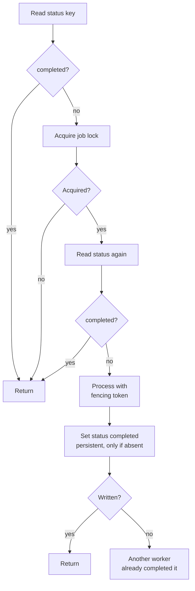

import Tabs from '@theme/Tabs';
import TabItem from '@theme/TabItem';

# Idempotent Jobs

Queues and schedulers can hand the same job to more than one worker, for example after a worker times out and the job is retried. If two workers run it, a customer can receive two invoices. Use this recipe when a worker pool must process each logical job once, or at least prevent duplicate side effects from concurrent workers.

This recipe combines:

- a lock to claim active processing
- a persistent key to record completion
- compare-and-set behavior to avoid overwriting another worker's result: the status is written with [`NX`](/docs/scripts/commands/set/#nx), so it is set only if no status exists yet

## Key Layout

```text
jobs/{job-id}/lock
jobs/{job-id}/status
```

Example:

```text
jobs/invoice-2048/lock
jobs/invoice-2048/status
```

## Claim and Complete

The worker checks the status before and after it acquires the lock, because another worker may have completed the job while this one waited:



<Tabs groupId="client-examples">
<TabItem value="dotnet" label=".NET">

```csharp
string jobId = "invoice-2048";
string statusKey = $"jobs/{jobId}/status";

KahunaKeyValue existing = await client.GetKeyValue(statusKey);
if (existing.Success && existing.ValueAsString() == "completed")
    return;

await using KahunaLock jobLock = await client.GetOrCreateLock(
    $"jobs/{jobId}/lock",
    expiry: TimeSpan.FromSeconds(30),
    wait: TimeSpan.FromSeconds(5),
    retry: TimeSpan.FromMilliseconds(200)
);

if (!jobLock.IsAcquired)
    return;

existing = await client.GetKeyValue(statusKey);
if (existing.Success && existing.ValueAsString() == "completed")
    return;

await ProcessInvoice(jobId, jobLock.FencingToken);

KahunaKeyValue marked = await client.SetKeyValue(
    statusKey,
    "completed",
    expiryTime: 0,
    flags: KeyValueFlags.SetIfNotExists,
    durability: KeyValueDurability.Persistent
);

if (!marked.Success)
    Console.WriteLine($"Job {jobId} was already marked completed by another worker.");
```

</TabItem>
<TabItem value="typescript" label="TypeScript">

```ts
const jobId = "invoice-2048";
const statusKey = `jobs/${jobId}/status`;

let existing = await client.get(statusKey);
if (existing.success && existing.valueAsString() === "completed") {
  return;
}

await using jobLock = await client.acquireLock(`jobs/${jobId}/lock`, {
  expiry: 30_000,
  wait: 5000,
  retry: 200
});

if (!jobLock.acquired) {
  return;
}

existing = await client.get(statusKey);
if (existing.success && existing.valueAsString() === "completed") {
  return;
}

await processInvoice(jobId, jobLock.fencingToken);

const marked = await client.set(statusKey, "completed", {
  mode: "ifNotExists",
  durability: "persistent"
});

if (!marked.success) {
  console.log(`Job ${jobId} was already marked completed by another worker.`);
}
```

</TabItem>
</Tabs>

The status write succeeds only if no status exists yet. Normally the lock already keeps a second worker out, so the conditional write matters when the lock did not: if processing outlasts the 30 second [lease](/docs/glossary/#lease), the lock expires and another worker can claim the job and run it again. The `NX` write still records completion once, but it cannot undo work that already ran, and releasing the expired lock at the end can raise an error. Only side effects that check the [fencing token](/docs/distributed-locks/fencing-tokens/) are protected from a second run. For long jobs, extend the lease between steps with `TryExtend` (.NET) or `extend` (TypeScript), as in [Leader Election](/docs/recipes/leader-election/#renew-while-healthy), and stop when the extension fails.

## Scripted Status Transition

For state transitions that should happen atomically on the server, use a script:

```kahuna
let status = get @status_key

if status == "completed" then
  return "already-completed"
end

set @status_key "completed" norev
return "completed"
```

Run it with parameters:

<Tabs groupId="client-examples">
<TabItem value="dotnet" label=".NET">

```csharp
KahunaKeyValueTransactionResult result = await client.ExecuteKeyValueTransactionScript(
    """
    let status = get @status_key

    if status == "completed" then
      return "already-completed"
    end

    set @status_key "completed" norev
    return "completed"
    """,
    parameters: [new() { Key = "@status_key", Value = statusKey }]
);
```

</TabItem>
<TabItem value="typescript" label="TypeScript">

```ts
const script = client.loadScript(`
let status = get @status_key

if status == "completed" then
  return "already-completed"
end

set @status_key "completed" norev
return "completed"
`);

const result = await script.run({
  parameters: [{ key: "@status_key", value: statusKey }]
});

const firstValue = result.values[0]?.value;
const status = firstValue ? new TextDecoder().decode(firstValue) : null;
```

</TabItem>
</Tabs>

## Operational Notes

- Make the lock [lease](/docs/glossary/#lease) longer than the expected processing step or extend it while processing.
- Store completion state persistently if jobs must not be repeated after restart.
- Use [no-revision writes](/docs/scripts/commands/set/#norev) (`NOREV`) for final job status when you only care whether the job completed.
- Use [fencing tokens](/docs/glossary/#fencing-token) for any side effect outside Kahuna.
- Keep job status values small and explicit, for example `pending`, `processing`, `completed`, `failed`.
