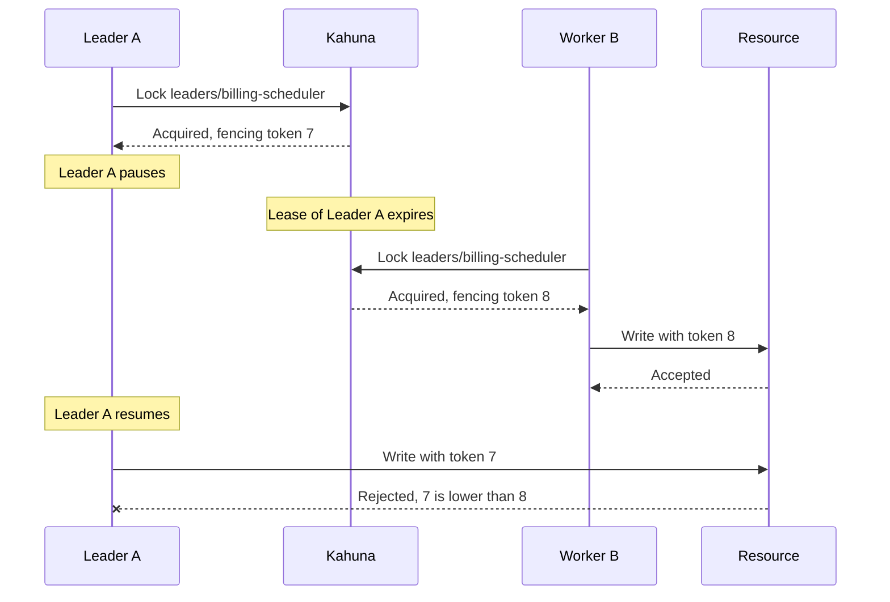

import Tabs from '@theme/Tabs';
import TabItem from '@theme/TabItem';

# Leader Election

Some roles must belong to one process at a time: two copies of a scheduler send duplicate emails, and two importers load the same file twice. Leader election picks one process to own the role and lets another take over when the owner dies. Common examples include schedulers, background workers, compactors, importers, and cluster-wide maintenance jobs.

With Kahuna, the role is a distributed lock, and the process that holds it is the leader. The lock [lease](/docs/glossary/#lease) prevents permanent ownership if the leader crashes. The [fencing token](/docs/glossary/#fencing-token) protects downstream systems from stale leaders.

## Acquire Leadership

Every candidate runs the same loop. The process that acquires the lock leads; the others keep trying, so a standby takes over as soon as the leader releases the lock or its lease expires.

<Tabs groupId="client-examples">
<TabItem value="dotnet" label=".NET">

```csharp
async Task Campaign(KahunaClient client, CancellationToken stoppingToken)
{
    while (!stoppingToken.IsCancellationRequested)
    {
        KahunaLock leadership = await client.GetOrCreateLock(
            "leaders/billing-scheduler",
            expiry: TimeSpan.FromSeconds(15),
            wait: TimeSpan.FromSeconds(3),
            retry: TimeSpan.FromMilliseconds(200),
            durability: LockDurability.Persistent,
            cancellationToken: stoppingToken
        );

        // Another process is leader. The 3 second wait paces the next attempt.
        if (!leadership.IsAcquired)
            continue;

        try
        {
            await LeadWhileHealthy(leadership, stoppingToken);
        }
        finally
        {
            // Release the lock if this process still holds it. When another process
            // already took over, the release can fail; that is expected here.
            try { await leadership.TryUnlock(CancellationToken.None); }
            catch (KahunaException) { }
        }
    }
}
```

</TabItem>
<TabItem value="typescript" label="TypeScript">

```ts
async function campaign(client: KahunaClient, signal: AbortSignal): Promise<void> {
  while (!signal.aborted) {
    const leadership = await client.acquireLock("leaders/billing-scheduler", {
      expiry: 15_000,
      wait: 3000,
      retry: 200,
      durability: "persistent",
      signal
    });

    // Another process is leader. The 3 second wait paces the next attempt.
    if (!leadership.acquired) {
      continue;
    }

    try {
      await leadWhileHealthy(leadership, signal);
    } finally {
      // Release the lock if this process still holds it. When another process
      // already took over, the release fails; that is expected here.
      await leadership.release().catch(() => false);
    }
  }
}
```

</TabItem>
</Tabs>

When the leader stops cleanly, the `finally` block releases the lock and a standby can take over on its next attempt. The release is explicit, rather than `await using`, because releasing a lock that another process already owns can raise an error, and that error would end the loop. When the leader crashes, nothing releases the lock, so a standby takes over after the lease expires, up to 15 seconds later.

## Renew While Healthy

The leader extends the lease periodically and stops leading as soon as it cannot. A failed extension raises an exception (`KahunaException` in .NET, `KahunaError` in TypeScript), for example when the lease already expired and another process owns the lock:

<Tabs groupId="client-examples">
<TabItem value="dotnet" label=".NET">

```csharp
async Task LeadWhileHealthy(KahunaLock leadership, CancellationToken stoppingToken)
{
    long fencingToken = leadership.FencingToken;

    while (!stoppingToken.IsCancellationRequested)
    {
        try
        {
            (bool extended, long token) = await leadership.TryExtend(TimeSpan.FromSeconds(15), stoppingToken);

            if (!extended || token != fencingToken)
                return;
        }
        catch (KahunaException)
        {
            // The lease expired and another process may own the lock, or Kahuna is unreachable.
            return;
        }

        await DoLeaderWork(fencingToken, stoppingToken);
        await Task.Delay(TimeSpan.FromSeconds(5), stoppingToken);
    }
}
```

</TabItem>
<TabItem value="typescript" label="TypeScript">

```ts
import { isKahunaError, type KahunaLock } from "kahuna-client";
import { setTimeout as sleep } from "node:timers/promises";

async function leadWhileHealthy(leadership: KahunaLock, signal: AbortSignal): Promise<void> {
  const fencingToken = leadership.fencingToken;

  while (!signal.aborted) {
    try {
      const extended = await leadership.extend(15_000, { signal });

      if (!extended.extended || extended.fencingToken !== fencingToken) {
        return;
      }
    } catch (error) {
      // The lease expired and another process may own the lock, or Kahuna is unreachable.
      if (isKahunaError(error)) return;
      throw error;
    }

    await doLeaderWork(fencingToken, signal);
    await sleep(5000, undefined, { signal });
  }
}
```

</TabItem>
</Tabs>

The lease protects the role only while one pass of the loop, the leader work plus the delay, finishes before the lease runs out (15 seconds here). If a pass takes longer, for example because of a long GC pause or a slow call, the lease expires, a standby becomes leader, and the old leader keeps working until its next extension fails. Keep each unit of leader work well inside the lease, and make every side effect carry the fencing token so the resource rejects work from a leader that has already been replaced.

## Use Fencing Tokens

Every external write made by the leader should carry the fencing token. The downstream system should reject writes with an older token than the latest committed token for that resource.

<Tabs groupId="client-examples">
<TabItem value="dotnet" label=".NET">

```csharp
await db.SaveCheckpoint(
    jobName: "billing-scheduler",
    checkpoint: checkpointValue,
    fencingToken: leadership.FencingToken
);
```

</TabItem>
<TabItem value="typescript" label="TypeScript">

```ts
await db.saveCheckpoint({
  jobName: "billing-scheduler",
  checkpoint: checkpointValue,
  fencingToken: leadership.fencingToken
});
```

</TabItem>
</Tabs>

If a leader pauses, loses the lease, and later resumes believing it still owns the role, the new leader's higher token lets the resource reject the old leader's late write (see [Fencing Tokens](/docs/distributed-locks/fencing-tokens/)):



## Operational Notes

- Keep the lease long enough to tolerate normal GC pauses and network jitter.
- Renew at a fraction of the lease duration, for example every 5 seconds for a 15 second lease.
- Use persistent lock durability for leadership that must survive process or node failures.
- Always use the fencing token when the leader writes to external systems.
