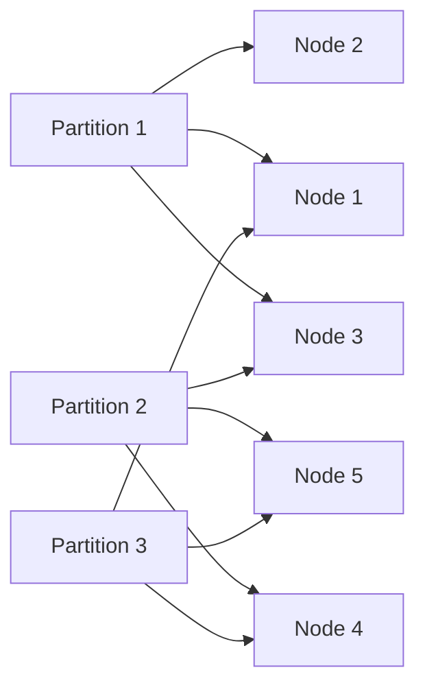
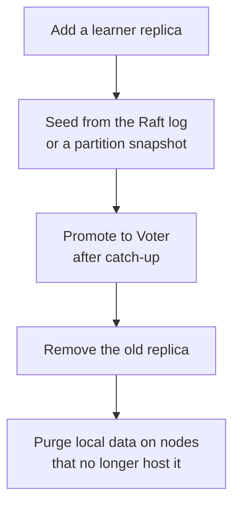

# Replication Factor and Replica Placement

Kahuna splits keys into [partitions](/docs/glossary/#partition). A **replica** is a copy of one partition stored on one node, and the **replication factor** is the number of replicas each partition has. By default, Kahuna uses full replication: every voting node stores every partition and takes part in every partition's [quorum](/docs/glossary/#quorum). This is simple and remains the default.

A replication factor lets you add nodes for capacity without adding a copy of every partition to each new node. The trade-off is that fault tolerance is counted per partition: with replication factor `3`, each partition tolerates one replica failure, whatever the node count.

## Why It Matters

Full replication has a hard scaling ceiling: every node stores every partition, every persistent write is copied to every voter for that partition, and adding nodes can increase coordination cost instead of increasing usable storage.

Replication factor removes that ceiling. Kahuna can keep each partition replicated to a small quorum while spreading different partitions across the cluster. Adding nodes can add storage capacity, reduce per-node write amplification, and give the placement controller more room to distribute load.

For example, with five nodes and replication factor `3`, each partition has three replicas and each node hosts only some of the partitions:



This differs from etcd and ZooKeeper, where every member stores a full copy of the data. Kahuna still provides strongly consistent partitions, but the cluster does not have to make every node a replica of every partition.

It does not give unlimited scale by itself. Hot keys, partition count, network bandwidth, storage throughput, and transaction shape still matter. Replication factor gives Kahuna the horizontal scaling model needed to grow past the limits of full replication.

## When to Use It

Use full replication when the cluster is small or when every node must contain a complete copy of all data.

Use a positive replication factor when you want to:

- Add more nodes without copying every partition to every node
- Reduce disk usage and write amplification per node
- Keep the [Raft](/docs/glossary/#raft) quorum for each partition small and predictable
- Spread partitions across zones or racks

Prefer odd values. Replication factor `3` tolerates one failed replica for a partition. Replication factor `5` tolerates two. Even values usually add cost without improving failure tolerance.

If the configured replication factor is larger than the current cluster size, Kahuna uses the available voters and can place additional replicas after more nodes join.

## Enable a Replication Factor

For larger clusters, set a replication factor so each partition is stored on a smaller replica set:

```bash
kahuna-server \
  --initial-cluster https://kahuna-1:8082 https://kahuna-2:8082 https://kahuna-3:8082 \
  --raft-replication-factor 3 \
  --raft-enable-placement-rebalancer
```

With replication factor `3`, each partition has three voter replicas. A node that does not host the target partition can still accept the client request and forward it to a hosting replica, so clients can continue to connect to any healthy node.

## Placement Rebalancer

Initial placement is applied when a new cluster is bootstrapped with `--raft-replication-factor`.

The ongoing placement rebalancer is controlled separately:

```bash
kahuna-server \
  --raft-replication-factor 3 \
  --raft-enable-placement-rebalancer \
  --raft-max-replica-moves-per-pass 2 \
  --raft-max-concurrent-replica-repairs 3 \
  --raft-max-concurrent-replica-transfers 1
```

The rebalancer repairs under-replicated partitions, trims over-replicated partitions, and smooths replica-count skew. It has its own controller interval, `--raft-placement-pass-interval`, so it does not require the leader balancer to be enabled.

Repair and balance are budgeted separately. Repair moves restore durability after a node leaves or fails and are controlled by `--raft-max-concurrent-replica-repairs`. Balance moves smooth replica-count skew and are controlled by `--raft-max-concurrent-replica-transfers`. `--raft-max-replica-moves-per-pass` caps how many new moves can start during one pass across both priorities.

Replica moves happen in stages. The new replica starts as a [learner](/docs/glossary/#leader-follower-and-learner) and is seeded from the Raft log or a partition [snapshot](/docs/glossary/#snapshot):



During a move, a request can receive a retryable response if leadership or hosting changes at the same time. Retrying against the cluster is the normal client behavior.

## Decommissioning a Node

On a placed cluster, a graceful leave drains the node before removing it from the roster. Kahuna first copies the departing node's hosted replicas to survivors, then commits the membership removal.

```bash
kahuna-cli \
  -c "https://kahuna-1:8082,https://kahuna-2:8082,https://kahuna-3:8082" \
  --cluster-leave \
  --node "https://kahuna-3:8082"
```

The leave response includes:

- `left`: the node is no longer in the committed roster and can be stopped
- `drained`: the node's placed replicas were evacuated before removal
- `outcome`: `Committed`, `NotAMember`, `RefusedDrainInProgress`, `DrainTimedOut`, or another membership outcome

`--raft-decommission-drain-timeout` bounds how long the leave waits for evacuation. If it times out, the node stays in the roster, already-moved replicas stay moved, and retrying resumes the drain.

`Evicted` (HTTP 503, retryable) means the cluster removed the node as a dead member while its leave request was running. Its replicas were not evacuated. Keep the process running so it can rejoin, then retry the leave; an empty roster entry alone is not confirmation of a completed drain.

Only one drain runs at a time. A second leave can return `RefusedDrainInProgress`; remove nodes sequentially during scale-down.

## Zones

Set a zone or rack hint on each node when replicas should be spread across failure domains:

```bash
kahuna-server \
  --raft-zone rack-a \
  --raft-replication-factor 3 \
  --raft-enable-placement-rebalancer
```

The planner prefers distinct zones when it can. Zone hints are advisory; the cluster still uses the available voters if there are not enough distinct zones.

## Inspect Placement

Use the CLI to inspect the committed placement table:

```bash
kahuna-cli -c "https://kahuna-1:8082" --cluster-placement
kahuna-cli -c "https://kahuna-1:8082" --cluster-placement --format json
```

The output shows:

- Global replication factor
- Whether the placement rebalancer is enabled
- Which partitions the contacted node hosts locally
- Each partition's lifecycle state and generation
- Each partition's effective replication factor
- Replica endpoints and roles

Replica roles are:

| Role | Meaning |
|------|---------|
| `Voter` | Stores the partition and votes in that partition's quorum. |
| `Learner` | Catching up before promotion. |
| `Removing` | Still present while the cluster completes a safe removal. |

An empty replica set means full replication for that partition: every roster voter hosts it.

The same information is available through:

```http
GET /v1/cluster/placement
```

## Override One Partition

You can override the target replication factor for one partition:

```bash
kahuna-cli \
  -c "https://kahuna-1:8082,https://kahuna-2:8082,https://kahuna-3:8082" \
  --set-replication-factor 5 \
  --partition 3
```

Use `0` to clear the override and return to the global replication factor:

```bash
kahuna-cli -c "https://kahuna-1:8082" \
  --set-replication-factor 0 \
  --partition 3
```

The override commits a new placement target. Replica movement happens later through the placement rebalancer.

The REST endpoint is:

```http
POST /v1/cluster/replication-factor
Content-Type: application/json

{"partitionId":3,"replicationFactor":5}
```

## Readiness

`GET /v1/cluster/health` includes `hostedPartitions`, the number of data partitions hosted by the node answering the request.

Treat `hostedPartitions` as informational only. With per-partition placement, a healthy node may host zero data partitions and still serve requests by forwarding them to hosting replicas.

## Backups

Use a coordinated backup for whole-cluster coverage under replica placement: it composes one share per hosting source at a common cut into a complete backup. A plain full backup stays node-local and can omit partitions hosted elsewhere. See [Replica Placement Coverage](/docs/backups-and-point-in-time-recovery/#replica-placement-coverage) for the version requirement, node configuration, and coverage validation, and [Capture Cost and Lagging Replicas](/docs/backups-and-point-in-time-recovery/#capture-cost-and-lagging-replicas) for retry behavior.

## Migration Notes

To move an existing fully replicated cluster to a replication factor:

1. Enable a positive replication factor and the placement rebalancer (`--raft-replication-factor` and `--raft-enable-placement-rebalancer`).
2. The server first gives each fully replicated partition an explicit replica set of all committed roster voters, so the existing quorum is preserved. It then trims surplus replicas one step at a time toward the target, within the per-pass move limit.
3. Follow progress with `--cluster-placement`. On the [partition 0](/docs/glossary/#partition-0) leader, the `raft.placement.ranges_awaiting_initial` gauge reaches zero when assignment finishes; trimming and movement can continue after that.

With rebalancing disabled the partitions stay fully replicated, and a warning explains why conversion has not begun. Growing the cluster at that point adds copies rather than distributing the data. Old server versions without conversion support still require their earlier migration procedure.

If a learner added by placement stays unpromoted, `--raft-learner-promotion-stall-warning-after` (30,000 ms) logs the last failed promotion check. See [Replica Placement Internals](/docs/internals/replication/#replica-placement-internals) for conversion, leader removal, and promotion details.

## Snapshot Receive Capacity

A learner below retained history receives a whole-partition snapshot. Size the snapshot receive caps and staging directory for your largest partition; see [Snapshot Options](/docs/snapshot-and-raft-recovery/#snapshot-options) for the settings and partial-install limitations.

## Kubernetes

For Kubernetes deployment and traffic-driven node counts, use the [Kubernetes Operator](/docs/kubernetes-operator/). It combines placement with roster-gated changes. The server performs eligible legacy conversion; the operator can hold growth while that placement remains pending. Automatic PITR seeding of new pods remains a separate workflow.
