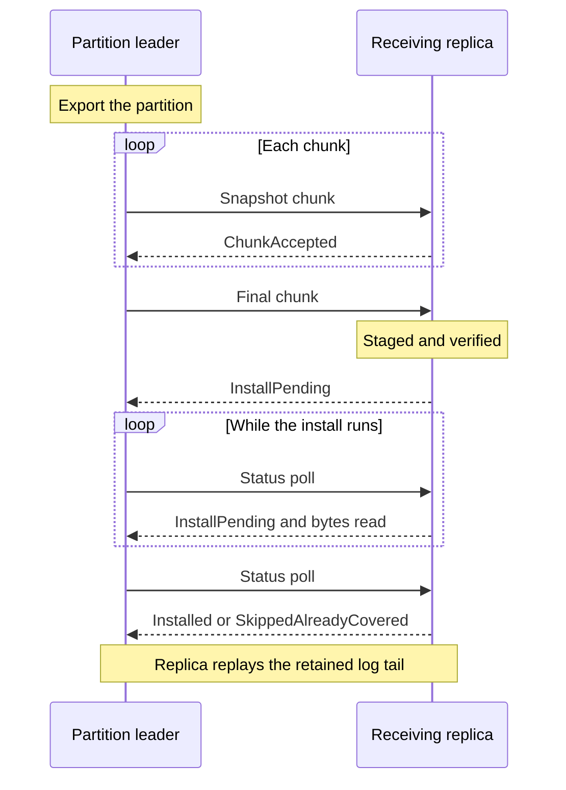

# Snapshot Installation and Raft Recovery

Read this page when a new node joins the cluster, when a replica falls too far behind its leader to catch up from the log, or when you investigate a node that is slow to catch up or stays a [learner](/docs/glossary/#leader-follower-and-learner). It also helps you size memory and disk for large partitions or memory-constrained nodes.

A replica normally stays current by receiving each new [Raft](/docs/glossary/#raft) log entry from its [partition](/docs/glossary/#partition) leader. That only works while the leader still has the entries the replica is missing. Leaders compact (discard) old log entries to bound disk use, so some replicas cannot catch up from the log alone:

- A new node that joins the cluster and starts empty.
- A node that was offline longer than the leader's retained log history.
- A replica that the [placement controller](/docs/replica-placement/) moves to a different node.
- A replica that must be repaired because its state diverged.

In these cases the leader sends a **snapshot**: a complete copy of the partition's state. The replica installs it and then replays the log entries that follow. This happens automatically; you do not trigger it.

This page explains what a snapshot contains, how much memory and disk it uses, which timeouts apply, and how to read the install outcomes and metrics. If your cluster joins and recovers nodes without problems, the defaults are usually sufficient.

Snapshot transfer works under both full replication and per-partition placement. It is separate from operator-triggered [backups and PITR](/docs/backups-and-point-in-time-recovery/); to seed a joining node from a backup instead of a leader snapshot, see [PITR Bootstrap](/docs/pitr-bootstrap/). For detection and containment of a divergent replica, see [Containment](/docs/internals/replication/#containment).

## What a Snapshot Contains

A data-partition snapshot carries the partition's key/value rows, persistent lock state, completion receipts, transaction records, prepared [intents](/docs/glossary/#write-intent), and committed-head ledger. Partition 0 (the system partition) transfers the range map and snapshot-floor hold registry instead.

A snapshot is an at-least boundary, not an exact point-in-time image: it can include writes applied after the requested position, and the receiver replays the retained log tail idempotently. Do not use it as a backup. Exports carry current rows, revisions at registered snapshot holds, and recent history, rather than the complete revision archive. The receiver refuses historical timestamps outside the recorded coverage; see [history across replica and range moves](/docs/distributed-keyvalue-store/snapshot-holds/#history-across-replica-and-range-moves).

The sender assembles the complete export before sending it. Each export buffer keeps up to 64 MiB in memory, then spills under `{StoragePath}/snapshot-export_{StorageRevision}`. Buffers are separate, so this is not a total heap limit. Released exports delete their files, and startup removes leftovers. Without a storage path, or if the spill directory cannot be prepared, export stays in memory (directory failure logs a warning). A later spill-file write failure fails the export.

The receiver stages the whole transfer and verifies every checksum before it changes any state. A truncated or corrupt transfer leaves the prior state untouched. It then replaces the partition's state in batches. See [Snapshot Transfer Internals](/docs/internals/snapshot-transfer/) for the export order, the two-pass install, and batch sizes.

:::caution Partial installs

Installing a snapshot is a recoverable replacement, not a single transaction over the whole partition. A storage or invalidation-hook failure after the replacement starts can leave partial rows behind. An on-disk marker records the interrupted install, and a retry purges that attempt's state before installing again, but the marker does not fence the partition from serving at startup. Do not assume automatic crash recovery from an interrupted install.

:::

## Snapshot Options

This is the reference for snapshot transfer options. Server durations are **milliseconds** on the command line; embedded durations are `TimeSpan`. Nullable embedded options use Kommander defaults, except that disk staging raises the default receive cap and transfer-step timeout as shown below. Server defaults remain unchanged even with disk staging enabled.

| Server flag | Embedded option | Default | Meaning |
|---|---|---|---|
| `--raft-snapshot-max-pending-bytes` | `RaftSnapshotMaxPendingBytes` | Server: 512 MiB. Embedded: 64 GiB with disk staging, otherwise 512 MiB. | Total staged bytes across receive sessions, on disk and in memory together, including installing sessions. Must be positive. |
| `--raft-snapshot-max-pending-sessions` | `RaftSnapshotMaxPendingSessions` | 8 | Concurrent receive sessions across all partitions. Older inactive sessions can be evicted after the cap. Must be positive. |
| `--raft-snapshot-receive-session-ttl` | No corresponding option | 30 s | Idle receive-session lifetime before the receiver drops its buffered bytes. |
| `--raft-snapshot-staging-directory` | `RaftSnapshotStagingDirectory` | See below | Private per-node directory for spilling received bytes. |
| `--raft-snapshot-staging-memory-bytes` | `RaftSnapshotStagingMemoryBytes` | 64 MiB | Resident staged-byte budget with a staging directory; zero stages entirely on disk. Ignored without a directory. Must be nonnegative. |
| `--raft-snapshot-chunk-ack-timeout` | `RaftSnapshotChunkAckTimeout` | 15 s | Bound a chunk acknowledgement or install-status call; not a total install deadline. |
| `--raft-snapshot-transfer-step-timeout` | `RaftSnapshotTransferStepTimeout` | Server: 120 s. Embedded: 15 min with disk staging, otherwise 120 s. | Bound lack of progress in export, stream reads, sends, or the install's reported bytes read; not total transfer/install duration. The complete export is one step. |
| `--raft-lost-acknowledged-entries-policy` | `RaftLostAcknowledgedEntriesPolicy` | `Quarantine` | Policy after acknowledged log entries disappear; `AcceptAndLog` accepts loss. See [recovery semantics](#lost-acknowledged-wal-entries). |
| `--raft-reseed-request-timeout` | No corresponding option | 180 s | Bounds a requested repair's apply hold and the leader's pending checkpoint request. |
| `--raft-allow-legacy-snapshot-senders` | No corresponding option | disabled | Accept snapshot chunks from older senders that omit session metadata. Use only for temporary mixed-version upgrades. |
| `--raft-grpc-enable-snapshot-compression` | No corresponding option | disabled | Compress Raft snapshot transfers sent over gRPC. |

Embedded timeouts must be positive, and an explicitly set chunk-ack timeout above the effective step timeout is rejected.

Snapshot rescue, export-retry caching, and live-replica compaction holds are leader-side catch-up settings. They are listed under [Raft Communication](/docs/server-configuration/#raft-communication) and explained in [Snapshot Catch-Up and Log Retention](/docs/architecture/raft/#snapshot-catch-up-and-log-retention).

### Receive Staging

The server default is no staging directory, so all staged bytes remain in memory. Embedded nodes with `Storage = "sqlite"` or `"rocksdb"` and a `StoragePath` default to `{StoragePath}/snapshot-staging_{StorageRevision}`; other embedded nodes default to memory staging. An explicit embedded staging directory must be nonblank and overrides this choice. `EmbeddedKahunaCluster.CreateInMemoryAsync` gives each member a subdirectory named for that member under an explicit base staging directory; the cluster still uses memory backend and WAL storage. Without a fixed `StorageRevision`, the automatic staging directory gets a fresh GUID on each construction; use a stable revision when reopening stored state.

Directories must be private to one node: Kommander deletes spill files there at startup. Distinct storage revisions provide distinct automatic directories when hosts share a storage path. Receive staging limits staged-byte residency, not decoded stores, backend caches, or total heap; sender export buffers spill separately. A spill-file write failure fails that receive session and causes sender retries. Size the pending cap above the largest expected partition snapshot even when staging on disk, allowing for concurrent sessions. Budget disk for installed state, received snapshots, and outgoing exports.

An export above the sender's own receive cap logs a warning: a peer with the same cap will refuse it and may repeatedly retry without catching up. Exports taking at least 30 seconds also log duration and size. For large partitions, configure every server's receive cap and step timeout explicitly; for example, `--raft-snapshot-max-pending-bytes 68719476736 --raft-snapshot-transfer-step-timeout 900000` with a private staging directory. This allows 64 GiB of total staged bytes and a 15-minute stall budget; it does not reserve disk or guarantee that every partition of that size can install.

### Acknowledgement and Deadlines

Peers separate **receipt** from **installation**. A polling sender's final chunk can receive `InstallPending` once the complete snapshot is staged and verified. The sender then polls for `Installed`, `SkippedAlreadyCovered`, or failure, rather than holding one chunk RPC open for the entire import. A sender that does not use install polling keeps its terminal chunk open until installation finishes.

The polling exchange between the leader and the receiving replica:



Each chunk or status call is bounded by the smaller of chunk-ack and transfer-step timeouts. During installation, the sender also watches the receiver's reported count of staged bytes read. Progress resets the transfer-step stall clock, so an install can take longer than 120 seconds while progressing. No byte progress for the step timeout, or unanswered status calls for the acknowledgement bound, fails that attempt and triggers normal retry backoff. A long storage operation after reads stop can therefore hit the stall bound even if the receiver remains alive. Increase the relevant budget for observed stalls; total partition install time alone is not a reason to increase chunk-ack timeout.

While an install of a partition is queued or running, the receiver stages no second snapshot of that partition and drops its other pending sessions. Receive byte and session caps stay active with disk staging. A polling sender learns which install is already running and waits for it. Repeated terminal chunks do not start another import. If an acknowledgement was lost, the next attempt queries the remembered session before exporting again; completed outcomes are retained in process so a sender can discover them. A receiver restart can lose that install record, requiring a new transfer. A lost acknowledgement does not roll back an install already running, and none of these waits roll back partial application state.

### Configuration Example

For example, configure a persistent embedded host's receive path (other options omitted):

```csharp
var options = new EmbeddedKahunaOptions
{
    Storage = "rocksdb",
    StoragePath = "/var/lib/kahuna/node-a",
    StorageRevision = "node-a",
    RaftSnapshotMaxPendingBytes = 1024L * 1024 * 1024,
    RaftSnapshotStagingMemoryBytes = 32L * 1024 * 1024,
    RaftSnapshotChunkAckTimeout = TimeSpan.FromSeconds(30),
    RaftSnapshotTransferStepTimeout = TimeSpan.FromMinutes(2)
};
```

The equivalent server staging/deadline settings require an explicit directory:

```bash
kahuna-server \
  --raft-snapshot-staging-directory /var/lib/kahuna/node-a/snapshot-staging \
  --raft-snapshot-max-pending-bytes 1073741824 \
  --raft-snapshot-staging-memory-bytes 33554432 \
  --raft-snapshot-chunk-ack-timeout 30000 \
  --raft-snapshot-transfer-step-timeout 120000
```

## Install Outcomes and Diagnostics

`Installed` means application import and the durable [WAL](/docs/glossary/#write-ahead-log-wal) boundary completed. `SkippedAlreadyCovered` means the receiver proved that its application/boundary already covers the requested state, so it did not import. Senders advance from the reported covered index and log a skip separately from a seeded replica. Merely accepting the terminal bytes (`ChunkAccepted`) is not accepted as installation success.

Application import also records [per-phase timings](/docs/internals/snapshot-transfer/#install-timing); inspect them when an install exceeds 10 seconds. A successful import persists its application durability floor at the installed boundary after fallible hooks complete, so subsequent compaction and restart see the installed progress.

Skip logs appear at Warning with the rule and the snapshot, applied, installed-boundary, and present/committed positions. A skip whose contiguous present position is below the snapshot is logged as an error. Use these positions to distinguish already-covered state from an unexpected log hole.

Embedded hosts can query `node.Raft.GetSnapshotStatuses(partitionId)` for sender diagnostics for that Raft partition such as `AwaitingInstall`, `AwaitingInstallIndex`, `InFlightFor`, and the last failure/backoff. Waiting on a progressing install is separate from a failed transfer. These diagnostics are not a cluster-wide readiness guarantee.

| Kommander metric | Meaning |
|---|---|
| `raft.snapshot.receive_staged_bytes` | Bytes in receive sessions still assembling snapshots. |
| `raft.snapshot.receive_installing_bytes` | Staged bytes held by queued/running installs. |
| `raft.snapshot.receive_in_memory_bytes` | Resident portion of assembling and installing bytes; spill bytes are excluded. |
| `raft.snapshot.install_duration_ms` | Receiver install duration from terminal chunk to outcome. |
| `raft.snapshot.install_peak_heap_bytes` | Sampled managed-heap high-water mark around installation; it does not fall when an install ends and is not a precise per-partition allocation measurement. |

## Lost Acknowledged WAL Entries

Recovery also detects a log shorter than the data this node previously acknowledged as durable. The default `--raft-lost-acknowledged-entries-policy Quarantine` prevents that partition from voting or campaigning until a leader repairs the missing range or a snapshot covers it. RocksDB WAL sync and hard-state ledgers also detect/reconcile acknowledged writes lost from the live log; these checks are separate from the materialized-store checksum checks.

`AcceptAndLog` explicitly accepts the loss, logs it at Critical, rewrites the acknowledged watermark to the surviving frontier, and permits normal operation. It is a data-loss policy, not a repair mechanism. In a single-voter partition, acknowledged data missing from the only copy is lost unless restored from a backup. Embedded hosts use `RaftLostAcknowledgedEntriesPolicy`; null keeps `Quarantine`.

RocksDB WAL `Corruption` also fail-stops that WAL engine. Its partitions step down and stop voting, campaigning, and acknowledging; normal retry/reopen does not repair it. `AcceptAndLog` applies to lost acknowledged entries, not to a corrupt engine. Preserve the files and repair or rebuild the affected storage.

An application durability floor below the WAL's compaction floor is a different failure: the materialized store needs a prefix no longer present in its own log. Recovery refuses suffix-only replay and requests a whole-partition snapshot. This partition withholds candidacy but can still vote. Without a healthy peer, restore from backup. `/v1/cluster/health` reports these conditions in `partitionStorageFaults`; the node remains unready while faults persist. Materialized-store damage and replacement notices appear separately in [`storageFault`](/docs/storage/overview/#storage-damage-and-node-identity).

## Repeated Out-of-Memory Restarts

A process that repeatedly runs out of memory during recovery can consume a fresh peer snapshot on every restart without becoming usable. Kahuna records fail-fast OOM exits in `out-of-memory-exits.log` under the storage path. Recording is best effort; OS/container kills that bypass managed fail-fast are not counted. On startup, `--oom-restart-breaker-threshold` (default **3**) trips after that many consecutive recorded exits within ten minutes of process startup, under the same managed heap limit, in the trailing one-hour window. No configured storage path means no persistent exit ledger.

A tripped node still restores and votes, but withholds candidacy for hosted partitions and returns HTTP 503 with the reason in `storageFault`. This does not reduce the memory required to restore or guarantee that the next restore will fit. `kahuna.process.out_of_memory_restart_breaker_trips_total` counts trips once per process.

Size the heap for retained durable transaction metadata as well as rows. Terminal records younger than `DurableRecordRetentionFloor` cannot be reclaimed early even when count/byte budgets are exceeded; the resident count can therefore approach commit rate × retention floor. Recovery and snapshot installation need allocation headroom above that baseline. See [durable transaction retention](/docs/server-configuration/#durable-transaction-retention).

Inspect the ledger's fault site and uptime, increase the managed heap/container budget when recovery needs more space, then restart. A changed managed heap limit, aging exits out of the one-hour window, or removing the ledger changes the next startup's count. The trip remains latched during the current process. `0` disables tripping but still records exits; clearing the ledger without fixing the memory shortage can resume the crash loop. Embedded hosts use `OutOfMemoryRestartBreakerThreshold`.

## Catch-Up Grace After a Snapshot

Backfill progress accounts for the follower's reported frontiers rather than only its committed index. A recently snapshot-seeded follower can defer escalation for the no-progress pause cap plus an estimated catch-up duration. The estimate uses its gap at install and the leader's subsequent commit rate; `--raft-backfill-seeded-catch-up-grace-cap` caps that catch-up component at 180,000 ms (zero disables the grace). When the rate is not yet measurable, the component uses that cap. This is not proof that the follower is progressing. The grace delays escalation, not the stall warning, and does not postpone repair indefinitely.

How long a leader retains log history before a lagging follower needs a snapshot is described in [Snapshot Catch-Up and Log Retention](/docs/architecture/raft/#snapshot-catch-up-and-log-retention).
