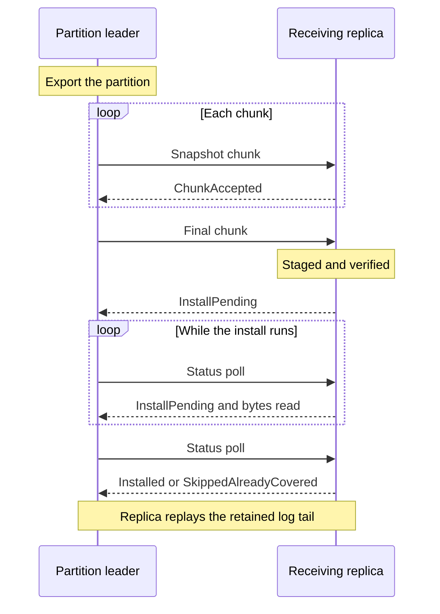

# Snapshot Installation and Raft Recovery

Read this page when a new node joins the cluster, when a replica falls too far behind its leader to catch up from the log, or when you investigate a node that is slow to catch up or stays a [learner](/docs/glossary/#leader-follower-and-learner). It also helps you size memory and disk for large partitions or memory-constrained nodes.

A replica normally stays current by receiving each new [Raft](/docs/glossary/#raft) log entry from its [partition](/docs/glossary/#partition) leader. That only works while the leader still has the entries the replica is missing. Leaders compact (discard) old log entries to bound disk use, so some replicas cannot catch up from the log alone:

- A new node that joins the cluster and starts empty.
- A node that was offline longer than the leader's retained log history.
- A replica that the [placement controller](/docs/replica-placement/) moves to a different node.
- A replica that must be repaired because its state diverged.

In these cases the leader sends a **snapshot**: a complete copy of the partition's state. The replica installs it and then replays the log entries that follow. This happens automatically; you do not trigger it.

This page explains what a snapshot contains, how much memory and disk it uses, which timeouts apply, and how to read the install outcomes and metrics. If your cluster joins and recovers nodes without problems, the defaults are usually sufficient.

Snapshot transfer works under both full replication and per-partition placement. It is separate from operator-triggered [backups and PITR](/docs/backups-and-point-in-time-recovery/); to seed a joining node from a backup instead of a leader snapshot, see [PITR Bootstrap](/docs/pitr-bootstrap/). For detection and containment of a divergent replica, see [Containment](/docs/internals/replication/#containment).

## What a Snapshot Contains

A data-partition snapshot carries the partition's key/value rows, persistent lock state, completion receipts, transaction records, prepared [intents](/docs/glossary/#write-intent), and committed-head ledger. Partition 0 (the system partition) transfers the range map and snapshot-floor hold registry instead.

A snapshot is an at-least boundary, not an exact point-in-time image: it can include writes applied after the requested position, and the receiver replays the retained log tail idempotently. Do not use it as a backup. The complete exported snapshot occupies memory on the sender.

The receiver stages the whole transfer and verifies every checksum before it changes any state. A truncated or corrupt transfer leaves the prior state untouched. It then replaces the partition's state in batches. See [Snapshot Transfer Internals](/docs/internals/snapshot-transfer/) for the export order, the two-pass install, and batch sizes.

:::caution Partial installs

Installing a snapshot is a recoverable replacement, not a single transaction over the whole partition. A storage or invalidation-hook failure after the replacement starts can leave partial rows behind. An on-disk marker records the interrupted install, and a retry purges that attempt's state before installing again, but the marker does not fence the partition from serving at startup. Do not assume automatic crash recovery from an interrupted install.

:::

## Snapshot Options

This is the reference for snapshot transfer options. Server durations are **milliseconds** on the command line. Embedded options with the `Raft` prefix are nullable `EmbeddedKahunaOptions` properties that leave the default of Kommander (Kahuna's Raft library) unchanged unless set; embedded durations are `TimeSpan`.

| Server flag | Embedded option | Default | Meaning |
|---|---|---|---|
| `--raft-snapshot-max-pending-bytes` | `RaftSnapshotMaxPendingBytes` | 512 MiB | Total staged bytes across receive sessions, on disk and in memory together, including installing sessions. Must be positive. |
| `--raft-snapshot-max-pending-sessions` | `RaftSnapshotMaxPendingSessions` | 8 | Concurrent receive sessions across all partitions. Older inactive sessions can be evicted after the cap. Must be positive. |
| `--raft-snapshot-receive-session-ttl` | No corresponding option | 30 s | Idle receive-session lifetime before the receiver drops its buffered bytes. |
| `--raft-snapshot-staging-directory` | `RaftSnapshotStagingDirectory` | See below | Private per-node directory for spilling received bytes. |
| `--raft-snapshot-staging-memory-bytes` | `RaftSnapshotStagingMemoryBytes` | 64 MiB | Resident staged-byte budget with a staging directory; zero stages entirely on disk. Ignored without a directory. Must be nonnegative. |
| `--raft-snapshot-chunk-ack-timeout` | `RaftSnapshotChunkAckTimeout` | 15 s | Bound a chunk acknowledgement or install-status call; not a total install deadline. |
| `--raft-snapshot-transfer-step-timeout` | `RaftSnapshotTransferStepTimeout` | 120 s | Bound lack of progress in export, stream reads, sends, or the install's reported bytes read; not total transfer/install duration. |
| `--raft-reseed-request-timeout` | No corresponding option | 180 s | Bounds a requested repair's apply hold and the leader's pending checkpoint request. |
| `--raft-allow-legacy-snapshot-senders` | No corresponding option | disabled | Accept snapshot chunks from older senders that omit session metadata. Use only for temporary mixed-version upgrades. |
| `--raft-grpc-enable-snapshot-compression` | No corresponding option | disabled | Compress Raft snapshot transfers sent over gRPC. |

Embedded timeouts must be positive, and an explicitly set chunk-ack timeout above the effective step timeout is rejected.

Snapshot rescue, export-retry caching, and live-replica compaction holds are leader-side catch-up settings. They are listed under [Raft Communication](/docs/server-configuration/#raft-communication) and explained in [Snapshot Catch-Up and Log Retention](/docs/architecture/raft/#snapshot-catch-up-and-log-retention).

### Receive Staging

The server default is no staging directory, so all staged bytes remain in memory. Embedded nodes with `Storage = "sqlite"` or `"rocksdb"` and a `StoragePath` default to `{StoragePath}/snapshot-staging_{StorageRevision}`; other embedded nodes default to memory staging. An explicit embedded staging directory must be nonblank and overrides this choice. `EmbeddedKahunaCluster.CreateInMemoryAsync` gives each member a subdirectory named for that member under an explicit base staging directory; the cluster still uses memory backend and WAL storage. Without a fixed `StorageRevision`, the automatic staging directory gets a fresh GUID on each construction; use a stable revision when reopening stored state.

Directories must be private to one node: Kommander deletes spill files there at startup. Distinct storage revisions provide distinct automatic directories when hosts share a storage path. Spill-to-disk limits staged-byte residency, not the decoded stores, export buffers, backend caches, or total heap. A spill-file write failure fails that receive session and causes sender retries. Size the pending cap above the largest expected partition snapshot even when staging on disk.

### Acknowledgement and Deadlines

Peers separate **receipt** from **installation**. A polling sender's final chunk can receive `InstallPending` once the complete snapshot is staged and verified. The sender then polls for `Installed`, `SkippedAlreadyCovered`, or failure, rather than holding one chunk RPC open for the entire import. A sender that does not use install polling keeps its terminal chunk open until installation finishes.

The polling exchange between the leader and the receiving replica:



Each chunk or status call is bounded by the smaller of chunk-ack and transfer-step timeouts. During installation, the sender also watches the receiver's reported count of staged bytes read. Progress resets the transfer-step stall clock, so an install can take longer than 120 seconds while progressing. No byte progress for the step timeout, or unanswered status calls for the acknowledgement bound, fails that attempt and triggers normal retry backoff. A long storage operation after reads stop can therefore hit the stall bound even if the receiver remains alive. Increase the relevant budget for observed stalls; total partition install time alone is not a reason to increase chunk-ack timeout.

While an install of a partition is queued or running, the receiver stages no second snapshot of that partition and drops its other pending sessions. Receive byte and session caps stay active with disk staging. A polling sender learns which install is already running and waits for it. Repeated terminal chunks do not start another import. If an acknowledgement was lost, the next attempt queries the remembered session before exporting again; completed outcomes are retained in process so a sender can discover them. A receiver restart can lose that install record, requiring a new transfer. A lost acknowledgement does not roll back an install already running, and none of these waits roll back partial application state.

### Configuration Example

For example, configure a persistent embedded host's receive path (other options omitted):

```csharp
var options = new EmbeddedKahunaOptions
{
    Storage = "rocksdb",
    StoragePath = "/var/lib/kahuna/node-a",
    StorageRevision = "node-a",
    RaftSnapshotMaxPendingBytes = 1024L * 1024 * 1024,
    RaftSnapshotStagingMemoryBytes = 32L * 1024 * 1024,
    RaftSnapshotChunkAckTimeout = TimeSpan.FromSeconds(30),
    RaftSnapshotTransferStepTimeout = TimeSpan.FromMinutes(2)
};
```

The equivalent server staging/deadline settings require an explicit directory:

```bash
kahuna-server \
  --raft-snapshot-staging-directory /var/lib/kahuna/node-a/snapshot-staging \
  --raft-snapshot-max-pending-bytes 1073741824 \
  --raft-snapshot-staging-memory-bytes 33554432 \
  --raft-snapshot-chunk-ack-timeout 30000 \
  --raft-snapshot-transfer-step-timeout 120000
```

## Install Outcomes and Diagnostics

`Installed` means application import and the durable [WAL](/docs/glossary/#write-ahead-log-wal) boundary completed. `SkippedAlreadyCovered` means the receiver proved that its application/boundary already covers the requested state, so it did not import. Senders advance from the reported covered index and log a skip separately from a seeded replica. Merely accepting the terminal bytes (`ChunkAccepted`) is not accepted as installation success.

Skip logs appear at Warning with the rule and the snapshot, applied, installed-boundary, and present/committed positions. A skip whose contiguous present position is below the snapshot is logged as an error. Use these positions to distinguish already-covered state from an unexpected log hole.

Embedded hosts can query `node.Raft.GetSnapshotStatuses(partitionId)` for sender diagnostics for that Raft partition such as `AwaitingInstall`, `AwaitingInstallIndex`, `InFlightFor`, and the last failure/backoff. Waiting on a progressing install is separate from a failed transfer. These diagnostics are not a cluster-wide readiness guarantee.

| Kommander metric | Meaning |
|---|---|
| `raft.snapshot.receive_staged_bytes` | Bytes in receive sessions still assembling snapshots. |
| `raft.snapshot.receive_installing_bytes` | Staged bytes held by queued/running installs. |
| `raft.snapshot.receive_in_memory_bytes` | Resident portion of assembling and installing bytes; spill bytes are excluded. |
| `raft.snapshot.install_duration_ms` | Receiver install duration from terminal chunk to outcome. |
| `raft.snapshot.install_peak_heap_bytes` | Sampled managed-heap high-water mark around installation; it does not fall when an install ends and is not a precise per-partition allocation measurement. |

## Catch-Up Grace After a Snapshot

Backfill progress accounts for the follower's reported frontiers rather than only its committed index. A recently snapshot-seeded follower can defer escalation for the no-progress pause cap plus an estimated catch-up duration. The estimate uses its gap at install and the leader's subsequent commit rate; `--raft-backfill-seeded-catch-up-grace-cap` caps that catch-up component at 180,000 ms (zero disables the grace). When the rate is not yet measurable, the component uses that cap. This is not proof that the follower is progressing. The grace delays escalation, not the stall warning, and does not postpone repair indefinitely.

How long a leader retains log history before a lagging follower needs a snapshot is described in [Snapshot Catch-Up and Log Retention](/docs/architecture/raft/#snapshot-catch-up-and-log-retention).
