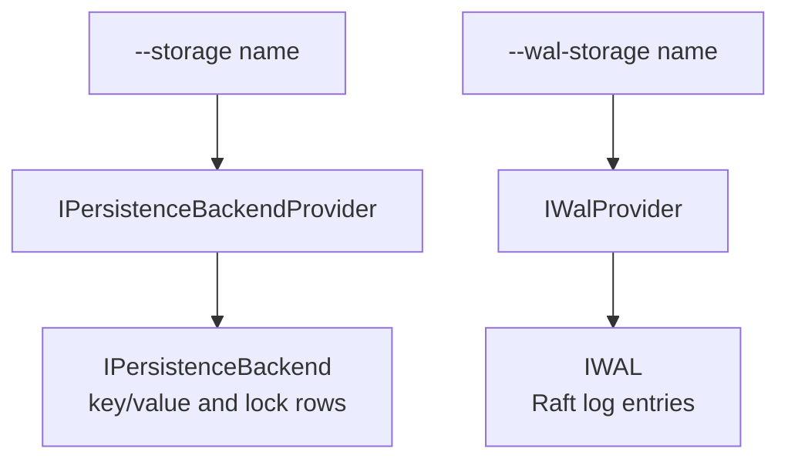

# Custom Storage Engines

Kahuna ships with RocksDB, SQLite, and in-memory storage. If your platform standardizes on another storage engine, or you need a special-purpose store for testing, you can plug in your own engine as a .NET class. Kahuna loads it the same way it loads [user-defined functions](/docs/scripts/user-defined-functions/): from an extension assembly that you name at startup.

This is a low-level extension point. Kahuna still provides replication, ordering, and transactions; your engine only stores and reads what a node has committed. A mistake in the engine can still lose or hide committed data, so treat it with the same care as the server itself.

## External Integration: Solarium

[Solarium.Kahuna](https://solariumdb.github.io/docs/integrations/kahuna/) provides both Kahuna's data store and Raft WAL through an external extension, so a node can run without the native RocksDB library. It requires Kahuna 1.14.2 or later; follow the linked guide for installation, configuration, and differences from RocksDB.

## Two Engines, Two Interfaces

A node has two independent storage layers, and you can replace either one or both:



| Layer | Interface | Selected with | Stores |
|-------|-----------|---------------|--------|
| Persistence backend | `IPersistenceBackendProvider`, which opens an `IPersistenceBackend` | `--storage` | Committed key/value rows, lock rows, and revision history |
| Write-ahead log | `IWalProvider`, which opens a Kommander `IWAL` | `--wal-storage` | The Raft log of every partition (see [WAL](/docs/glossary/#write-ahead-log-wal)) |

Both interfaces are in `Kahuna.Core` (namespace `Kahuna.Server.Persistence.Providers`). See [Storage Engines](/docs/storage/overview/) for what each layer holds.

## Create the Project

Create a class library that targets the same .NET version as the server (`net10.0`) and references `Kahuna.Core` at the version of the server you run:

```xml
<Project Sdk="Microsoft.NET.Sdk">
  <PropertyGroup>
    <TargetFramework>net10.0</TargetFramework>
    <Nullable>enable</Nullable>
    <ImplicitUsings>enable</ImplicitUsings>
  </PropertyGroup>
  <ItemGroup>
    <ProjectReference Include="../kahuna/Kahuna.Core/Kahuna.Core.csproj" />
  </ItemGroup>
</Project>
```

The server loads the extension's own dependencies from the extension's directory, so you can ship a private library next to it.

## Implement a Persistence Backend

The example below is a complete engine that keeps the current row of each key and lock in memory. It is the smallest useful engine: it shows every required member, but it keeps no revision history and supports no backups.

```csharp
using System.Collections.Concurrent;
using Kahuna.Server.KeyValues;
using Kahuna.Server.Locks.Data;
using Kahuna.Server.Persistence;
using Kahuna.Server.Persistence.Backend;
using Kahuna.Server.Persistence.Pitr;
using Kahuna.Server.Persistence.Providers;
using Kommander.Time;
using Microsoft.Extensions.Logging;

namespace Acme.KahunaStorage;

// Selected with --storage acme-memory.
public sealed class AcmeStorageEngine : IPersistenceBackendProvider
{
    public string StorageType => "acme-memory";

    // Everything lives in memory, so the node creates no storage directory.
    public bool KeepsDataOnDisk => false;

    public IPersistenceBackend Open(PersistenceBackendContext context) => new AcmeBackend();

    // Backups and restores need checkpoints; this engine does not support them.
    public IPersistenceBackend OpenAt(string directory, string revision, ILogger logger) =>
        throw new NotSupportedException("acme-memory keeps no checkpoints.");

    public string DataDirectory(string storageRoot, string revision) => storageRoot;

    public bool HasData(string storageRoot, string revision) => false;

    public void MergeCheckpointInto(string targetDirectory, string targetRevision, string sourceDirectory, CancellationToken ct) =>
        throw new NotSupportedException("acme-memory keeps no checkpoints.");
}

internal sealed class AcmeBackend : IPersistenceBackend
{
    private readonly ConcurrentDictionary<string, ReadOnlyKeyValueEntry> keyValues = new(StringComparer.Ordinal);

    private readonly ConcurrentDictionary<string, LockRow> locks = new(StringComparer.Ordinal);

    public bool StoreLocks(List<PersistenceRequestItem> items)
    {
        foreach (PersistenceRequestItem item in items)
            locks[item.Key] = new LockRow(
                item.Value,
                item.Revision,
                new(item.ExpiresNode, item.ExpiresPhysical, item.ExpiresCounter),
                new(item.LastUsedNode, item.LastUsedPhysical, item.LastUsedCounter),
                new(item.LastModifiedNode, item.LastModifiedPhysical, item.LastModifiedCounter),
                (LockState)item.State);

        return true;
    }

    public bool StoreKeyValues(List<PersistenceRequestItem> items)
    {
        foreach (PersistenceRequestItem item in items)
        {
            // Never let an older record replace a newer current row.
            if (keyValues.TryGetValue(item.Key, out ReadOnlyKeyValueEntry? current) && current.Revision > item.Revision)
                continue;

            keyValues[item.Key] = new ReadOnlyKeyValueEntry(
                item.Value,
                item.Revision,
                new(item.ExpiresNode, item.ExpiresPhysical, item.ExpiresCounter),
                new(item.LastUsedNode, item.LastUsedPhysical, item.LastUsedCounter),
                new(item.LastModifiedNode, item.LastModifiedPhysical, item.LastModifiedCounter),
                (KeyValueState)item.State);
        }

        return true;
    }

    public LockRow? GetLock(string resource) => locks.GetValueOrDefault(resource);

    public ReadOnlyKeyValueEntry? GetKeyValue(string keyName) => keyValues.GetValueOrDefault(keyName);

    // This engine keeps current rows only, so it can serve a past revision only if it is the current one.
    public ReadOnlyKeyValueEntry? GetKeyValueRevision(string keyName, long revision) =>
        GetKeyValue(keyName) is { } row && row.Revision == revision ? row : null;

    public ReadOnlyKeyValueEntry? GetKeyValueRevisionAtOrBefore(string keyName, long maxRevision, HLCTimestamp readTimestamp) =>
        GetKeyValue(keyName) is { } row && row.Revision <= maxRevision && row.LastModified.CompareTo(readTimestamp) <= 0 ? row : null;

    public List<(string, ReadOnlyKeyValueEntry)> GetKeyValueByPrefix(string prefixKeyName) =>
        [.. keyValues.Where(pair => pair.Key.StartsWith(prefixKeyName, StringComparison.Ordinal))
                     .Select(pair => (pair.Key, pair.Value))];

    public List<(string, ReadOnlyKeyValueEntry)> GetKeyValueByRange(string prefix, string? startKey, int limit) =>
        [.. keyValues.Where(pair => pair.Key.StartsWith(prefix, StringComparison.Ordinal)
                                    && (startKey is null || string.CompareOrdinal(pair.Key, startKey) >= 0))
                     .OrderBy(pair => pair.Key, StringComparer.Ordinal)
                     .Take(limit)
                     .Select(pair => (pair.Key, pair.Value))];

    // No revision history to prune.
    public bool PruneKeyValueRevisions(
        IReadOnlyCollection<string>? keys, int retentionCount, TimeSpan retentionAge, int batchSize, HLCTimestamp floorTimestamp,
        out RevisionPruneResult result)
    {
        result = default;
        return true;
    }

    public CheckpointResult CreateCheckpoint(string destinationPath, long appliedIndex, HLCTimestamp appliedTime) =>
        throw new NotSupportedException("acme-memory keeps no checkpoints.");
}
```

### The Provider

| Member | What Kahuna uses it for |
|--------|-------------------------|
| `StorageType` | The name you pass to `--storage`. Compared ordinally. |
| `KeepsDataOnDisk` | `true` when the engine keeps files under the storage path. The node then creates that directory, puts snapshot staging under it, and can install a point-in-time recovery base image into it. `false` for an in-memory engine. |
| `Open` | Opens the node's backend. The context carries the storage path, the storage revision, the node configuration, and a logger. |
| `OpenAt`, `DataDirectory`, `HasData`, `MergeCheckpointInto` | Backup, restore, and bootstrap: open a staged checkpoint, locate the store's files, and merge the checkpoints of a cluster-wide backup. |
| `AdoptRevision`, `StagesLiveCheckpointsInStore` | Optional. For an engine whose file names contain the revision, or that must stage checkpoints on the same file system as the store. |

### The Backend

The members without a default implementation are the ones the example implements: storing and reading lock and key/value rows, revision and prefix and range reads, pruning revision history, and `CreateCheckpoint`.

The most important rule: **`StoreKeyValues` must never let an older record replace a newer current row.** The same committed write can reach the backend more than once and out of order, so the current row of a key may only move forward. A backend that breaks this rule can make committed data invisible.

The other members have defaults. Override them when your engine can do better or when you need the feature:

| Member | Default | Needed for |
|--------|---------|-----------|
| `ScanKeyValues`, `ScanLocks`, `DeleteKeyValues`, `DeleteLocks` | Throw `NotSupportedException` | Seeding a replica with a full partition copy and moving replicas between nodes. Without them, a lagging replica that the log alone cannot catch up cannot be seeded from this node. |
| `CreateCheckpointAsOf` and the `Supports*Checkpoint` flags | Fall back to `CreateCheckpoint`, or report no support | Exact and key-filtered backups. |
| `StoreDurabilityFloors`, `GetDurabilityFloor`, `RemoveDurabilityFloor` | No durability floor | Recording which log entries are already stored, so a restart replays less. |
| `GetFailStopReason` | No fault | Reporting permanent backend corruption. Kahuna refuses requests with `StorageCorrupt` and contains the node when a fault is latched. |
| `KeepsDurabilityFloors` | `false` | Reporting floor `0` for an empty floor-tracking store, so recovery cannot skip a missing application prefix. |
| `SupportsStoreIdentity`, `GetStoreIdentity`, `WriteStoreIdentity`, `HoldsDurableState` | No identity support | Detecting foreign stores and empty replacement directories before trusting their durability floors. See [node identity](/docs/storage/overview/#storage-damage-and-node-identity). |
| `GetPrunedHistoryFloor` | No history was pruned | Making backups fail safely when pruned history makes an exact cut impossible. Override it if your engine prunes history. |
| `GetKeyValues`, `GetKeyValueWithRecentRevisions`, `GetKeyValueByPrefixAtOrBefore` | Built from the required reads | Faster batch reads and historical bucket and prefix reads. |

An engine that throws in its checkpoint members, like the example, works for reads and writes, but backups and restores fail on it.

## Implement a WAL

`IWalProvider` is small: a name, `KeepsDataOnDisk`, and `Open`, which returns a Kommander `IWAL`. The `IWAL` interface itself is large, because it covers reading, writing, compacting, and checkpointing the Raft log of every partition. Start from one of Kommander's implementations rather than writing one from scratch. This provider reuses Kommander's in-memory WAL:

```csharp
using Kahuna.Server.Persistence.Providers;
using Kommander.WAL;

namespace Acme.KahunaStorage;

// Selected with --wal-storage acme-memory.
public sealed class AcmeWalEngine : IWalProvider
{
    public string StorageType => "acme-memory";

    public bool KeepsDataOnDisk => false;

    public IWAL Open(WalContext context) => new InMemoryWAL(context.Logger);
}
```

The `WalContext` passes the WAL path, the WAL revision, the logger, and `SyncWrites`. When `SyncWrites` is `true`, every write must be durable before it is acknowledged.

## Load the Engine

For `kahuna-server`, name the assembly and select the engines by name:

```bash
kahuna-server \
  --extension-assembly /opt/acme/Acme.KahunaStorage.dll \
  --storage acme-memory \
  --wal-storage acme-memory \
  --extension-option acme.mode=fast acme.region=west
```

The sample in this page does not read those settings. A real provider can read `context.ExtensionOptions` inside `Open`, for either `PersistenceBackendContext` or `WalContext`. Kahuna passes the same map to both contexts without interpreting its keys. Use an engine-prefixed key so several extensions can coexist, and reject invalid values in the provider.

Pass several `key=value` pairs after one `--extension-option`. The first `=` separates the key from its value, so the value can contain another `=`. Empty or repeated keys fail startup. For an [embedded node](/docs/embedded-kahuna-node/), set `EmbeddedKahunaOptions.ExtensionOptions` instead. Give every node that loads the engine the same settings.

At startup the server logs every extension assembly it loads, with its SHA-256 and the engines it registered:

```text
Loaded extension assembly /opt/acme/Acme.KahunaStorage.dll (sha256 ...): 0 provider(s), 0 function(s), storage engines [storage:acme-memory, wal:acme-memory]. ...
```

For an [embedded node](/docs/embedded-kahuna-node/), register the providers in code before you create the node:

```csharp
using Kahuna;

EmbeddedKahunaOptions options = new()
{
    Storage = "acme-memory",
    WalStorage = "acme-memory",
};

options.StorageProviders.Register(new AcmeStorageEngine());
options.StorageProviders.Register(new AcmeWalEngine());

await using EmbeddedKahunaNode node = new(options, loggerFactory);
await node.StartAsync(cancellationToken);
```

## Backup Storage Providers

You can use the same extension mechanism to store backups outside the local filesystem without replacing the key/value backend or Raft WAL. Implement `IBackupStorageProvider` from `Kahuna.Server.Persistence.Pitr`:

| Member | Contract |
|---|---|
| `TargetName` | Case-sensitive name selected by `--pitr-backup-target`. The built-in name is `local`. |
| `RequiresLocalScratch` | Require a local checkpoint staging directory; remote artifact stores need one. |
| `Open(BackupStorageContext)` | Validate settings without I/O, then return an `IBackupStorage`. The context supplies `BackupDir`, `ScratchDir`, `Configuration`, `Logger`, and `ExtensionOptions`. |

`IBackupStorage.StartAsync(CancellationToken)` connects and validates the target before the node joins. Only after success may callers use its `Manifests` (`IBackupStorageTarget`) and `Artifacts` (`IBackupArtifactStore`). A failed start must permit another attempt. `Dispose` can race with startup and must release partially constructed clients. PITR bootstrap opens a separate instance before the node exists, so a provider must support more than one `Open` per process.

Publish a public concrete provider with a public parameterless constructor, and load its assembly with `--extension-assembly`. Select its name, pass provider-prefixed settings through `--extension-option`, and configure [backup and scratch directories](/docs/backups-and-point-in-time-recovery/#backup-targets). For embedded hosts, register the provider with `options.StorageProviders.Register(provider)` before constructing the node and set `BackupTarget`; the old `BackupStorageProvider` factory option no longer exists.

Publish the extension with its dependencies and `.deps.json`. Kahuna shares its own `Kahuna.Core` and Kommander assemblies with the extension; an extension built against a newer shared dependency than the running server fails startup with a version mismatch. Validate settings without including secret values in exception messages.

## Important Considerations

- **Trust:** an extension assembly runs inside the server process with the server's privileges. Nothing sandboxes it. Build, sign, and roll it out like a server binary.
- **Names:** on `kahuna-server`, an extension cannot reuse the name of an engine that is already registered, such as `rocksdb`, and startup fails if it tries. In embedded code, `StorageProviders.Register` replaces an engine with the same name.
- **Startup failures:** startup also fails if the assembly is missing or publishes no function provider, storage engine, or backup provider. Duplicate backup target names, including `local`, are refused by the extension loader.
- **Every node:** each node opens its own storage, so every node that uses the engine must load the same extension build. Compare the SHA-256 in the startup logs.
- **Versions:** the interfaces are part of `Kahuna.Core`. Build the extension against the `Kahuna.Core` version of the server you run.

## Related Topics

- [Storage Engines](/docs/storage/overview/)
- [User-Defined Functions](/docs/scripts/user-defined-functions/)
- [Server Configuration](/docs/server-configuration/): `--extension-assembly`, `--extension-option`, `--storage`, and `--wal-storage`
- [Backups and Point-in-Time Recovery](/docs/backups-and-point-in-time-recovery/)
