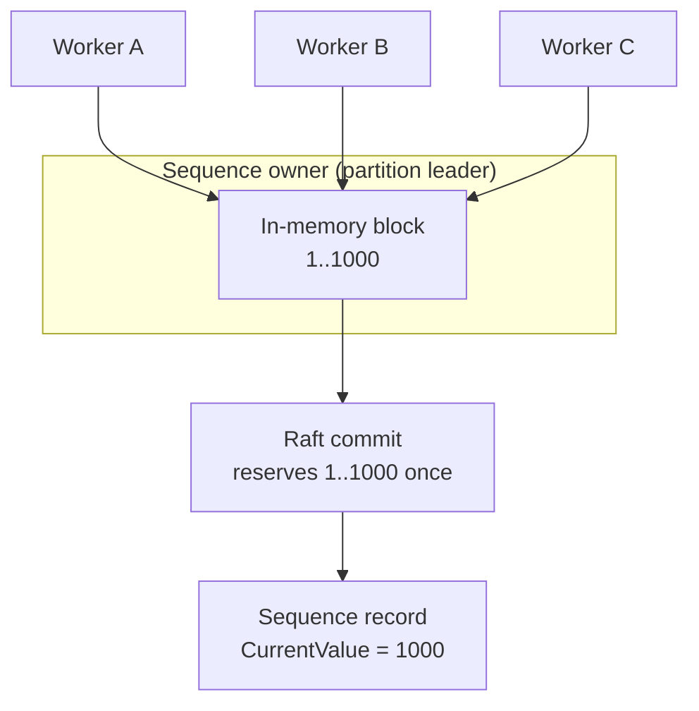

import Tabs from '@theme/Tabs';
import TabItem from '@theme/TabItem';

# Tutorial: Distributed Sequencer

A sequence works like a database identity column that several processes can share: one source of increasing numbers, such as invoice, ticket, or order numbers, without duplicates, even when the processes run on different machines or retry after a timeout. See [Distributed Sequencer](/docs/distributed-sequencer/) for the concepts.

This tutorial shows how to create a sequence, allocate individual values, reserve ranges, and use idempotency keys for safe retries.

## Create a Sequence

Start `kahuna-cli` and create an `orders` sequence:

```text
kahuna-cli> create-sequence orders 0 1
r0 created orders current 0 increment 1 max -
```

The arguments are:

- `orders`: sequence name.
- `0`: initial value.
- `1`: increment.

With these defaults, the first allocated value is `1`.

By default, Kahuna reserves values in blocks of 1000 and hands them out from memory. For a sequence that should commit every value individually, create it with a per-sequence block size of `1`:

```bash
kahuna-cli --create-sequence invoices --initial-value 0 --increment 1 --block-size 1
```

## Allocate One Value

```text
kahuna-cli> next-sequence orders create-order-1001
r1 next orders 1
```

The optional second argument is an idempotency key. If the client retries the same operation after a timeout, using `create-order-1001` again returns the same allocation instead of consuming another value.

## Reserve a Range

Reserve five IDs for a worker:

```text
kahuna-cli> reserve-sequence orders 5 worker-a-batch-1
r2 reserved orders 2..6 count 5
```

The worker can now use `2`, `3`, `4`, `5`, and `6` locally without making another network call for each ID.

## Inspect the Sequence

```text
kahuna-cli> get-sequence orders
r1 get orders current 1000 increment 1 max - block default incarnation 0
```

Workers A, B, and C ask the sequence owner for values. The owner serves them from an in-memory block it reserved in one Raft commit:



`current 1000` means the highest reserved value is `1000`, not the last value handed out. The node that owns the sequence, the [leader](/docs/glossary/#leader-follower-and-learner) of its partition, reserves a block of values in one [Raft](/docs/glossary/#raft) commit and serves `next` calls from memory, so `current` may be ahead of the last value your application consumed. See [Sequence Model and Allocation](/docs/distributed-sequencer/model/) for block sizes and gaps.

## Update a Sequence

Use `update-sequence` to change the reserved high-water mark or retune the per-sequence block size without deleting the sequence:

```bash
kahuna-cli --update-sequence orders --current-value 5000 --block-size 100
```

The next allocation returns `5001`. The update starts a new incarnation (a new generation of the sequence's values) and takes about one server `SequencerBlockLease`, five seconds by default, to return, during which allocations return `MustRetry`; see [Updating a Sequence](/docs/distributed-sequencer/model/#updating-a-sequence).

## Use Single-Command Mode

The same workflow can be run without entering interactive mode:

```bash
kahuna-cli --create-sequence invoices --initial-value 1000 --increment 1
kahuna-cli --update-sequence invoices --current-value 5000 --block-size 100
kahuna-cli --next-sequence invoices --idempotency-key invoice-req-1
kahuna-cli --reserve-sequence invoices --count 10 --idempotency-key invoice-batch-1
kahuna-cli --get-sequence invoices
```

## Use a Client

This example creates a new sequence, `web-orders`, because creating `orders` again would fail with `AlreadyExists`.

<Tabs groupId="client-examples">
<TabItem value="dotnet" label=".NET">

```csharp
using Kahuna.Client;

var client = new KahunaClient("https://localhost:8082");

await client.CreateSequence("web-orders");

long orderId = await client.NextSequenceValue(
    "web-orders",
    idempotencyKey: "create-order-1001"
);

KahunaSequenceRange batch = await client.ReserveSequenceRange(
    "web-orders",
    count: 5,
    idempotencyKey: "worker-a-batch-1"
);

Console.WriteLine($"Next order: {orderId}");
Console.WriteLine($"Reserved: {batch.Start}..{batch.End}");
```

</TabItem>
<TabItem value="typescript" label="TypeScript">

```ts
import { KahunaClient } from "kahuna-client";

const client = new KahunaClient({
  endpoints: ["https://localhost:8082"]
});

await client.createSequence("web-orders");

const orderId = await client.nextSequenceValue("web-orders", {
  idempotencyKey: "create-order-1001"
});

const batch = await client.reserveSequenceRange("web-orders", 5, {
  idempotencyKey: "worker-a-batch-1"
});

console.log(`Next order: ${orderId}`);
console.log(`Reserved: ${batch.start}..${batch.end}`);
```

</TabItem>
</Tabs>

## Clean Up

```text
kahuna-cli> delete-sequence orders
deleted

kahuna-cli> delete-sequence web-orders
deleted
```

Deleting a sequence removes the named counter. Creating the same sequence again starts it from the new creation parameters.
