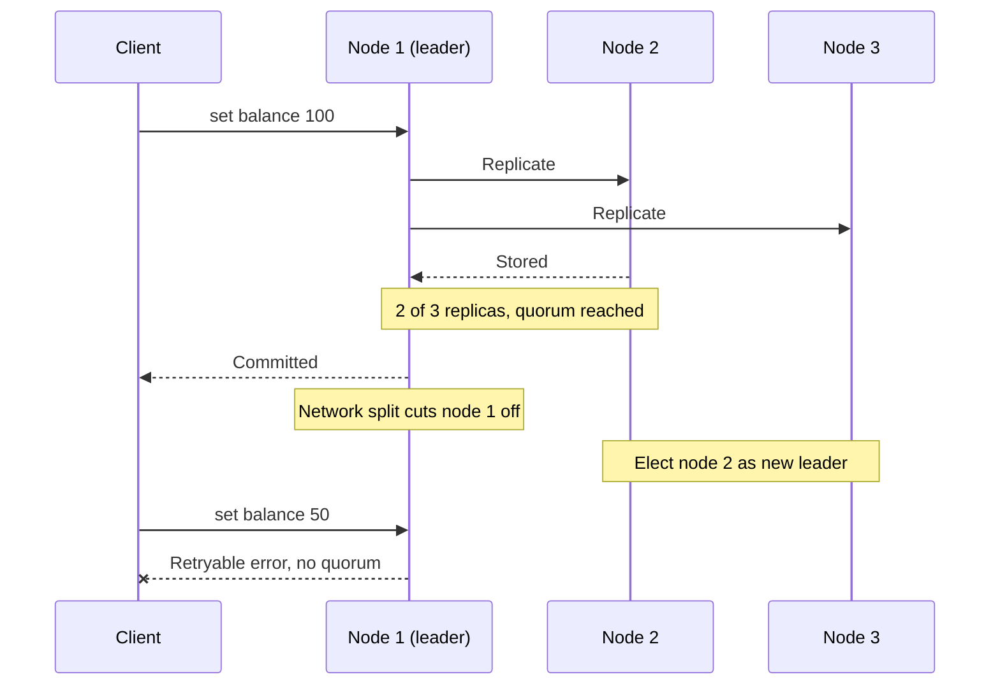
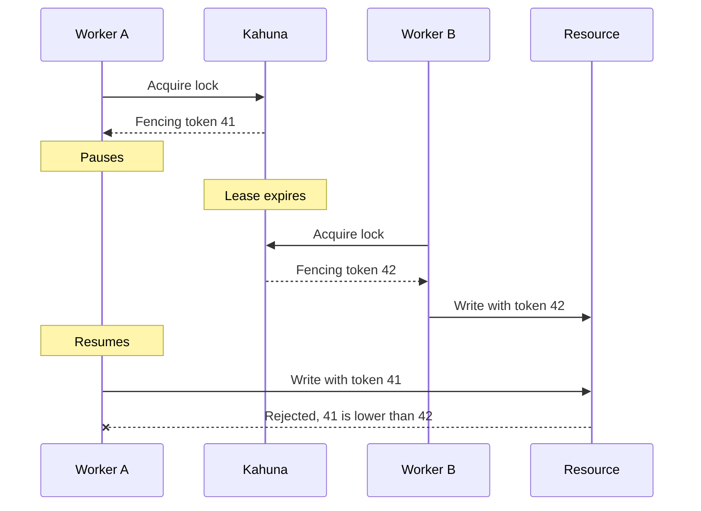
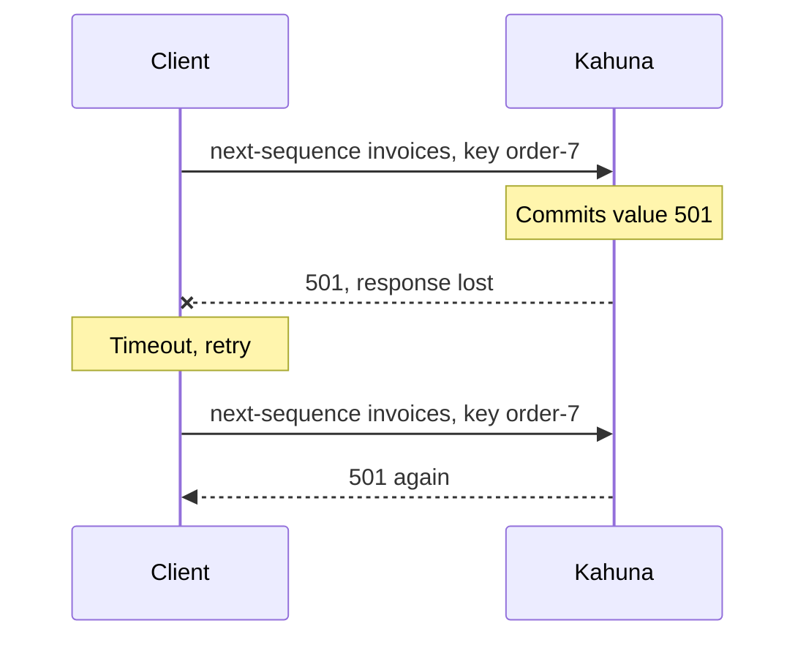

# What Kahuna Solves

Locks, counters, and shared state built on Redis or Postgres work until a server fails, a request times out, or the cluster resizes. Then a lock can have two owners after a failover, and a retried increment can give one order two numbers. Teams patch these gaps with their own glue code, and the cases they miss surface in production.

Kahuna handles these cases on the server, so each application does not have to. It targets systems that must stay consistent and online, such as fintech, healthcare, reservations, and online games.

It gives you three building blocks in one self-hosted cluster that [stays online](#built-to-stay-online) through node failures, upgrades, and scaling:

| Solution | What it provides | Common uses |
|----------|------------------|-------------|
| [Distributed key/value store](/docs/distributed-keyvalue-store/) | Replicated shared state with conditional writes and multi-node transactions | Configuration, service metadata, feature flags, reservations |
| [Distributed locks](/docs/distributed-locks/) | One active owner, expiring leases, and fencing tokens | Scheduled jobs, leader election, exclusive resource access |
| [Distributed sequencer](/docs/distributed-sequencer/) | Retry-safe allocation of ordered values or ranges | Invoice numbers, tickets, order IDs, offsets |

Use Kahuna when several application instances must agree on **state**, **ownership**, or **ordering**, especially when a wrong answer is worse than a temporary error. For the full story, read [Couldn't You Just Use Redis and Postgres?](/blog/redis-postgres-and-kahuna/).

## Where Single-Server Patterns Break

### Shared State Needs an Authority

Without a single authority, replicas can accept conflicting writes during a network failure.

In Kahuna, each [partition](/docs/glossary/#partition) has one [leader](/docs/glossary/#leader-follower-and-learner) that orders its writes. A persistent write succeeds only after a [quorum](/docs/glossary/#quorum) of replicas stores it. If the cluster cannot agree, Kahuna rejects or delays the write instead of keeping two histories.

In the flow below, node 1 commits the first write because two of three replicas store it. When a network split cuts node 1 off, it cannot reach a quorum, so it rejects the second write with a retryable error.

### Expiration Alone Does Not Make a Safe Lock

An expiring key frees a lock when its owner crashes, but it cannot stop an owner that only paused. If worker A pauses, its lease expires, and worker B acquires the lock, both workers believe they own the resource when A resumes.

Kahuna issues a **fencing token** with every lock acquisition. For persistent locks the token always increases, so the protected resource can reject late operations from an older owner. See [Leases](/docs/distributed-locks/leases/) and [Fencing Tokens](/docs/distributed-locks/fencing-tokens/).

### Atomic Counters Are Not Retry-Safe

Suppose a server allocates invoice number `501`, but the response is lost. The client cannot know whether it should retry. A second increment may allocate `502` for the same request.

Kahuna sequences accept an **[idempotency key](/docs/glossary/#idempotency-key)**. Retrying the same request returns the same allocation. They can also reserve non-overlapping ranges to reduce network calls. See [Idempotent Retries](/docs/distributed-sequencer/idempotency/).

## One System for Coordination

All three building blocks share the same replication, persistence, and clients, so you do not build your own lock format, renewal loop, or multi-key commit protocol.

| Kahuna advantage | Practical benefit |
|------------------|-------------------|
| First-class locks, key/value state, and sequences | Use documented operations instead of application-specific recipes. |
| [Revisions](/docs/glossary/#revision), compare-and-set, and historical reads | Detect concurrent changes and read earlier values. |
| Distributed transactions and scripts | Several keys can change together or roll back together. |
| Native .NET and TypeScript clients | Async APIs, cancellation, transactions, and multiple endpoints fit normal .NET and Node.js services. |
| REST, gRPC, CLI, and scripts | Applications and operators can choose the appropriate interface. |
| Hash and key-range routing | Support both general coordination keys and ordered, scan-heavy key spaces. |
| Cache-class speed for temporary state | Local memory benchmarks reached 194k-203k requests per second for an atomic ephemeral rate-limit script, competitive with a same-machine Valkey Lua counter. |
| Jepsen-tested correctness | Public Jepsen workloads exercise key/value registers, locks, interactive transactions, sequences, and membership churn under faults. |
| MIT license | Use, modify, and redistribute Kahuna without proprietary runtime fees. |

## Built to Stay Online

A Kahuna cluster keeps serving through failures and maintenance:

- **No single point of failure:** a partition keeps serving while a minority of its replicas is down. See [Raft Consensus](/docs/architecture/raft/).
- **Rolling upgrades:** the [Kubernetes operator](/docs/kubernetes-operator/) replaces one node at a time.
- **Online scaling:** nodes join and leave while the cluster serves traffic, and the operator can autoscale. See [Replica Placement](/docs/replica-placement/).
- **Load balancing:** [leader balancing](/docs/leader-balancing/) and [load-based range splitting](/docs/distributed-keyvalue-store/load-based-range-splitting/) move work to spare capacity.
- **Online backups** with [point-in-time recovery](/docs/backups-and-point-in-time-recovery/).

During a leader election or a node restart, requests to that partition can briefly fail with a retryable error. A partition needs three replicas to survive the loss of one. Ephemeral keys and locks do not survive a restart or a leader change; use persistent [durability](/docs/glossary/#durability) for state that must.

## Extend It With C#

Kahuna is written in C#, so you extend it with ordinary .NET code:

- **[User-defined functions](/docs/scripts/user-defined-functions/):** call your own C# functions from Kahuna Script, inside the transaction.
- **[Custom storage engines](/docs/storage/custom-storage-engines/):** plug in your own storage backend.
- **[Embedding](/docs/embedded-kahuna-node/):** run a Kahuna node inside your own .NET process.

Extensions run with full server privileges, and every node that coordinates scripts must load the same set.

## Replacing a Cache and Database for Small State

Applications often keep durable state in a database and copy hot values into a cache. The application must then keep both copies in sync and decide which one is correct when they disagree.

For coordination and small shared state, Kahuna combines both roles. Hot values stay in memory, persistent values are replicated to disk, and there is only one copy to update. Configuration, service metadata, locks, reservations, rate limits, and sequences often do not need a separate cache in front of a separate database.

Kahuna does **not** replace a primary business database. Relational queries, document storage, analytics, large records, and bulk data belong in systems designed for those workloads.

## When to Choose Kahuna

Use a simple cache when data can be lost, rebuilt, or briefly inconsistent.

Choose Kahuna when any of these would cause incorrect behavior:

- Two workers owning the same job
- An acknowledged update disappearing after failover
- Several nodes accepting conflicting values
- A retried request allocating a second ID
- A multi-key update becoming partially visible
- The coordination layer going offline during a node failure, an upgrade, or a resize

Consensus adds network communication and operational cost, so Kahuna is intentionally focused on coordination and small strongly consistent state.

Follow the [Tutorial](/docs/intro/) to start a standalone node and execute your first commands.
